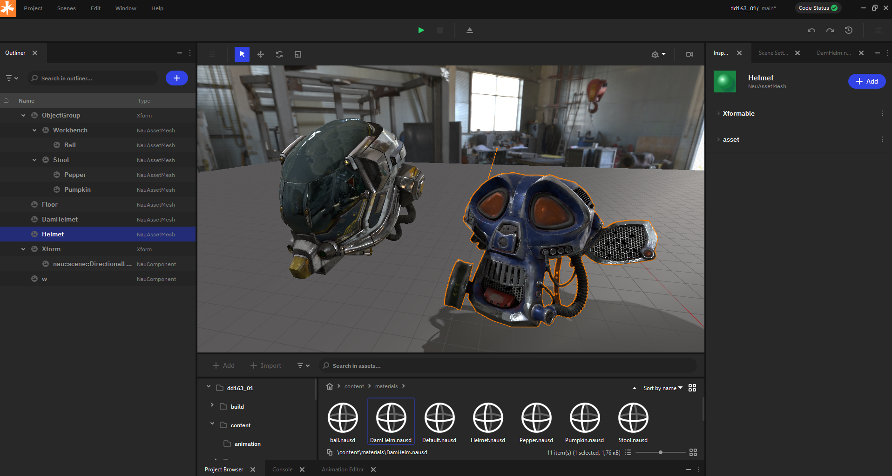
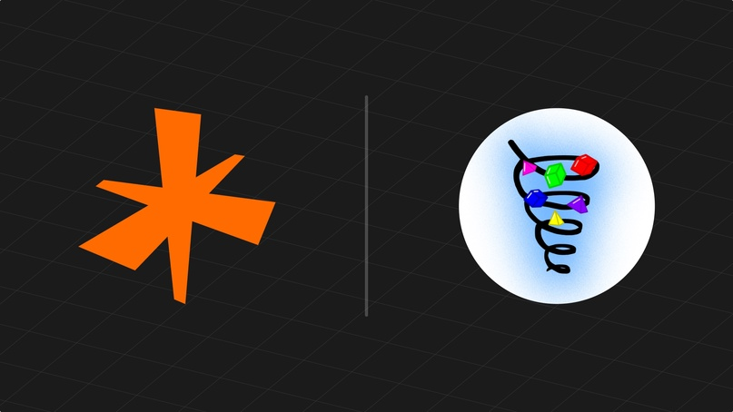
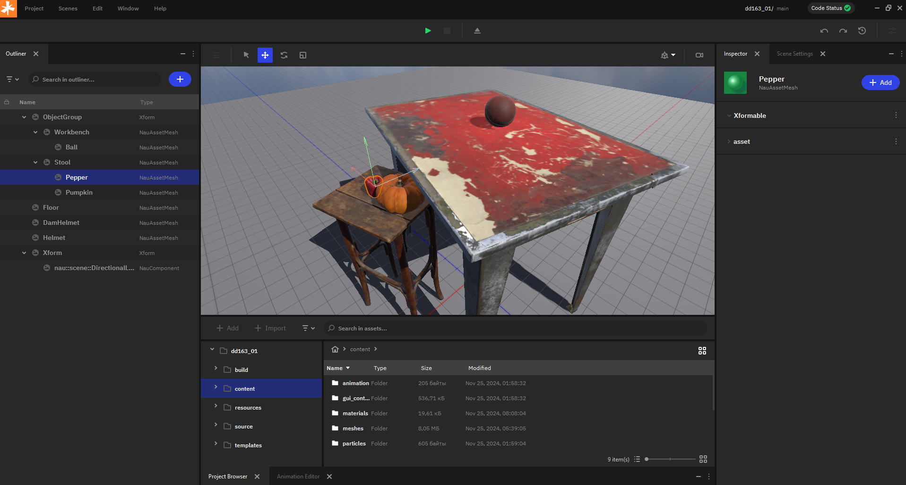
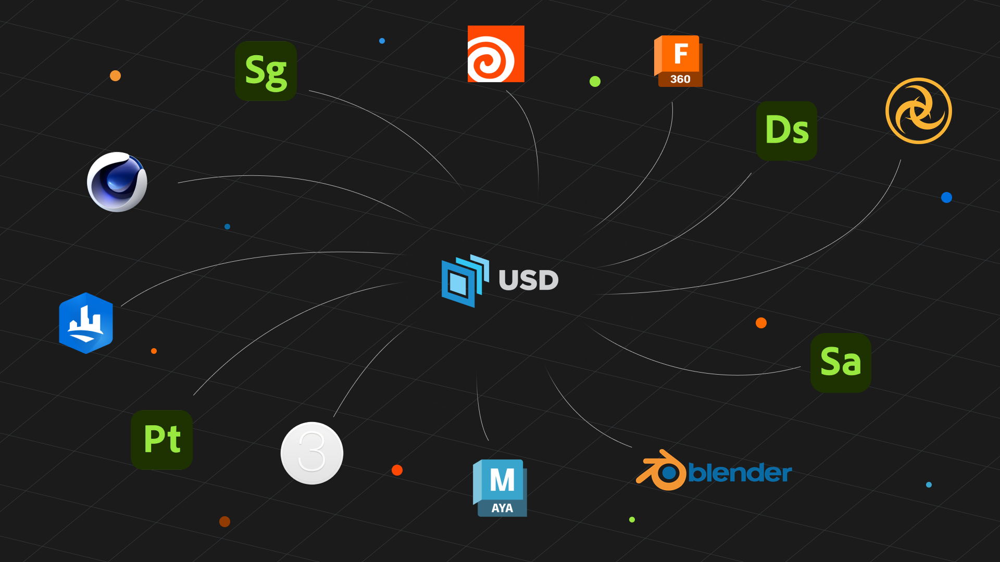
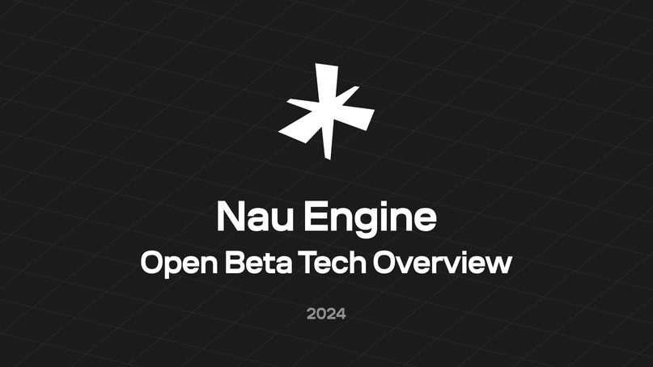

==================
Обзор Nau Engine
==================

.. toctree::
   :hidden:
   
   goс/goc_overview_doc

Ключевые возможности
-------------------------------------------------

В материале расскажем о том, как Nau Engine поможет воплотить ваши игровые идеи в жизнь, используя доступные в бета-версии инструменты. Nau Engine содержит базовый функционал для создания игр, позволяя вам экспериментировать с различными механиками и концепциями. Несмотря на ограничения бета-версии, вы сможете оценить потенциал движка и начать разработку своего проекта.

Графика  
++++++++++++

Nau Engine поддерживает современные графические API, на данный момент реализован DX12 для Windows. Движок использует PBR для отображения материалов. Система визуальных эффектов (VFX) на базе daFX позволяет создавать визуальные эффекты.

Физика
++++++++++++

Система физики на базе физического движка Jolt обеспечивает взаимодействие объектов в игровом мире. Поддерживаются различные типы коллайдеров (сферы, капсулы и меши), что позволяет настраивать геометрию объектов. Движок способен симулировать такие физические явления, как столкновения, гравитация и др. 

Редактор 
++++++++++++

Интуитивный редактор трехмерной сцены, материалов, анимаций и визуальных эффектов (VFX) позволит вам создавать уровни, персонажей и эффекты. Редактор построен на базе Qt6 и включает в себя Project Browser (Браузер проекта), Viewport (Окно просмотра), Outliner (Структура сцены), Inspector (Инспектор) и Console (Консоль).

Скриптинг 
++++++++++++++++++++++++

В бета-версии Nau Engine cистема скриптинга позволяет использовать C++ для написания игровой логики. Документация содержит примеры реализации различных игровых механик.  

Интеграция звука  
++++++++++++++++++++++++

Встроенная аудиосистема на базе miniaudio поддерживает воспроизведение звуковых эффектов и музыки в различных форматах, а также позволяет настраивать пространственный звук.

Импорт ассетов 
++++++++++++++++++++++++

Nau Engine поддерживает импорт разнообразных типов данных, включая изображения (PNG), звук (WAV) и другие распространенные форматы. Особо следует отметить поддержку OpenUSD (Universal Scene Description), что значительно упрощает процесс импорта готовых сцен и сложных ассетов, созданных в сторонних приложениях для 3D-моделирования. Это позволяет разработчикам использовать уже готовый контент, сокращая время разработки и повышая эффективность работы. В бета-версии поддерживаются основные функции импорта USD.

GUI  
++++++++++++

В бета-версии Nau Engine представлен отдельный редактор интерфейса пользователя (GUI Editor), позволяющий создавать игровые интерфейсы. Редактор основан на библиотеке Cocos2dx.

Анимации
++++++++++++++

В Nau Engine реалистичность сцены достигается не только физикой, но и анимацией. Бета-версия поддерживает ключевую анимацию (keyframe) для управления положением и свойствами объектов. Также доступен импорт скелетной анимации, на базе открытой библиотеки ozz-animation. В скриптах можно управлять воспроизведением анимаций.

Присоединяйтесь к сообществу!
-----------------------------

Ваша обратная связь очень важна для нас! Сообщайте о найденных ошибках, предлагайте новые функции и делитесь вашим опытом работы с движком. Обратите внимание, в бета-версии Nau Engine могут быть ограничения в функциональности и производительности. Мы будем рады вашему участию в развитии движка, подготовили для вас подробную :ref:`инструкцию <contributors_guidelines>`. Вместе мы сделаем Nau Engine лучше!

--------

.. grid:: 4
   

   .. grid-item-card:: 
       :img-top: images/goc_overview.png
       :link: goс/goc_overview_doc.html
       :text-align: center

       Система игровых объектов (GOC)