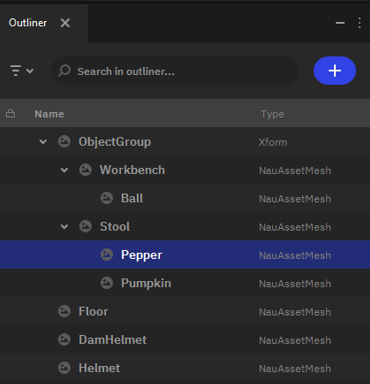
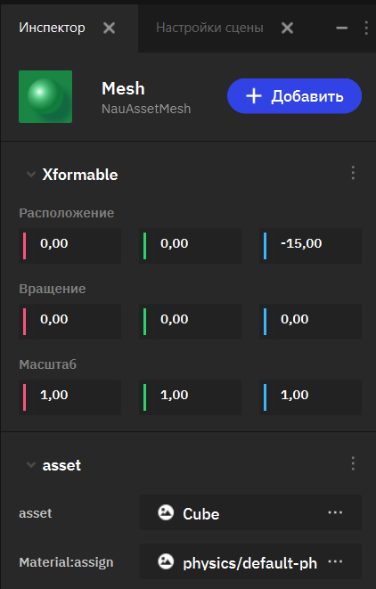
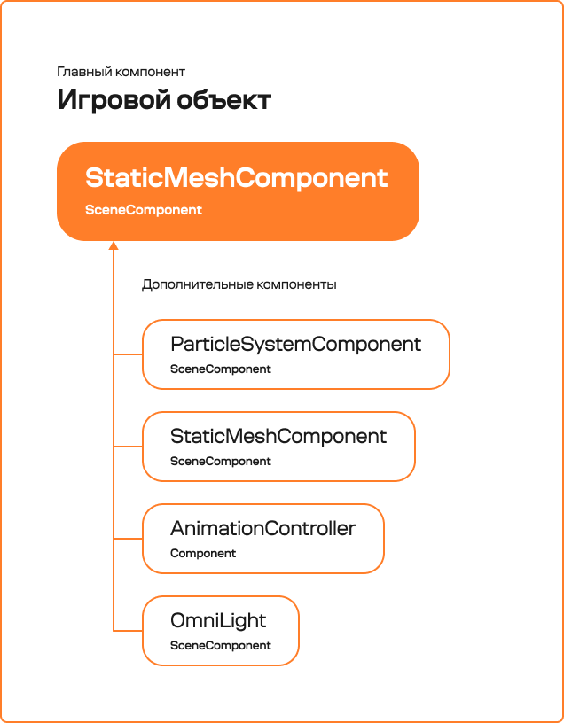
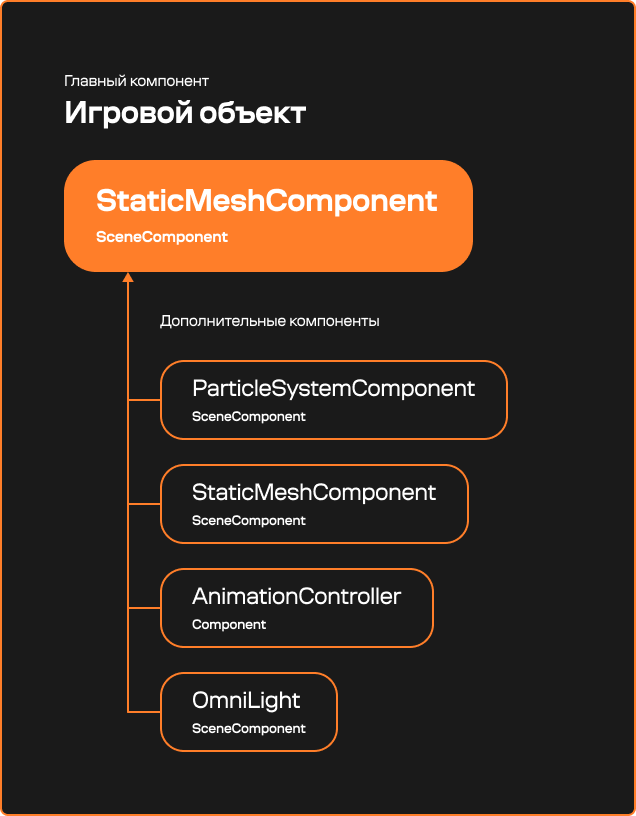
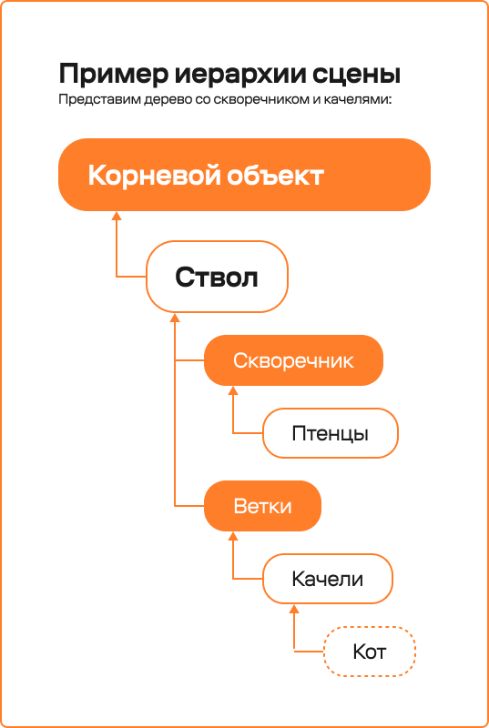
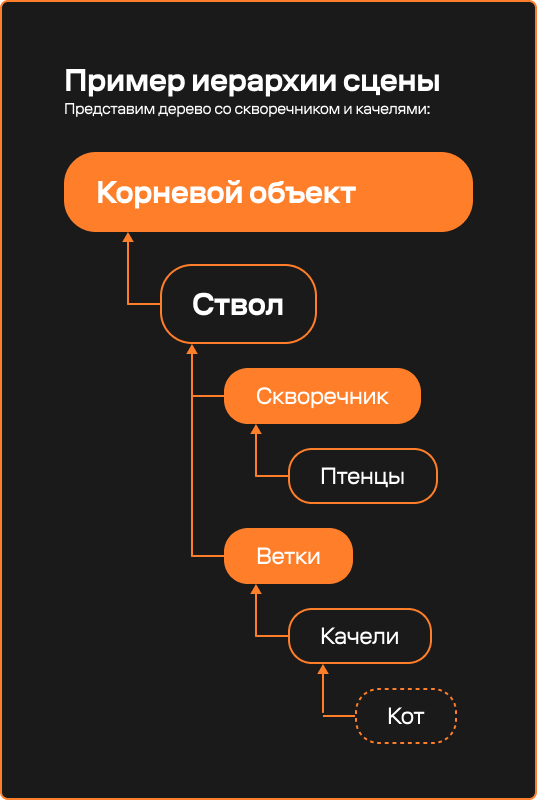

Система игровых объектов (GOC)
===============================

.. _goc_overview_doc:

Структура сцены
---------------

В основе сцены Nau Engine лежит концепция иерархии игровых объектов и 
компонентов, которая широко используется во многих игровых движках.

Игровая сцена конфигурируется в редакторе и сохраняется в проекте как файл. 
Для создания игры необходима как минимум одна сцена, которая будет 
обозначена как стартовая в настройках проекта.

Nau Engine позволяет динамически загружать или выгружать игровые сцены для 
гибкого управления игровой механикой или трёхмерным пространством мира. 
Одновременно может быть загружено несколько сцен.

Игровой объект
---------------

**Игровой объект** — это элемент игровой сцены, обладающий 
определенными характеристиками и логикой, зависящей от его 
компонентов. 

Примеры **визуализируемых** игровых объектов:

   * трехмерные модели
   * визуальные эффекты
   * источники света

Также в сцене могут присутствовать **служебные** объекты, 
отвечающие за логику игры, но не имеющие визуального 
представления:

   * источники звука
   * камеры
   * триггеры - виртуальные объекты, реагирующие на вход персонажа в их область действия.

Некоторые объекты могут служить исключительно контейнером для 
игровой логики, не влияя на пространство мира. Роль и назначение 
игрового объекта определяются разработчиком в зависимости от 
концепции игры.

Иерархия игровых объектов
~~~~~~~~~~~~~~~~~~~~~~~~~

Игровые объекты могут быть вложены друг в друга, формируя сложные 
структуры. Принципы вложенности аналогичны другим игровым движкам. 
Координаты вложенных объектов сохраняются относительно родительского 
объекта. Перемещение родителя влечет за собой перемещение всех 
дочерних объектов.

   Окно **Структуры (Outliner)**

Настройка сцены
~~~~~~~~~~~~~~~~

Иерархия игровых объектов отображается в окне **Структуры (Outliner)** 
в режиме **Мира (World)**. При создании игровой сцены можно 
создавать и удалять игровые объекты, настраивать их положение в 
иерархии.

Работа с иерархией игровых объектов аналогична:

* **Scene** в Godot
* **Hierarchy** в Unity 
* **Outliner** в Unreal Engine.

|

--------

Игровой объект: контейнер компонентов
-------------------------------------

Настройки игрового объекта, выбранного в сцене, доступны в окне 
**Инспектор (Inspector)**.

Игровой объект является контейнером для компонентов. Каждый 
игровой объект обязан иметь **главный компонент**, а также может 
иметь список **дополнительных компонентов**.

Игровой объект всегда обладает данными трансформации (положение, 
вращение, масштабирование) относительно родительского объекта 
в сцене. Можно изменять родителя объекта или делать его 
независимым от родителя, перемещая в пространство сцены.

Компоненты
-----------

Компонент игрового объекта содержит данные и логику.  
Все компоненты, как системные, так и пользовательские, наследуются 
от класса **Component**.

Для размещения игрового объекта в сцене необходимы данные о его 
положении в пространстве и месте в иерархии объектов. Эти данные 
содержатся в классе **SceneComponent**, который наследуется от 
**Component**.

Главный компонент
~~~~~~~~~~~~~~~~~~

Каждый игровой объект обязан иметь **главный компонент**, которым 
может быть только **SceneComponent**, или унаследованный от него класс.

Системные компоненты Nau Engine, использующие данные о положении 
в пространстве, наследуются от **SceneComponent**, 
что позволяет выбирать их в качестве главных компонентов.

**Пример:**

Системный компонент статической геометрии (**StaticMeshComponent**) 
унаследован от **SceneComponent** и содержит данные о 
положении объекта в пространстве (transform). При создании объекта 
статической геометрии в сцене, он будет ограничен только 
главным компонентом **StaticMeshComponent**.

Дополнительные компоненты
~~~~~~~~~~~~~~~~~~~~~~~~~

К игровому объекту можно добавлять **дополнительные компоненты**, 
созданные на базе **Component**. 
Дополнительные компоненты, реализующие **SceneComponent** имеют собственное 
положение в пространстве главного компонента.

Дополнительный компонент не может иметь собственных вложенных компонентов. Все они располагаются в пространстве главного компонента.

Компоненты пользователя
~~~~~~~~~~~~~~~~~~~~~~~

Система компонентов позволяет работать с игровыми объектами 
и их поведением. Вы можете создавать собственные компоненты, 
используя:

   * C++ (основной язык Nau Engine)

Нативные компоненты (C++)
^^^^^^^^^^^^^^^^^^^^^^^^^

Основные принципы работы системы остаются неизменными 
независимо от языка. В статье, :ref:`разработка игровой логики <game_logic_doc>`, рассказывает о шагах реализации пользовательского компонента.

Работа с C++ требует дополнительных шагов:

1. **Компиляция кода:** после внесения изменений требуется 
   компиляция и перезапуск редактора. 
2. **Создание и редактирование:** файлы с кодом C++ 
   можно создавать и редактировать в браузере проектов, но 
   нельзя назначать как компоненты простым перетаскиванием. 
   После компиляции они появятся в списке доступных 
   системных компонентов. 

.. note:: 
   
   Нативный код обеспечивает максимальную производительность и полный контроль.

Дополнительная информация
-------------------------

Отличия системы Nau Engine от других движков

.. list-table::
   :header-rows: 1
   :stub-columns: 1

   * -  
     - Nau Engine
     - Unity
     - Unreal
   * - Сцена
     - Состоит из иерархии игровых объектов
     - Состоит из иерархии игровых объектов
     - Состоит из иерархии игровых объектов и иерархии компонетов объекта
   * - Игровой объект
     - Класс недоступен для изменения разработчиком.
     - Класс недоступен для наследования.
     - От **Actor** можно наследовать пользовательский тип.
   * - Базовый класс компонента
     - **Component** (только жизненный цикл) и **SceneComponent** (дополнительно содержит данные трансформации).
     - **MonoBehaviour:** основа для всех компонентов, обеспечивает их жизненный цикл.
     - **ActorComponent** (только жизненный цикл) и **SceneComponent** дополнительно содержит данные трансформации)
   * - Данные положения
     - В **SceneComponent** или наследуемом от него компоненте.
     - В компоненте **Transform**, который существует самостоятельно на объекте.
     - **SceneComponent** позволяет работать с локальными 
       трансформациями и поддерживает иерархию компонентов.
   * - Структура игрового объекта
     - Главный компонент (наследуется от **SceneComponent**) + 
       список дополнительных компонентов (могут наследоваться 
       от **Component**).
     - Список компонентов, обязательно включающий компонент 
       типа **Transform**.
     - Иерархия компонентов внутри объекта (**Actor**). 
       Компонент может иметь данные трансформации.
   * - Данные положения в пространстве
     - В главном компоненте. Каждый 
       наследуемый от него компонент может иметь своё положение 
       в пространстве.
     - В обязательном компоненте **Transform**. На объекте 
       может быть только один **Transform**.
     - 
   * - Основная роль игрового объекта
     - Определяется главным компонентом и уточняется дополнительными компонентами.
     - Определяется списком компонентов объекта.
     - Определяется в наследнике класса игрового объекта (Actor) и уточняется набором компонентов.

Сам корневой объект (ствол) может находиться как в пространстве сцены, так и быть дочерним по отношению к другому объекту (например, холму).

