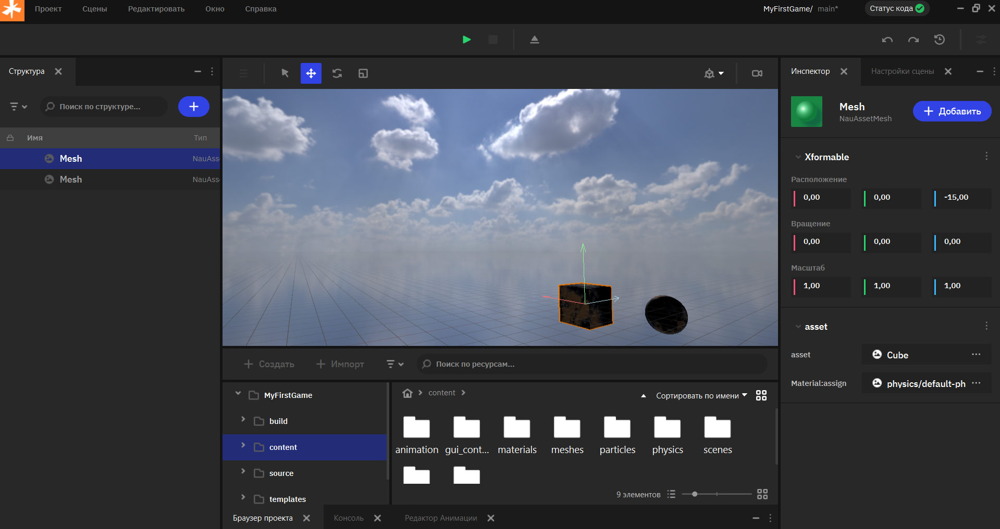
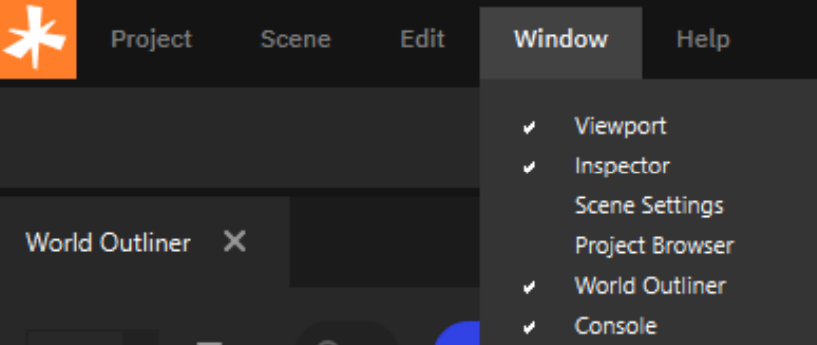

Первый запуск
============================

Общая инфорамция
----------------

Интерфейс редактора Nau Engine разработан с учетом удобства использования и интуитивности. Движок разработан с учетом индустриальных стандартов, и многие разработчики, знакомые с другими инструментами создания игр и графики, найдут в нем много общего и смогут быстро освоиться. В бета-версии интерфейс может быть упрощенным, однако базовые элементы управления расположены таким образом, чтобы обеспечить удобство работы.

   Интерфейс Nau Editor

Редактор Nau Engine позволяет гибко настраивать рабочее пространство, изменяя размер и положение окон, а также группируя вкладки. В вашем распоряжении основные окна редактора: Viewport (окно просмотра сцены), Inspector (инспектор свойств объектов), Project Browser (обозреватель проекта), Outliner (обозреватель иерархии сцены) и Console (консоль вывода сообщений).

Для быстрого доступа ко всем окнам, включая закрытые, воспользуйтесь меню "Окно" (Window). Это позволит вам организовать рабочую область в соответствии с вашими предпочтениями и текущими задачами.

|
|

.. note:: Обратите внимание, что заголовки окон всегда прикреплены к ближайшему краю экрана. Это позволяет избежать случайного закрытия окон и обеспечивает удобный доступ к ним, даже при значительном изменении размеров и расположения. Эта особенность дизайна способствует более эргономичной работе с редактором, особенно при использовании нескольких мониторов. 
  
   .. figure:: img/first_min_02.png
      :figwidth: 45%
      :align: right

      У окна справа, заголовок будет находиться у верхней границы

   .. figure:: img/first_min_03.png
      :figwidth: 45%
      :align: left

      У окна внизу, заголовок будет находиться у нижней границы

Инструменты редактора
---------------------

Помимо основных инструментов и окон (Viewport, Inspector, Project Browser, Outliner, Console), в редакторе Nau Engine доступны и другие функции, необходимые для разработки игр:

**Система материалов (Material Editor)** 
   позволяет создавать и редактировать материалы для объектов, настраивая их свойства, такие как цвет, текстура, отражение и другие параметры.

**Редактор визуальных эффектов (VFX Editor)** 
   предоставляет инструменты для создания и настройки эффектов частиц, например, дыма, огня, дождя и других визуальных эффектов.

**Редактор анимации (Animation Editor)** 
   позволяет работать с ключевыми кадрами. С его помощью можно создавать простые анимации для объектов, изменяя их положение, вращение и масштаб. Также предусмотрена базовая поддержка анимации скелетных моделей. 

**Редактор игровых интерфейсов (GUI Editor)** 
   позволит создавать пользовательские интерфейсы непосредственно в редакторе Nau Engine. GUI редактор – это интуитивный и удобный интерфейс для разработки меню, HUD (Heads-Up Display), диалоговых окон и других элементов интерфейса вашего проекта.

**Инструменты импорта** 
   позволяют импортировать различные типы ассетов (модели, текстуры, звук) и экспортировать готовые сцены и проекты. Поддержка формата OpenUSD упрощает работу с внешними 3D-пакетами. 

Функциональность некоторых инструментов может быть ограничена в текущей бета-версии. Более подробная информация доступна в соответствующих разделах документации.

--------

.. grid:: 4

   .. grid-item-card:: 
       :img-top: img/interface.png
       :link: interface/interface_doc.html
       :text-align: center

       Обзор интерфейса

   .. grid-item-card:: 
       :img-top: img/shortcuts.png
       :link: workflow/workflow_doc.html
       :text-align: center

       Оптимизация рабочего процесса

.. toctree::
   :hidden:

   ./interface/interface_doc
   ./workflow/workflow_doc

   