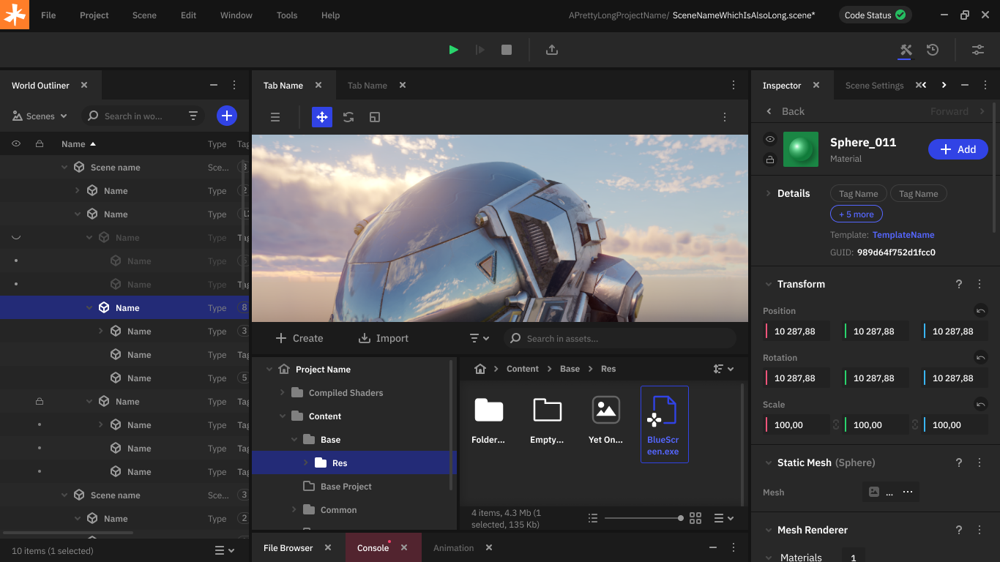
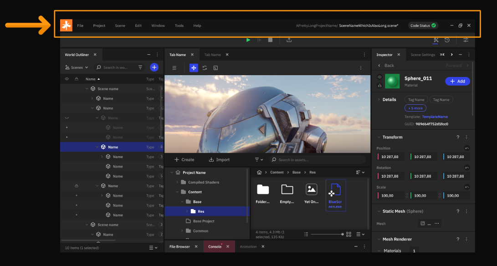
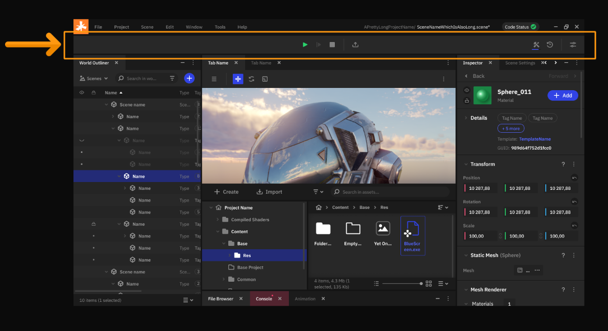
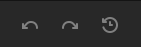
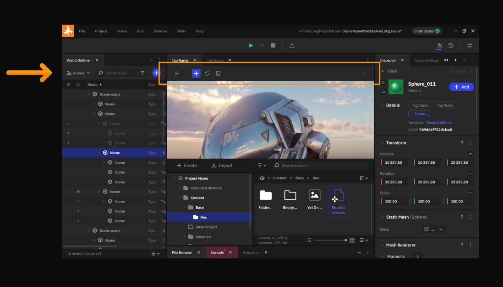
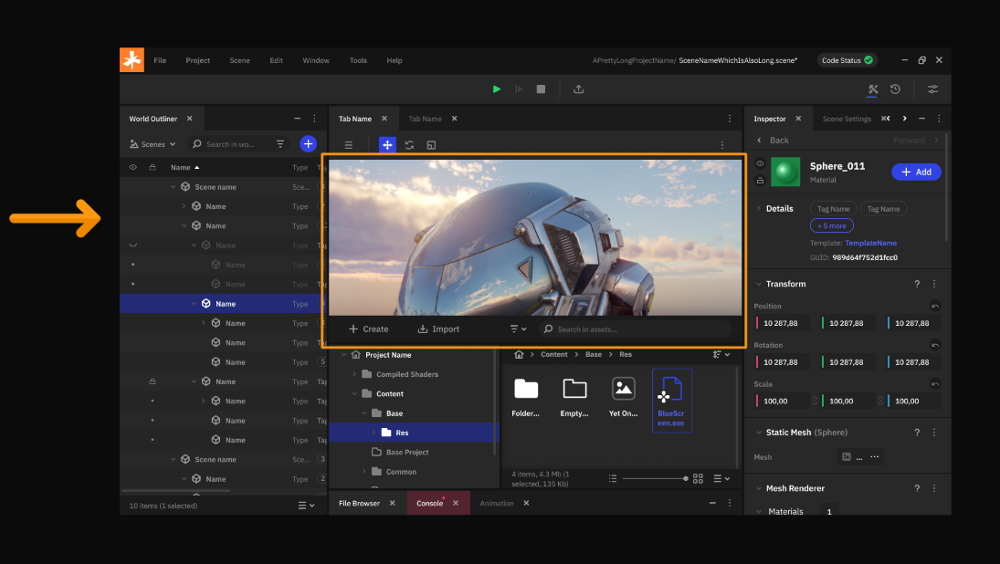
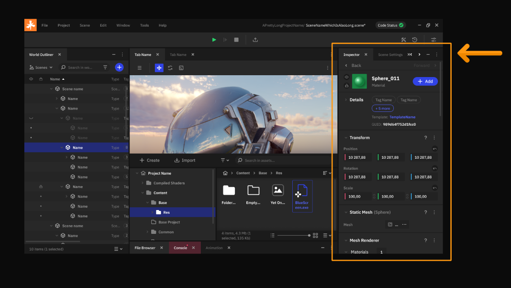
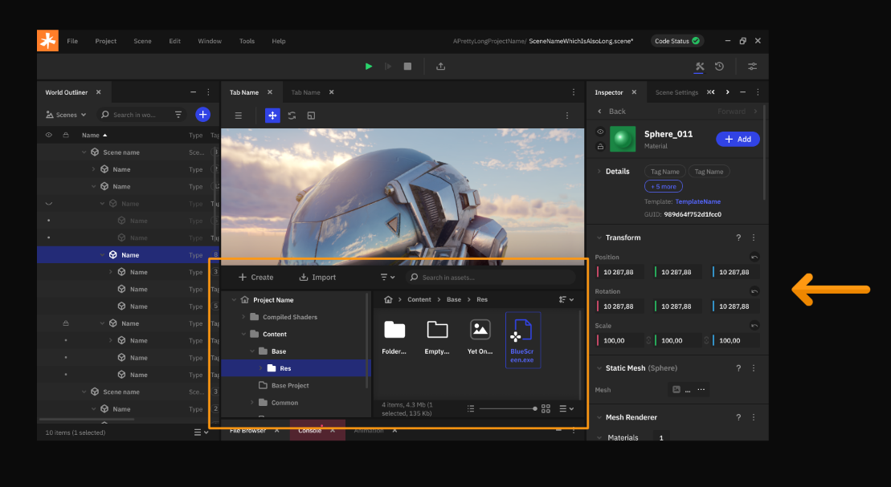
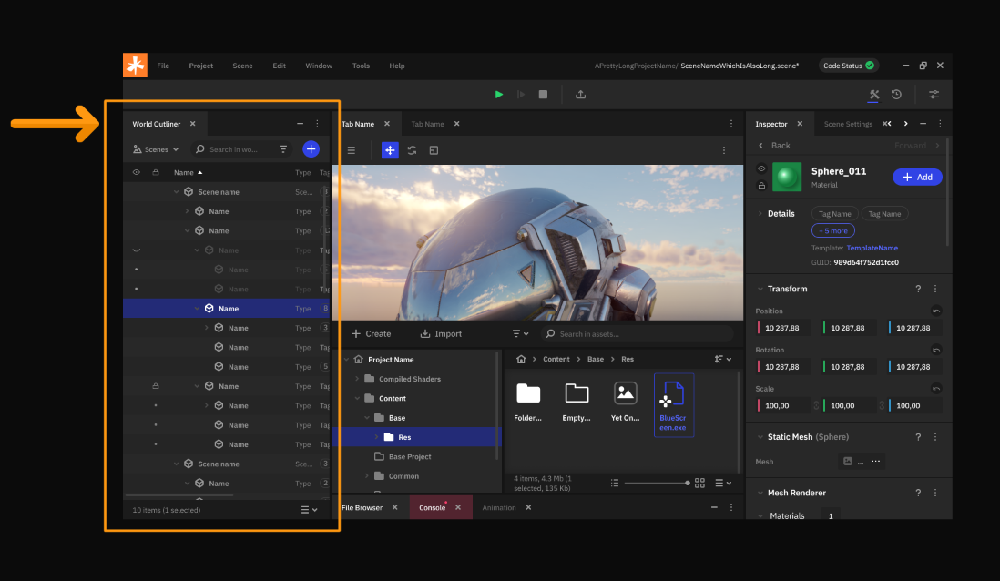

Обзор интерфейса
============================

Данный раздел документации посвящен обзору интерфейса редактора Nau Engine. Мы рассмотрим основные элементы интерфейса, их функции и возможности настройки. Ознакомление с интерфейсом поможет вам быстрее освоиться в среде разработки и эффективно использовать доступные инструменты. Помните, что это бета-версия, и некоторые элементы интерфейса могут быть изменены в будущих обновлениях.

.. _basic_interface:

Основные окна
-------------

  
**Ленточное меню** в верхней части редактора Nau Engine предоставляет доступ к основным функциям.

В текущей бета-версии доступны следующие пункты:

  * Проект (Project): позволяет выполнять базовые операции с проектом, такие как сохранение, загрузка и закрытие.
  * Сцена (Scene): содержит основные функции для управления сценами:
	* Новая сцена (New Scene) — создание новой сцены в рамках проекта.
	* Открыть сцену (Open Scene) — открыть уже существующую сцену проекта.
	* Сохранить сцену (Save Scene)
	* Последние сцены (Recent Scene) — быстрый доступ к последним открывавшимся сценам.
  * Редактировать (Edit) : позволяет повторить/отменить действия и изменить язык редактора. 
  * Окно (Window): обеспечивает доступ к списку всех окон редактора. Их можно показывать или скрывать по необходимости.
  * Помощь (Help): предоставляет доступ к справочной информации о движке и возможность отправить обратную связь.

**Главная панель (Main Toolbar)** расположена под ленточным меню и предоставляет быстрый доступ к часто используемым функциям редактора.

  
На панели доступны следующие опции:

* Play mode |play_mode|: запускает или останавливает режим воспроизведения для тестирования сцены.
* Сборка приложения |build|: позволяет собрать исполняемый файл проекта.
* История действий |history|: обеспечивает базовые функции отмены и повтора действий.

**Панель инструментов окна просмотра (Viewport tools)** расположена в верхней части окна Viewport.

Она содержит базовые инструменты для взаимодействия с объектами в сцене:

  * Перемещение (Move): позволяет перемещать объекты в сцене.

  * Вращение (Rotate): позволяет вращать объекты.

  * Масштабирование (Scale): позволяет изменять размер объектов.

  * Выбор (Select): позволяет выделять объекты в сцене. 
  
  * Установить координаты пространства инструментов трансформации: локальные или мировые.
  
  * Настройки камеры на сцене: позволяет управлять основными параметрами камеры в сцене.

**Окно просмотра (Viewport)**

В рабочем режиме отображает пространство сцены, или игровой интерфейс, позволяя как манипулировать объектами при помощи гизмо, так и выделять их для дальнейшей настройки свойств. После запуска Play mode, отображает приложение таким, каким его увидит конечный пользователь после сборки. 

**Инспектор (Inspector)**

Окно Инспектора (Inspector) отображает свойства объекта, выбранного в Структуре (Outliner), Обозревателе (Viewport) или Браузере проекта (Project Browser). 

Здесь вы можете изменять существующие параметры объекта, а также добавлять или удалять компоненты, чтобы изменить его поведение. Nau Engine предоставляет набор встроенных компонентов, которые можно добавлять к объектам через Инспектор. Кроме того, вы можете создавать и использовать свои собственные компоненты для расширения функциональности движка. В бета-версии набор доступных компонентов и возможности их настройки могут быть ограничены.

**Браузер проекта (Project Browser)**

   
Ваш основной инструмент для навигации и управления файлами и ресурсами в проекте Nau Engine (:ref:`Подробнее <assets_browser>`). Помимо просмотра и редактирования структуры файлов, он позволяет:
  * Создавать новые папки и файлы: организуйте ресурсы вашего проекта, создавая логическую структуру папок. Добавляйте новые файлы (скрипты, сцены, ассеты) непосредственно через браузер проекта.

  * Переименовывать и перемещать файлы: поддерживайте порядок в проекте, легко переименовывая и перемещая файлы и папки по мере необходимости.

  * Получать доступ к контекстному меню: щелкните правой кнопкой мыши на файле или папке, чтобы открыть контекстное меню с дополнительными операциями.

  * Быстро находить нужные файлы: используйте поиск для быстрого нахождения нужных файлов в проекте.

**Структура сцены (Outliner)**

Отображает иерархию объектов в зависимости от текущего режима работы:

  * В режиме World: Outliner показывает иерархическую структуру всех игровых объектов в сцене. Это позволяет визуализировать связь между объектами, выбирать и управлять ими.

  * В режиме редактирования интерфейса: Outliner отображает иерархию элементов пользовательского интерфейса (UI), позволяя управлять их расположением и свойствами.

**Консоль (Console)** — важный инструмент для отслеживания состояния движка и поиска ошибок. В ней отображаются системные сообщения, предупреждения и ошибки, возникающие во время работы редактора или игры. Анализ сообщений консоли поможет вам выявить и исправить проблемы в вашем проекте. В бета-версии функциональность консоли может быть ограничена. (:ref:`Подробнее <console>`)

----

В этой статье мы рассмотрели основные элементы интерфейса редактора Nau Engine. Вы познакомились с ленточным меню, главной панелью инструментов, панелью инструментов обозревателя, браузером проекта, структурой сцены и консолью. Это базовый набор инструментов, необходимый для начала работы с движком. Обратите внимание, что это бета-версия, и некоторые элементы интерфейса могут иметь ограниченную функциональность. Редактор Nau Engine также содержит другие окна и панели, которые мы подробно рассмотрим в отдельных статьях. Понимание принципов работы интерфейса поможет вам эффективно использовать Nau Engine для создания ваших проектов.

