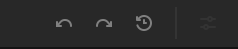
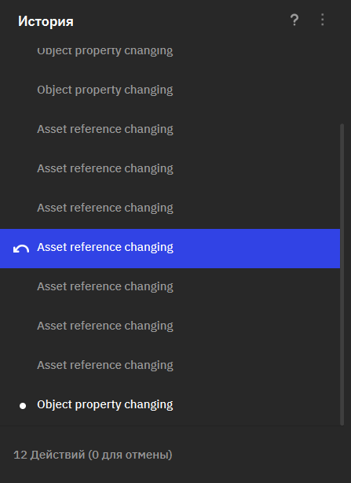

Оптимизация рабочего процесса
================================

Оптимизация рабочего процесса — важный аспект эффективной разработки. 
В бета-версии Nau Engine для этого предусмотрены **горячие клавиши** и **история изменений**. 
Горячие клавиши обеспечивают быстрый доступ к функциям редактора, 
а история изменений позволяет отменять и повторять действия. 
В данной статье описаны основные горячие клавиши и принципы работы с историей изменений. 
Обратите внимание, что в бета-версии функциональность может быть ограничена.

Горячие клавиши 
----------------

Горячие клавиши — это важный инструмент для повышения эффективности работы в любом приложении, 
и Nau Engine не исключение. Использование сочетаний клавиш позволяет ускорить 
выполнение рутинных операций и сосредоточиться на творческом процессе. 

Редактор Nau Engine поддерживает большинство стандартных горячих клавиш 
(например: **Enter**, **Delete**, **Ctrl+Z** для отмены, **Ctrl+Y** для повтора), 
а также ряд других сочетаний, предназначенных для ускорения работы с движком. 
Ниже приведен список некоторых полезных горячих клавиш, доступных в текущей бета-версии. 
Обратите внимание, что этот список не является исчерпывающим и может быть расширен в будущих обновлениях.

   * **Ctrl+S** - сохранить проект, над которым идёт работа

   * **Ctrl+C / Ctrl+V** - копировать / вставить выделенный объект
 
   * **Ctrl+D** - дублировать выделенный объект

   * **F2** - начать переименование
     
   * **Ctrl + N** - создать новую сцену 

   * **Ctrl+O** - открыть новую сцену из файла 
      
   * **F** - (в рамках сцены или иерархии) сфокусировать камеру редактора на объекте
     
   * **Ctrl+A** (в рамках сцены или иерархии) выделить все объекты

Описанные выше горячие клавиши помогут вам оптимизировать рабочий процесс в редакторе Nau Engine. 

История действий
-----------------

	
История изменений (история действий) в Nau Engine позволяет отменять и 
повторять выполненные операции, что существенно упрощает процесс разработки и 
помогает избежать ошибок. Эта функция автоматически записывает ваши действия в редакторе, 
позволяя вернуться к предыдущим состояниям проекта.

Запись действий в редакторе происходит автоматически. Для управления 
историей изменений используются следующие элементы, расположенные в правом верхнем углу главной панели:

**Стрелки отмены/повтора (Undo/Redo)**  

Классические кнопки для отмены последнего действия (Undo) и его повтора (Redo). Эти функции также доступны по стандартным горячим клавишам (Ctrl+Z для отмены и Ctrl+Y или Ctrl+Shift+Z для повтора).

**Кнопка "История" (History)** 

Открывает окно с подробной историей изменений в виде списка. Вы можете выбрать любое действие из списка, чтобы вернуться к соответствующему состоянию проекта. Обратите внимание, что  функциональность этого инструмента может быть ограничена в бета-версии.
