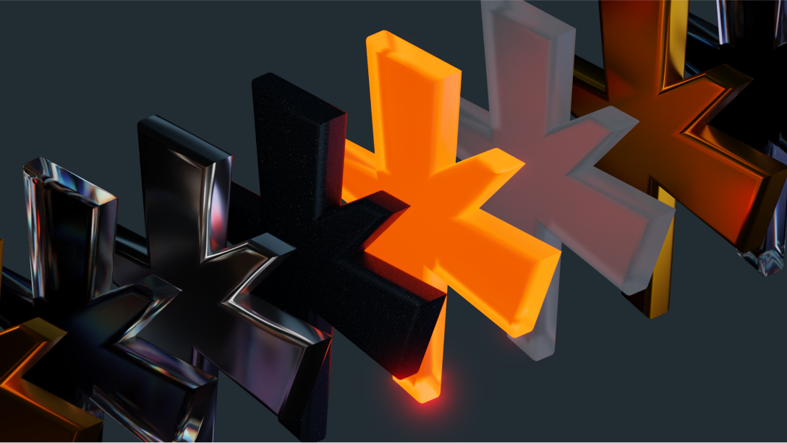

Введение в Nau Engine
=====================
.. _intro_nau_doc:

.. toctree::
   :hidden:

   ./engine_overview/engine_overview_doc
   ./install_nau/install_nau_doc
   ./first_launch/first_launch_doc
   ./contribution/contribution_doc

Приветствуем вас в мире Nau Engine!
-------------------------------------

Nau Engine — игровой движок для создания игр и интерактивных приложений. 
В бета-версии мы предлагаем базовый набор инструментов, 
доступный как новичкам, так и опытным разработчикам. 
Данная документация содержит инструкции по работе в Nau Engine. :api:`UI/Button/classes.html <API>` документация предоставит дополнительную информацию для более сложной интеграции. 
Мы будем рады вашим отзывам по бета-версии.

   

Открытый исходный код Nau Engine
------------------------------------

Nau Engine — это игровой движок с открытым исходным кодом, построенный на базе C++ кода и оснащенный редактором на Qt 6. Доступность исходного кода позволяет глубоко изучить архитектуру движка, вносить изменения и расширять его функциональность. Это дает уникальную возможность участвовать в разработке и создавать модификации под свои нужды. В бета-версии уже доступны основные функции, а документация и уроки на портале помогут вам освоиться и ответить на возникающие вопросы.

   
   

Кому подойдет Nau Engine?
---------------------------------

Nau Engine — это игровой движок, разработанный для широкого круга пользователей, увлеченных созданием игр и интерактивных приложений. В данный момент движок находится в стадии бета-тестирования и некоторые функции могут быть ограничены. Несмотря на это, Nau Engine уже сейчас может быть полезен пользователям.

* **Инди-разработчики** 
    Если вы мечтаете создать свою игру, но не хотите тратить деньги на коммерческие движки или разбираться в сложных лицензионных соглашениях, Nau Engine — отличный выбор. Он бесплатен, имеет открытый исходный код и предоставляет базовый набор инструментов для разработки игр.

* **Студенты и преподаватели** 
    Nau Engine подходит для обучения игровой разработке. Открытый исходный код позволяет изучить внутреннее устройство движка и понять, как все работает "под капотом".

* **Профессиональные студии** 
    Несмотря на то, что Nau Engine находится в бета-версии, он может быть интересен профессиональным студиям для прототипирования и экспериментов с новыми технологиями.

* **Корпорации (строительные, газовые и др.)**  
    Nau Engine может быть использован для создания интерактивных симуляций, тренажеров и обучающих приложений.

--------

.. grid:: 4

   .. grid-item-card:: 
       :img-top: images/engine_overview.png
       :link: engine_overview/engine_overview_doc.html
       :text-align: center

       Обзор Nau Engine

   .. grid-item-card:: 
       :img-top: images/first_launch.png
       :link: first_launch/first_launch_doc.html
       :text-align: center

       Первый запуск

   .. grid-item-card:: 
       :img-top: images/install_nau.png
       :link: install_nau/install_nau_doc.html
       :text-align: center

       Установка Nau Engine
    
   .. grid-item-card:: 
       :img-top: images/contribution.png
       :link: contribution/contribution_doc.html
       :text-align: center

       Вклад в Nau Engine
