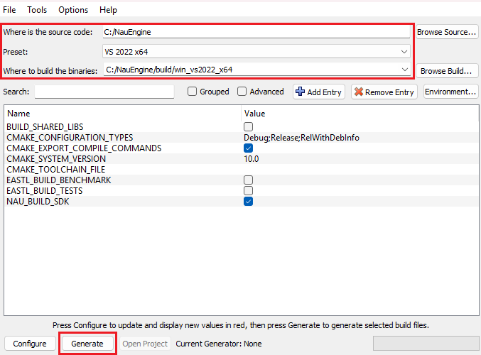
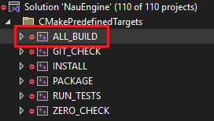

Установка Nau Engine
====================
.. _install_nau:

Минимальные системные требования
--------------------------------

* **Операционная система:** Windows 10 (64bit)
* **Процессор:** 2.3 Ghz Dual-Core
* **ОЗУ**: 8 гб
* **Видеокарта:** DirectX12-compatible 4GB VRAM, NVidia GeForce 1050 TI / AMD Radeon RX550 / Intel UHD Graphics 620

Необходимые приложения
--------------------------

Для установки Nau Engine любым способом (через инсталлер/ сборка из исходников) вам потребуются следующие приложения и пакеты:
  
* `Python 3.10 <https://www.python.org/downloads/>`_. Python необходимо установить для всех пользователей, например, в корень диска, а путь до pip добавить в ``PATH``.
* `CMake 3.20 (или выше) <https://cmake.org/download/>`_
* `Visual Studio 2022 <https://visualstudio.microsoft.com/downloads/>`_
   
   * Пакет Desktop Development with C++
   * MSVC v143
   * Windows 10 SDK

* `cymbal <https://pypi.org/project/cymbal/>`_
* `clang <https://pypi.org/project/clang/>`_
* Клиент Git

Кроме того, во внешнюю папку, например, в ``C:/Tools`` необходимо установить менеджер пакетов vcpkg.

1. В терминале в папке ``C:/Tools`` вызовите

   .. code-block::
      :class: larg
    
      git clone https://github.com/microsoft/vcpkg

2. Добавьте ``VCPKG_ROOT`` в переменные окружения для всех пользователей и в значении укажите ``C:/Tools``.

3. Выполните скрипт ``C:/Tools/vcpkg/bootstrap-vcpkg.bat``.

Установка Nau Engine через инсталлер
-------------------------------------

1. Скачайте инсталлер редактора с `официального сайта <https://nauengine.org/>`_ и запустите его.

.. caution:: Перед установкой убедитесь, что удалили другие версии Nau Engine, установленные на Вашем устройстве.

2. Выберите язык установки. Язык установки не влияет на язык редактора.

3. Внимательно прочитайте лицензионное соглашение, согласитесь с ним. Убедитесь, что вы установили все необходимые приложения (см. выше).

4. Укажите путь для установки Nau Engine.

.. caution:: Не рекомендуется устанавливать движок в папки облачных дисков (OneDrive, Yandex Disk). Также необходимо исключить из пути установки кириллицу.

5. Выберите тип установки

6. Дождитесь установки.

Сборка движка из исходников
---------------------------

Ядро движка
~~~~~~~~~~~~

1. Предположим, вы хотите развернуть ядро движка в папке ``C:/NauEngine``. 
   В директории ``C:`` в терминале вызовите

   .. code-block:: bash
      :class: larg

      git clone https://github.com/NauEngine/NauEnginePublic.git NauEngine

   Это создаст папку C:/NauEngine.

2. Необходимо подключить сабмодули. Для этого в папке ``C:/NauEngine`` вызовите

   .. code-block:: bash
      :class: larg

      git submodule update --init --recursive

3. В CMake необходимо сгенерировать файлы проекта. Для этого в CMakeGUI укажите (см. картинку):

   * **Source**: C:/NauEngine
   * **Preset**: Visual Studio 2022 x64
   * **Destination**: C:/NauEngine/build/win_vs2022_x64 (выставится автоматически).

4. Нажмите Generate для генерации файлов проекта. Подтвердите действия во всех всплывших диалоговых окнах. Процесс займет какое-то время.

5. Откройте сгенерированный файл ``C:/NauEngine/build/win_vs2022_x64/NauEngine.sln`` и соберите таргет ``ALL_BUILD``.
   Процесс займет какое-то время.

Редактор движка
~~~~~~~~~~~~~~~~

1. Соберите ядро движка по инструкции выше.

2. Установите `Qt VS plugin <https://marketplace.visualstudio.com/items?itemName=TheQtCompany.QtVisualStudioTools2022>`_
   и `Qt 6.4.1 <https://cdn.nauengine.org/s3/naungn-portal-prod/documents/Qt-6.4.1_2.zip>`_. 
3. Скачайте `OpenUSD <https://cdn.nauengine.org/s3/naungn-portal-prod/documents/usd24.08_no_Hydra.zip>`_. 

4. Склонируйте репозиторий NauEditor.
   Предположим, вы хотите развернуть редактор в папке ``C:\NauEditor``. Тогда в ``C:`` в терминале вызовите

   .. code-block:: bash
      :class: larg

      git clone https://github.com/NauEngine/NauEditorPublic.git

2. Необходимо обновить сабмодули.

   В папке ``C:\NauEditor`` в терминале вызовите

   .. code-block:: bash
      :class: larg

      git submodule update --init --recursive

3. Выполните конфигурацию проекта через cmake.
   В папке ``C:\NauEditor`` в терминале вызовите

   .. code-block:: bash
      :class: larg
  
      cmake --preset=win_vs2022_x64_dll -DNAU_ROOT_DIR="Путь\к\папке\NauEngine" -Dpxr_DIR="Путь\к\папкe\openUSD_24.08_noHydra" -DCMAKE_PREFIX_PATH="Путь\r\папкe\Qt-6.4.1_2\msvc2019_64"

4. Соберите редактор из исходников.
   Для этого откройте сгенерированный файл ``.sln`` в Visual Studio. Далее, аналогично тому, как это было необходимо для сборки
   ядра, соберите таргет ``ALL_BUILD``.

   В случае, если сборка не удалась, попробуйте удалить папку ``build`` и повторить процедуру.