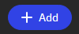
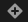
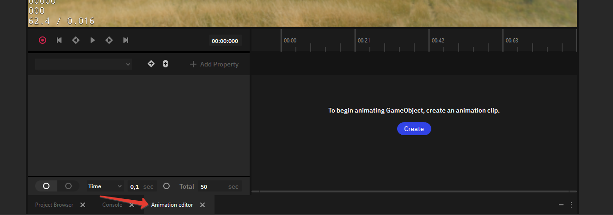
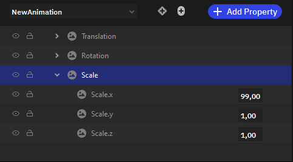
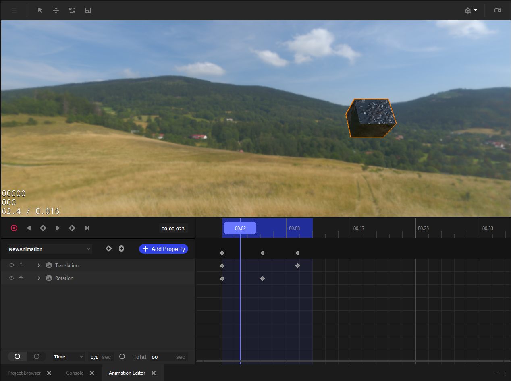

Анимация объектов
=================

.. _animation:

Анимация в играх и приложениях играет ключевую роль, делая взаимодействие с контентом более наглядным и понятным для пользователей. Она помогает привлечь внимание игроков и удержать его, создавая эмоциональную связь с персонажами и сюжетом, а также добавляя динамичность и интерес к игровому процессу.

Качественно проработанная анимация способна значительно улучшить пользовательский опыт и сделать игру или приложение более запоминающимися.

Общие возможности
-----------------
Анимационная система Nau Engine условно разделена на две системы: скелетная анимация и анимация параметров.

Анимация параметров создаётся средствами Nau Editor и не требует отдельных инструментов. Файл анимационного клипа является собственным форматом редактора.

Скелетная анимация может быть импортирована из внешнего редактора. Для этого используйте контейнер USD.

.. note:: При подготовке файлов во внешних источниках старайтесь не хранить в одном контейнере более одного персонажа.

Начало работы
-------------

Чтобы объект мог воспроизводить анимации, нужно сначала добавить к нему соответствующий компонент.

Для этого следует выбрать объект и в Inspector нажать на |add| и в всплывшем окне выбрать **Animation Controller** (как для анимации параметров, так и для скелетной анимации)  или **Animation Skeleton** (только для скелетной анимации).

Анимация параметров
-------------------

Основные шаги для настройки анимации параметров:
 #. Выберите нужный игровой объект в сцене.
 #. Откройте редактор анимации в нижней панели экрана.
 #. Создайте файл анимационного клипа, нажав на **Create clip** в редакторе анимации, затем выбрав имя и расположение нового файла.
 
    .. image:: img/anim_create_clip.png
	   :width: 400px
      
 #. Добавьте свойство в анимацию, нажав на **Add property**.

    .. image:: img/add_property.png
	   :width: 400px

 #. Добавьте ключевые кадры (|add_keyframe|) и установите для них значения свойств анимации.
 #. Воспроизведите анимацию при помощи встроенного плеера.
 #. Проверьте работу анимации в Play Mode.
 
Анимация параметров работает через окно редактора Анимаций.

Вы можете переключиться на него, открыв соответствующую вкладку.

Создание анимации
*****************

Если для объекта ещё не настроена анимация, в окне будет доступна кнопка создания новой анимации. Нажмите "Создать" (Create) для создания нового файла анимационного клипа для выбранного игрового объекта, вложенных объектов и их свойств.

Добавление свойств
******************

После создания анимационного компонента на объекте и привязки файла анимации вы сможете редактировать анимацию свойств. 

Для того чтобы добавить новое свойство, нажмите на кнопку «Добавить свойство» (Add Property). Свойства анимации включают в себя Scale, Rotation и Translation. Они отвечают за изменения соответствующих параметров объекта между ключевыми кадрами.

Задать значения свойств для каждого кадра можно в редакторе анимации для каждого кадра. Параметры в остальных кадрах будут плавно изменяться в зависимости от ключевых значений.

Редактирование анимации
***********************

Добавленные свойства могут анимироваться по ключевым точкам. 

Чтобы создать ключевой кадр, нужно нажать на  |add_keyframe|  в редакторе анимации. Чтобы удалить его, нужно кликнуть правой кнопкой мыши по нужному кадру в таймлайне и выбрать **Delete**.

Ключевой кадр (со всеми свойствами) можно перетащить на таймлайне, зажав левую кнопку мыши; также можно отредактировать сами свойства (см. добавление свойств).

Предварительный просмотр возможен как при воспроизведении через редактор анимации при помощи панели плеера, так и простым перетягиванием анимационного курсора в нужную точку таймлайна.

Скелетная анимация
------------------

Nau Engine поддерживает импорт и воспроизведение скелетной анимации из контейнера USD. Вы можете просмотреть импортированную скелетную анимацию через Nau Editor, однако её редактирование должно проводиться в исходной программе, откуда была экспортирована модель. Обратите внимание, что в бета-версии функциональность может быть ограничена.

Основные шаги для скелетной анимации:
 #. Импортируйте USD-ассет с подготовленной анимацией.
 #. Создайте объект Mesh в сцене.
 #. Назначьте в параметрах объекта импортированный ранее ассет, при наличии информации о скелете в ассете будет автоматически создан SkinnedMesh вместо StaticMesh.
 #. Добавьте компонент AnimationController в инспекторе объекта.
 #. В поле Animation:asset выберите общий с Mesh контейнер USD, содержащий скелет и данные анимации.
 #. Запустите Play Mode, чтобы просмотреть изменения в сцене.
 #. Используйте Animation API из пользовательского компонента для управления анимацией персонажа.

.. image:: img/skinned_mesh.png
   :width: 100%

Использование скриптов
----------------------

Для системы анимации доступны соответствующие API Nau Animation (:api:`Animation/index.html <Animation>`). Получить доступ к нужным функциям можно через объектную систему сцены, обратившись к нужному компоненту анимации.