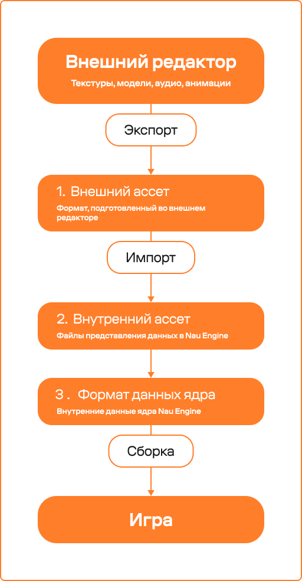
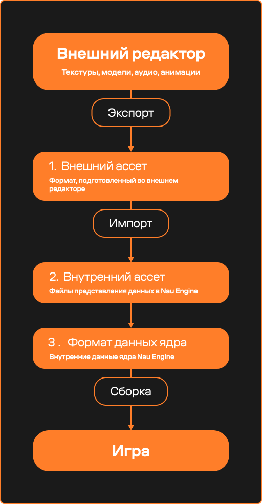

Организация ресурсов
=====================

.. toctree::
   :hidden:

   browser/assets_browser_doc
   import/assets_import_doc

Общая структура данных
----------------------

Основным файлом, с которым происходит взаимодействие в редакторе, является внутренний ассет (ресурс проекта). В нём содержится необходимая информация о типе данных, исходном файле, а также идентификаторы для связи с кэшированным файлом в формате ядра. То есть в процессе работы используются следующие группы ресурсов:

1. **Внешние ассеты:** файлы различных форматов, 
   созданные во внешних программах.
2. **Внутренние ассеты:** файлы представления данных 
   определенного типа в проекте. Используются для подготовки, 
   конфигурирования данных в редакторе и 
   последующего формирования данных ядра.
3. **Данные ядра:** представляют собой высоко оптимизированные
   форматы данных, специально подготовленные для использования
   с Nau Engine и конкретными средами выполнения. Эти данные
   автоматически генерируются из внешнних и внутренних ассетов.

|

Внешние ассеты
+++++++++++++++

Внешние ассеты — это файлы, созданные в сторонних программах 
(например, 3D-редакторах, графических редакторах, аудиоредакторах), 
которые используются в вашем проекте Nau Engine. Движок поддерживает 
ряд форматов файлов, которые могут быть импортированы в качестве внешних ассетов. 
Эти файлы могут располагаться как внутри папки проекта, так и в любом другом 
месте на вашем компьютере. В бета-версии список поддерживаемых форматов может быть ограничен.

Подробнее об импорте ассетов: :ref:`Импорт ассетов <importing_assets>`

Внутренние ассеты
+++++++++++++++++++

Внутренний ассет — это представление ресурса 
(например, модели, текстуры, звука) внутри редактора Nau Engine. 
Он создается автоматически при импорте внешнего ассета или 
создании ресурса непосредственно в редакторе.

**Содержит:**

 * информацию об исходном ассете,
 * внутренние данные для редактора,
 * идентификаторы, связывающие ассет с данными ядра.

Внутренний ассет может ссылаться на внешний ассет, 
находящийся за пределами проекта. Пока исходный 
ассет доступен и ссылка актуальна, можно 
выполнить повторный импорт данных с 
измененными параметрами. 

Данные ядра
++++++++++++++

Данные ядра — это оптимизированное представление ассетов, 
используемое движком для повышения производительности. 
Они генерируются автоматически при импорте ассетов в проект. 
В случае необходимости, например, при возникновении проблем 
с отображением или работой ассетов, вы можете вручную очистить 
сгенерированные данные ядра и перегенерировать их. Эта функция может 
быть полезна при работе с бета-версией движка, когда возможны ошибки в процессе генерации данных ядра.

-----------

.. grid:: 4

   .. grid-item-card:: 
       :img-top: img/browser.png
       :link: browser/assets_browser_doc.html
       :text-align: center

       Файловый браузер

   .. grid-item-card:: 
            :img-top: img/import.png
            :link: import/assets_import_doc.html
            :text-align: center

            Импорт ресурсов