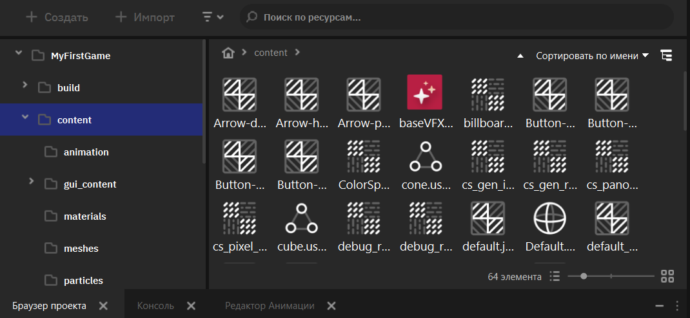
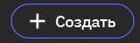
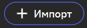
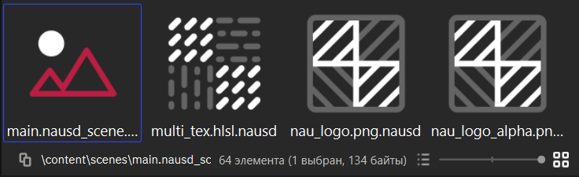
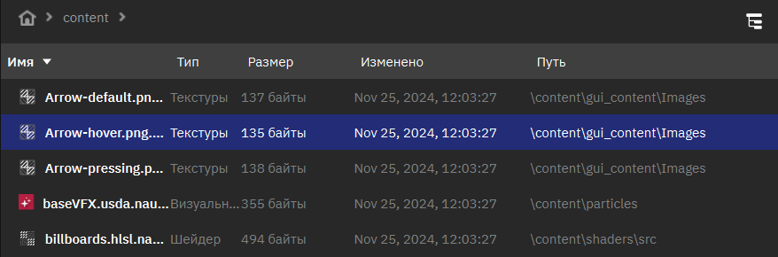
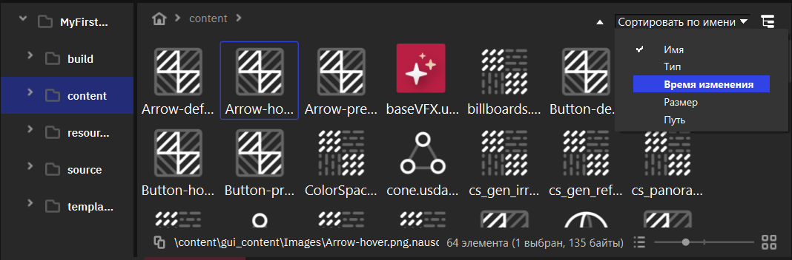
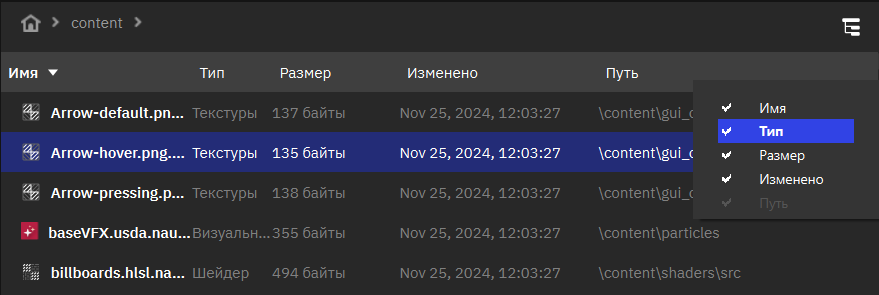
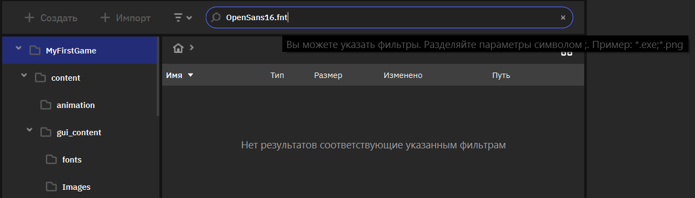
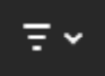
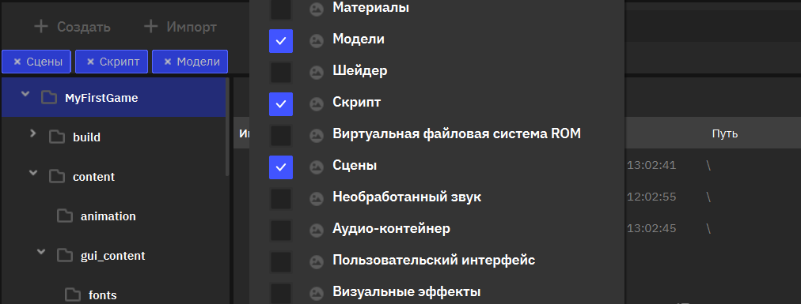

Браузер проекта
================
.. _assets_browser:

Браузер проекта (Project Browser) — это один из основных инструментов в Nau Engine, предназначенный для управления ассетами вашего проекта. Он отображает все файлы и папки внутри проекта, позволяя вам организовывать, импортировать и управлять ресурсами, необходимыми для создания вашей игры. В этой статье мы подробно рассмотрим функции браузера проекта и основные принципы работы с ассетами в Nau Engine. Обратите внимание, что в бета-версии функциональность браузера проекта может быть ограничена.

Общая информация
----------------

Браузер проекта отображает все файлы и папки, находящиеся в вашем проекте, включая как внутренние ассеты Nau Engine, так и импортированные внешние файлы. Это позволяет вам удобно просматривать и управлять всеми ресурсами проекта в одном месте. Вы можете использовать браузер проекта для навигации по структуре папок, просмотра содержимого файлов, а также для выполнения различных операций с ассетами, таких как импорт, удаление и переименование.

   

Браузер проекта разделен на две основные области. В левой части отображается древовидная структура папок вашего проекта, позволяющая быстро переходить к нужной директории. В правой части отображается содержимое выбранной папки, включая файлы и подпапки.

В браузере проекта ассеты отображаются с иконками или превью, 
соответствующими их типу (например: изображение для текстур, иконка модели для 3D-моделей). 
Это позволяет быстро визуально определить тип каждого ассета. 
В бета-версии отображение превью может быть недоступно для некоторых типов ассетов.

Работая с браузером проекта, вы можете выполнять следующие действия:

   * **Создавать новые ассеты:** нажмите кнопку |browser_add_icon|, чтобы создать новый ассет, например: VFX, материал, GUI-ассет.

   * **Импортировать ассеты:** нажмите кнопку |browser_import_icon|, чтобы импортировать файлы из внешних источников. Подробнее об :ref:`импорте ассетов <importing_assets>`. Обратите внимание, что список поддерживаемых форматов файлов может быть ограничен в бета-версии. 

   * **Выполнять стандартные операции с файлами и папками:** вы можете копировать, вырезать, вставлять, удалять, переименовывать файлы и папки, используя стандартные сочетания клавиш (Ctrl+C, Ctrl+X, Ctrl+V, Delete, F2) или контекстное меню (правая кнопка мыши).

   * **Создавать новые папки:** щелкните правой кнопкой мыши в правой части браузера проекта и выберите "Создать папку" в контекстном меню.

   * **Изменять структуру проекта:** перетаскивайте файлы и папки с помощью drag-and-drop, чтобы изменить структуру вашего проекта.

  

.. note:: Для навигации по проекту используйте древовидную структуру папок в левой части браузера проекта. Щелчок по папке открывает ее содержимое в правой части окна. Стрелка слева от названия папки позволяет развернуть или свернуть список вложенных папок и файлов.

   .. figure:: img/browser_crumbs.png
      :figwidth: 80%

Выбор способа визуализации и сортировки
-----------------------------------------

В правом нижнем углу браузера проекта находится слайдер, 
позволяющий переключаться между двумя режимами отображения ассетов: 
"Список" и "Плитка". В режиме "Список" ассеты отображаются в виде списка 
с подробной информацией, такой как имя, тип, размер файла и дата создания/изменения. В режиме 
"Плитка" ассеты представлены иконками с названиями. 

В режиме "Список" браузера проекта ассеты отображаются в виде 
таблицы с несколькими колонками. Нажатие на заголовок колонки сортирует ассеты 
по соответствующему параметру. Повторное нажатие на заголовок той 
же колонки меняет порядок сортировки (по возрастанию/по убыванию). 
Эта функция позволяет быстро находить нужные ассеты, например, 
самые большие файлы или недавно измененные ресурсы. 

В браузере проекта вы также можете управлять сортировкой ассетов с помощью выпадающего списка, расположенного в правой верхней части окна. Этот список позволяет выбрать параметр сортировки (например, имя, тип, размер, время изменения) и порядок сортировки (по возрастанию или по убыванию).

Щелчок правой кнопкой мыши на заголовке любой колонки открывает контекстное меню. В этом меню вы можете выбрать, какие колонки отображать, а какие скрывать. Это позволяет настроить отображение информации в соответствии с вашими потребностями.
   

.. note:: 
   В правой части браузера проекта находятся кнопка, позволяющие управлять отображением ассетов внутри текущей папки. 
   
   Кнопка |browser_button_01| включает режим "Плоский список ресурсов", в котором отображаются все ассеты, находящиеся в текущей папке и ее подпапках, без отображения самой структуры папок. Это удобно для быстрого просмотра всех доступных ресурсов в выбранной ветке проекта. 
   
   Кнопка |browser_button_02| возвращает стандартный режим отображения, где ассеты группируются по папкам, восстанавливая иерархическое представление. 

Фильтрация и поиск
------------------

Браузер проекта Nau Engine предоставляет инструменты для поиска и фильтрации ассетов, что упрощает навигацию и управление ресурсами, особенно в больших проектах. 

Вы можете фильтровать отображаемые в браузере проекта ассеты двумя способами:

* **Поиск по имени:** введите текст в поле поиска, чтобы отобразить только те ассеты, в названии которых содержится введенная последовательность символов. Поиск не чувствителен к регистру.

* **Фильтрация по типу:** нажмите кнопку |browser_button_03|, чтобы открыть меню фильтрации по типу ассетов. В этом меню вы можете выбрать, какие типы ассетов должны отображаться в браузере проекта. Например, вы можете выбрать отображение только текстур, или только 3D-моделей. Выбранные фильтры применяются к текущей папке и всем ее подпапкам (в режиме отображения иерархии папок) или ко всем ассетам в режиме "Плоский список ресурсов".

------

В этой статье мы рассмотрели основные функции браузера 
проекта Nau Engine и принципы работы с ассетами. 
Браузер проекта — это важный инструмент для управления 
ресурсами вашего проекта, позволяющий эффективно организовывать, 
импортировать и настраивать ассеты. Мы рассмотрели навигацию по проекту, 
основные операции с файлами и папками, режимы отображения, 
а также функции поиска и фильтрации. Помните, что функциональность браузера 
проекта в бета-версии может быть ограничена. Освоение работы с браузером проекта 
поможет вам эффективно управлять ресурсами и ускорить процесс разработки в Nau Engine.