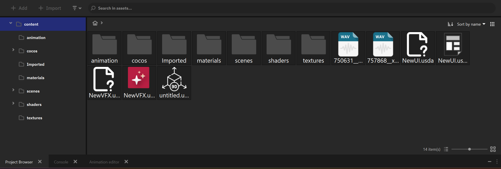

.. _importing_assets:

Импорт ресурсов
===============

В Nau Engine ассеты — это ресурсы, используемые для создания вашей игры, такие как 3D-модели, текстуры, аудиофайлы, анимации и другие данные. Движок поддерживает импорт различных форматов файлов, позволяя вам использовать ресурсы, созданные в других программах. В этой статье мы рассмотрим способы импорта ассетов в Nau Engine, поддерживаемые форматы файлов, а также особенности работы с внутренними и внешними ассетами. Обратите внимание, что в бета-версии Nau Engine список поддерживаемых форматов и функциональность импорта могут быть ограничены.

Способы импорта
---------------

В Nau Engine существует несколько способов импортировать ассеты в ваш проект. Рассмотрим два основных способа:

**Импорт через кнопку "Импорт":**

В левом верхнем углу браузера проекта расположена кнопка "Импорт". 
Нажмите на нее и откроется стандартное диалоговое окно вашей операционной системы, 
позволяющее выбрать нужный файл на вашем компьютере. Выбрав файл и нажав "Открыть", 
Nau Engine импортирует его в ваш проект и отобразит в браузере проекта. 
В зависимости от исходного формата, файл будет автоматически 
сконвертирован в соответствующий внутренний формат. 
Этот способ удобен для импорта отдельных файлов или небольшого количества ресурсов, 
когда вам нужно точно контролировать тип импортируемого ассета.

   

**Импорт перетаскиванием (drag-and-drop):**

Импортируйте ассеты быстро и удобно, перетаскивая файлы из проводника вашей 
операционной системы прямо в браузер проекта Nau Engine. Перетащите файлы 
либо в область просмотра файлов браузера, либо в папку Content вашего 
проекта в проводнике. Nau Engine автоматически определит типы файлов и 
импортирует их. Этот способ особенно эффективен для одновременного импорта нескольких файлов.

После успешного импорта ассет становится доступен для использования в вашем проекте. 
Вы можете использовать его для настройки объектов в сцене, например, 
назначить импортированную текстуру материалу или добавить импортированную 3D-модель в сцену.

Форматы импорта
---------------

Nau Engine поддерживает импорт различных форматов файлов, позволяя вам использовать 
разнообразные ресурсы в вашем проекте. Вы можете импортировать как файлы стандартных 
форматов (например, изображения, аудио, 3D-модели), так и файлы собственных форматов 
Nau Engine, предназначенных для хранения специфичных данных, таких как сцены, материалы и анимации. 
В бета-версии список поддерживаемых форматов может быть ограничен.

Стандартные форматы
++++++++++++++++++++++++++++++

Nau Engine поддерживает ряд распространенных форматов файлов, используемых в разработке игр. 
В бета-версии список поддерживаемых форматов ограничен. 
На данный момент поддерживаются следующие форматы:

.. list-table::
   :align: left
   :header-rows: 1
   :stub-columns: 1

   * - Группа
     - Формат (расширения)
     - Иконка в Project Browser
     - Описание
   * - Растровые изображения
     - .jpg, .png, .dds, .bmp, .tiff
     - |image|
     - Используются в материалах как текстуры или как элементы интерфейса.
   * - Трёхмерные модели
     - .usd, .usda, .usdc
     - |model|
     - Файлы моделей и сцен, созданные в других 3D-редакторах.
   * - Аудио
     - .wav, .mp3, .flac
     - |sound|
     - Музыка, звуковые эффекты, речь. Используются для воспроизведения звука, в том числе пространственного.

.. note:: Если вы используете файлы формата, который не поддерживается Nau Engine, вам потребуется конвертировать их в один из поддерживаемых форматов с помощью сторонних программ.

Трёхмерные модели
:::::::::::::::::

Для импорта трёхмерных моделей Nau Engine использует универсальный формат **OpenUSD** (.usd, .usda, .usdc). 
Этот формат позволяет эффективно импортировать сложные сцены, содержащие геометрию, 
анимацию и другие данные. Подготовьте ваши 3D-модели в предпочитаемом вами 
3D-редакторе и экспортируйте их в формате **USD** для использования в Nau Engine. 
В текущей бета-версии Nau Engine поддержка формата **USD** имеет следующие ограничения: 

 * **Модели со скелетной анимацией:** импортируются только модели, содержащие один объект геометрии, привязанный к одному скелету. Если ваша модель содержит несколько скелетов или объектов геометрии, разделите ее на отдельные файлы перед импортом.
 
 * **Текстуры модели:** текстуры, используемые в модели, импортируются отдельно и должны быть назначены материалу вручную в редакторе Nau Engine.

Форматы NAU Engine
++++++++++++++++++

Помимо стандартных форматов, Nau Engine использует собственные форматы файлов для хранения специфичных данных.

.. list-table::
   :align: left
   :header-rows: 1
   :stub-columns: 1
   
   * - Тип
     - Назначение
     - Использование
   * - Audio Container
     - Содержит ссылки на аудиофайлы и настройки воспроизведения (например, случайное или последовательное).
     - Используется компонентом AudioEmitter для воспроизведения звука.
   * - VFX
     - Хранит настройки эффектов частиц.
     - Применяется компонентом VFXInstance для отображения визуальных эффектов.
   * - GUI
     - Содержит данные для создания пользовательского интерфейса.
     - Используется для построения интерфейса игры.
   * - PBR Material
     - Хранит параметры материалов для 3D-объектов.
     - Назначается компонентам, отвечающим за визуализацию моделей в сцене. Позволяет настроить материал для объекта геометрии.
   * - Physics Material
     - Содержит физические параметры объектов.
     - Используется компонентом RigidBody для определения физического поведения объекта.
     
Вы можете импортировать в текущий проект ассеты, созданные в других проектах Nau Engine. Это позволяет повторно использовать ресурсы и ускорить процесс разработки. Для импорта перетащите файлы из другого проекта в браузер проекта.

Прочие форматы
++++++++++++++++++++++++

Вы можете хранить в папке проекта файлы любых форматов, 
даже если они напрямую не поддерживаются Nau Engine. 
Такие файлы не будут отображаться в браузере проекта, 
и на текущий момент редактор не предоставляет специальных инструментов для работы с ними. 
Вы можете обращаться к этим файлам из кода вашей игры, используя стандартные функции языка программирования C++.
