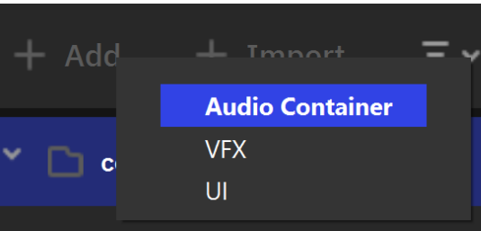
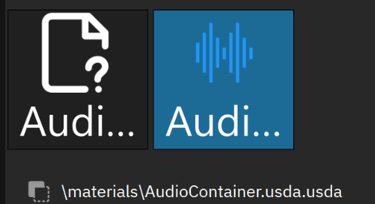
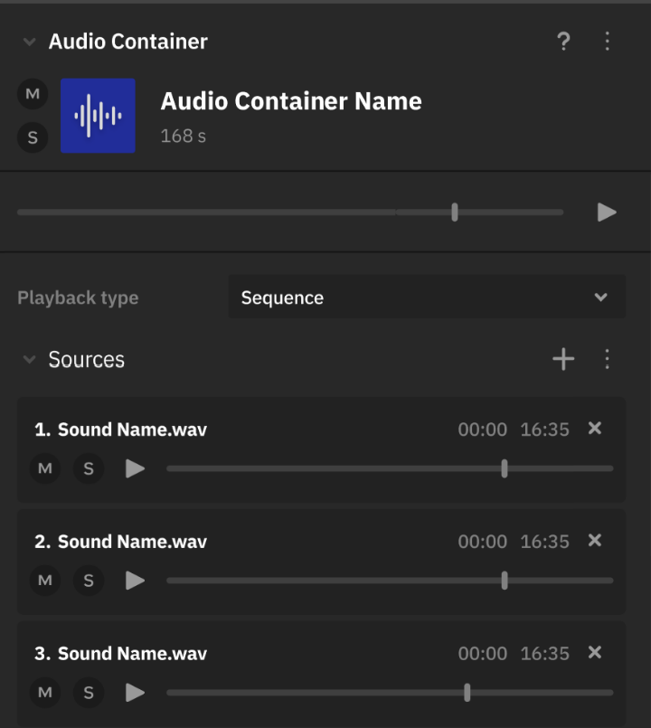

Звуки и музыка
==============

.. _audio_doc:

Общая информация
----------------

Аудиосистема Nau Engine позволяет реализовать при создании игры основные задачи по оформлению звуковой картины. Для импорта поддерживаются распространенные форматы аудио. Поддерживается настройка позиционного звука через систему игровых объектов. Для этого необходимо использовать стандартные компоненты слушатель (AudioListener) и эмиттер (AudioEmitter). 

Дополнительные функции обеспечиваются специальными внутренними ассетами — аудиоконтейнерами. Они предоставляют широкий спектр возможностей для решения распространенных задач, связанных с озвучанием игр. Например, вы можете легко реализовать рандомизацию звуков при их воспроизведении, выбирая случайный файл из заданного набора. Также доступны функции создания и управления списками воспроизведения, что особенно полезно для организации фонового музыкального сопровождения или озвучивания сложных последовательностей событий.

Система позволяет управлять воспроизведением звука через пользовательские компоненты.

Начните с нескольких простых шагов. Для того чтобы добавить звуки в игру, нужно:

 1. **импортировать файлы** в проект по общим правилам,
 2. **создать контейнер** в файлах проекта и, добавив нужные звуки, настроить его,
 3. **создать на сцене объект с компонентом “эмиттер”**,  который будет воспроизводить содержимое контейнера,
 4. **создать на сцене объект с компонентом “слушатель”**, который будет "улавливать" воспроизводимые звуки.

.. note:: В проекте можно использовать аудио-файлы следующих форматов: wav (pcm), flac, mp3. 

Контейнер
---------
Создание
~~~~~~~~

Контейнер можно создать в любой папке проекта. Для этого нужно выбрать пункт **“Аудио контейнер”** в выпадающем меню, которое появляется по нажатии кнопки "Добавить" ("+Add").

|

В файлах будет создан ассет собственного формата Nau Editor.

Свойства и настройка
~~~~~~~~~~~~~~~~~~~~

   
Выбранный контейнер можно редактировать через инспектор, двойным кликом ЛКМ по ассету контейнера в браузере проекта. Доступные для изменения свойства:

**Тип проигрывания** позволяет задать, как будут воспроизводиться звуки в контейнере.

* *Sequence* проигрывает все звуки по порядку, 
* *Random* проигрывает один случайный звук,
* *Shuffle* проигрывает все звуки в случайном порядке,
* *Mix* соединяет звуки в контейнере воедино.

.. note:: В данный момент может наблюдаться баг с отображением типа Mix.

**Список звуков** позволяет добавлять в контейнер / удалять из него как аудио-файлы, так и другие контейнеры, а также менять их порядок при помощи перетаскивания.

После добавления звуков в список, можно увидеть общую длительность проигрывания контейнера. 

И отдельные файлы в списке, и весь контейнер можно воспроизводить, нажав на кнопку «Воспроизвести» |audio_play|.

-----

Звуки на сцене
--------------

Для того чтобы звуки появились в игре, на сцене должны присутствовать игровые объекты со следующими компонентами: 

 * **эмиттер (Emitter)** проигрывает содержимое контейнера в пространстве сцены,
 * **слушатель (Listener)** улавливает звуки от эмиттеров, с учетом положения.

Дополнительные настройка эмиттера
~~~~~~~~~~~~~~~~~~~~~~~~~~~~~~~~~

В эмиттере можно:

* добавить ссылку на контейнер, который будет проигрываться,
* указать, будет ли звук воспроизводиться автоматически при запуске сцены, или его нужно активировать (например из скриптов),
* указать, будет ли звук зациклен при проигрывании,
* настроить будет ли звук привязан к пространству (3D) или нет (2D), а также в первом случае задать форму и размер этого пространства

