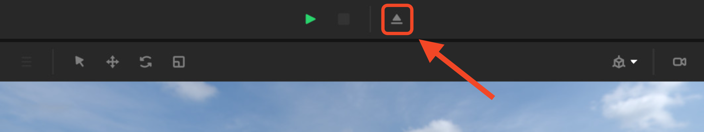
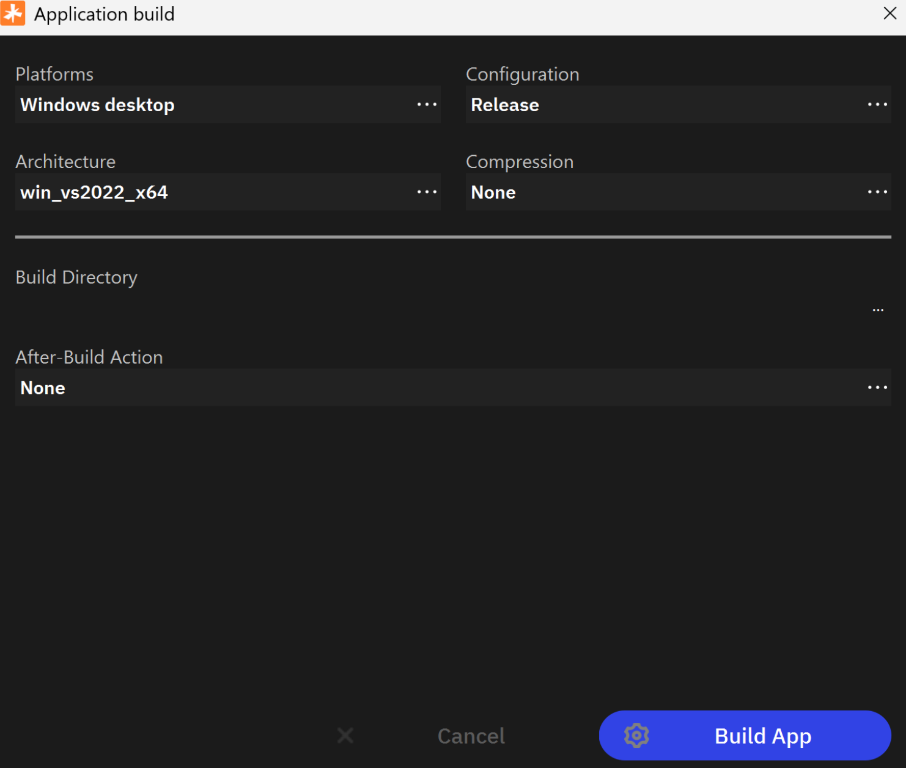
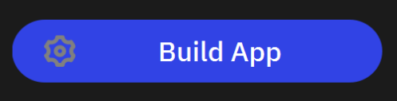
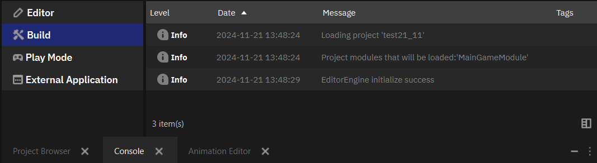
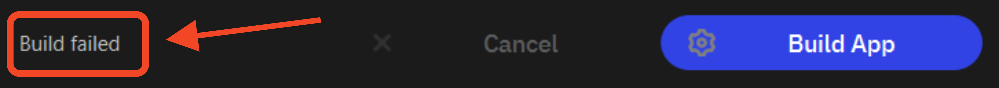

Сборка проекта
==========================

.. _building_from_source:

После того, как вы закончили работу над вашим проектом в Nau Engine, следующим шагом является его сборка. **Сборка проекта** — это процесс создания исполняемого файла вашей игры, который можно запустить на платформе Windows. В этом разделе мы рассмотрим, как собрать ваш проект в редакторе Nau Engine и подготовить его к запуску. Обратите внимание, что в бета-версии Nau Engine сборка проектов поддерживается только на платформе Windows.

.. attention::
   Обратите внимание, что для корректной сборки в сцене должен присутствовать игровой объект с компонентом камеры. Создать камеру можно с помощью меню добавления нового объекта в окне Outliner.

Окно сборки проекта
++++++++++++++++++++

Чтобы открыть окно сборки проекта, нажмите кнопку |build_button_01| на главной панели инструментов редактора, которая находится над окном Viewport. 

В этом окне вы сможете настроить параметры сборки и запустить процесс создания исполняемого файла вашей игры. 

В окне сборки проекта вы можете настроить следующие параметры:

* **Целевая платформа (Platforms):** в бета-версии доступна только платформа Windows.

* **Конфигурация сборки (Configuration):** выберите конфигурацию сборки: *Release* (для выпуска готовой игры) или *Debug* (для отладки).

* **Архитектура (Architecture):** выберите архитектуру целевой платформы из выпадающего списка: `win_vs2022_x64` или `win_vs2022_x64_dll`.

   * *win_vs2022_x64:* эта опция создает статически слинкованный исполняемый файл. В этом случае все необходимые библиотеки включаются непосредственно в исполняемый файл, что делает его более портативным (не требует дополнительных DLL), но увеличивает размер файла.

   * *win_vs2022_x64_dll:* эта опция создает динамически слинкованный исполняемый файл. В этом случае исполняемый файл использует внешние DLL-библиотеки. Это уменьшает размер исполняемого файла, но требует наличия необходимых DLL на целевой системе.

* **Сжатие (Compression):**  в бета-версии сжатие отключено и установлено значение *None*.

* **Директория сборки (Build Directory):** укажите папку, в которую будет сохранен собранный проект. Используйте кнопку "Обзор" для выбора папки. Рекомендуется каждую сборку проводить в пустую директорию. Вы можете создать новую или очистить текущую.

* **Действие после сборки (After-Build Action):** выберите действие, которое будет выполнено после завершения сборки: "Открыть папку", "Запустить" или "Ничего".

После настройки параметров нажмите кнопку "Собрать" |build_button_02|, 
чтобы начать процесс сборки проекта. Собранный проект будет помещен в 
указанную вами директорию. Ход сборки и все возникающие сообщения будут 
отображаться в :ref:`консоли редактора <console>`. 

В случае возникновения ошибок во время сборки, проверьте сообщения в 
консоли редактора для получения дополнительной информации. Сообщения об 
ошибках помогут вам выявить и исправить проблемы в вашем проекте. 
Если сборка прошла успешно, вы можете перейти в указанную вами директорию 
сборки и запустить ваш проект. В противном случае, если сборка завершилась 
неудачно, в окне сборки проекта появится надпись *Ошибка сборки* (Build failed).

После успешной сборки проекта вы найдете ярлык на исполняемый файл вашей игры в указанной вами директории сборки. Как правило, собранный проект содержит следующие элементы:

* Исполняемый файл: файл, запускающий вашу игру. Располагается в папке "bin" и имеет то же название, что и проект.

* Папка с ресурсами (content или resources): содержит все необходимые для работы игры ресурсы, такие как текстуры, модели, аудиофайлы и другие данные.

* Другие файлы (bin и config): в зависимости от настроек проекта и используемых библиотек, собранный проект может содержать другие файлы, например, конфигурационные файлы или дополнительные данные.

Советы по оптимизации сборки
------------------------------

В бета-версии Nau Engine возможности оптимизации сборки проекта могут быть ограничены. Однако, даже на этом этапе разработки следующие рекомендации могут быть полезны:

   * **Выбирайте конфигурацию Release:** конфигурация Release предназначена для сборки готовой игры и включает оптимизации, которые уменьшают размер исполняемого файла и повышают производительность. Конфигурация Debug предназначена для отладки и содержит дополнительную информацию, увеличивающую размер файла.

   * **Убедитесь, что в вашем проекте нет неиспользуемых ресурсов:** перед сборкой проекта проверьте, что все ассеты, включенные в проект, действительно используются. Удаление неиспользуемых ресурсов поможет уменьшить размер конечного файла.

   * **Следите за сообщениями в консоли:** внимательно изучайте сообщения, появляющиеся в консоли во время сборки. Предупреждения и сообщения об ошибках могут указывать на потенциальные проблемы, которые могут повлиять на производительность или стабильность вашей игры.

-----

В этой статье мы рассмотрели процесс сборки проекта в Nau Engine. 
Вы узнали, как открыть окно сборки, настроить параметры сборки, 
запустить процесс сборки и работать с собранным проектом. 
Несмотря на то, что в бета-версии возможности сборки могут быть ограничены, 
понимание основных принципов этого процесса поможет вам подготовить 
ваш проект к запуску и тестированию. Следите за обновлениями документации.