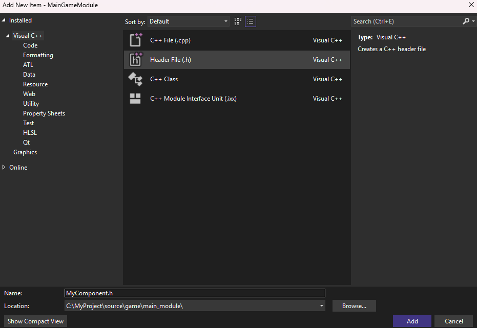

Разработка игровой логики 
=========================

.. _game_logic_doc:

.. toctree::
   :hidden:

   script_manager/script_manager_doc

.. |add| image:: images/add.png
   :width: 3em
   :class: no-scaled-link

   
   
Игровая логика Nau Engine основана на **компонентах**.

**Компонент** — это модуль движка, реализующий ту или иную функциональность (например, компонент освещения или компонент физики). Компонент в Nau Engine может использоваться самостоятельно либо как часть другого объекта. Ряд таких стандатрных компонентов уже реализован в Nau Engine и может быть добавлен пользователем на |plus| в Outliner как самостоятельная ячейка иерархии, либо на |add| в Inspector как модуль, встроенный в другой объект.

В Nau Engine существует несколько способов реализации пользовательской игровой логики. 
В бета-версии вы можете использовать как скриптовые компоненты на C++, 
так и скрипты на Lua (с перспективой использования TypeScript). 
Данная статья посвящена созданию скриптовых компонентов на C++. 
Мы рассмотрим ключевые аспекты этого процесса: наследование от базового класса ``Component``, 
реализацию интерфейса ``IComponentUpdate`` для обновления компонента каждый кадр и поддержку 
рефлексии для работы с компонентом в редакторе. 

Если же вы предпочитаете использовать скрипты на Lua, 
обратитесь к документации по настройке и использованию :ref:`ScriptManager <script_manager_doc>`. 
Обратите внимание, что в бета-версии функциональность некоторых возможностей может быть ограничена.

Создание скриптового компонента на C++
---------------------------------------

В бета версии пользователь может реализовать логику для своего игрового проекта с помощью скриптовых компонентов, написанных
на языке С++. Подчеркнем факторы, на которые необходимо обратить внимание при создании собственного класса компонента.

* Скриптовый компонент, как и любой другой компонент в системе GOC, наследуется от базового класса :api:`Scene/Components/classes.html#_CPPv4N3nau5scene9ComponentE <Component>`.
* Наверняка, вам потребуется, чтобы ваш компонент обновлялся каждый кадр вместе с остальными компонентами. Для этого необходимо, чтобы ваш класс реализовывал интерфейс :api:`Scene/Components/classes.html#_CPPv4N3nau5scene16IComponentUpdateE <IComponentUpdate>`.
* Для того, чтобы вы могли воспользоваться созданным вами компонентом в редакторе, необходимо, чтобы созданный компонент поддерживал рефлексию. 

|

Предположим, вы хотите создать скриптовый компонент ``MyComponent``

1. Cоздайте файлы ``MyComponent.h`` и ``MyComponent.cpp`` в папке ``source/game/main_module`` вашего проекта.

2. Ниже представлен шаблон кода класса ``MyComponent``, объявленного в файле ``MyComponent.h``
   согласно факторам, изложенным выше. Данный класс
   готов к использованию в качестве основы для ваших скриптовых компонентов.

   .. literalinclude:: MyComponent_v1.h
      :language: cpp
      :class: larg
      :linenos:

3. В файл ``MyComponent.cpp`` поместите следующий код:

   .. literalinclude:: MyComponent_v1.cpp
      :language: cpp
      :class: larg
      :linenos:

4. Необходимо также зарегистрировать класс MyComponent в движке. Для этого
   в файле ``source/game/main_module/module.cpp`` в тело метода ``initialize`` добавьте следующий код:

   .. code-block:: cpp
      :class: larg

      nau::getServiceProvider().addClass<MyComponent>();

5. Для отображения компонента в редакторе требуется сохранить изменения в проекте Visual Studio, а затем перезапустить редактор
   (открыть-закрыть). Результат компиляции проекта можно отследить в редакторе.

   .. figure:: images/code_status.png
      :align: center
      :figwidth: 75%
      :alt: Результат компиляции

Для углубленной работы с компонентами рекомендуется обратититься к :api:`Scene/index.html <руководству>` по API движка.

Отладка пользовательского кода
---------------------------------------

Для отладки C++ кода в бета-версии Nau Engine рекомендуется следующий подход:

1. **Запустите debug-версию редактора:** debug-версия редактора содержит отладочную информацию, необходимую для работы отладчика. Подробные шаги по сборке редактора описаны в статье :ref:`Установка Nau Engine <install_nau>`

2. **Откройте ваш проект в debug-версии редактора:** это позволит вам воспроизвести ситуацию, в которой возникает ошибка.

3. **Закройте редактор.**

4. **Откройте файл решения (.sln) в Visual Studio:** Для отладки кода вам потребуется открыть решение (solution) вашего проекта в Visual Studio. Файл решения обычно находится в папке ``build`` вашего проекта.

5. **Отлаживайте код:** Используйте стандартные инструменты отладки Visual Studio (точки останова, пошаговое выполнение, просмотр переменных) для поиска и исправления ошибок в вашем коде.

Этот процесс может показаться несколько громоздким, но он позволяет использовать мощные инструменты отладки Visual Studio.

-----------

.. grid:: 4

   .. grid-item-card:: 
       :img-top: images/game_logic.png
       :link: script_manager/script_manager_doc.html
       :text-align: center

       Менеджер скриптов
