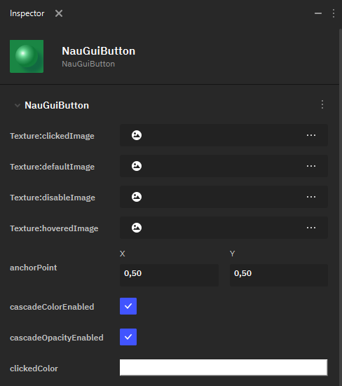
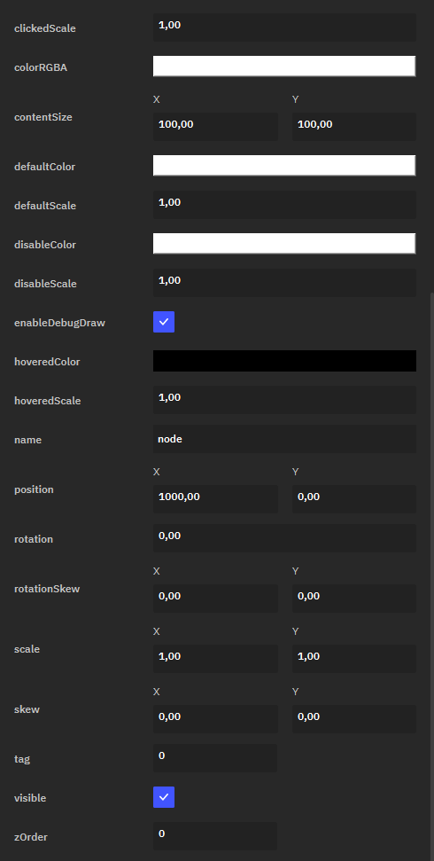

Кнопка
======

**Button** — это элемент UI, характеризующийся возможностью взаимодействовать с ним путем нажатия. Так, у кнопки есть несколько состояний, меняющихся в зависимости от того, активна она и была ли нажата.

 В Nau Engine доступны следующие параметры настройки **Button**:

* **Texture:clickedImage** - 2D-текстура для нажатой (активной) кнопки.
* **Texture:defaultImage** - 2D-текстура для стандартного состояния ненажатой кнопки.
* **Texture:disableImage** - 2D-текстура для неактивной (отключенной) кнопки.
* **Texture:hoveredImage** - 2D-текстура для кнопки, на которую наведена мышь.

 Все 2D-текстуры импортируются в проект по общим правилам.

* **anchorPoint** — определяет точку объекта, относительно которой происходит его трансформация.
* **cascadeColorEnabled** — флаг, определяющий, включен ли каскадный цвет.
* **cascadeOpacityEnable** — флаг, определяющий, включена ли каскадная насыщенность цвета.

.. figure:: img/color_select.png
   :figwidth: 100%
   
* **clickedColor** — определяет цвет нажатой кнопки при помощи RGBA-модели.
* **clickedScale** — определяет масштабирование кнопки при нажатии.

* **colorRGBA** — определяет общий цвет кнопки при помощи RGBA-модели. Выбранный цвет применяется для всех состояний кнопки и смешивается с цветами текстуры; для сохранения исходного оттенка текстуры значение **colorRGBA** должно быть белым.
* **contentSize** — задаёт размер прямоугольного блока, отведённого на UI-холсте под кнопку.
* **clickedColor** — определяет цвет кнопки в стандартном состоянии.
* **clickedScale** — определяет масштабирование кнопки в стандартном состоянии.
* **disableColor** — определяет цвет неактивной кнопки.
* **disableScale** — определяет масштабирование неактивной кнопки.
* **enableDebugDraw** — флаг, определяющий, нужно отрисовывать ли отладочный прямоугольник.
* **hoveredColor** — определяет цвет кнопки при наведении на неё мышью.
* **hoveredScale** — определяет масштабирование кнопки при наведении на неё мышью.
* **name** — имя ноды.
* **position** — позиция кнопки на 2D-холсте.
* **rotation** — угол поворота кнопки.
* **rotationSkew** — определяет сдвиг (Skew) объекта с вращением относительно оси X или Y.
* **scale** — определяет масштабирование кнопки.
* **skew** — определяет сдвиг кнопки (без учёта вращения) относительно оси X или Y.
* **tag** — число, задающее тэг объекта.
* **visible** — флаг, указывающий, является ли кнопка видимой.
* **zOrder** — определяет слой спрайта на оси Z: то есть, как накладываются друг на друга элементы UI на 2D-холсте.