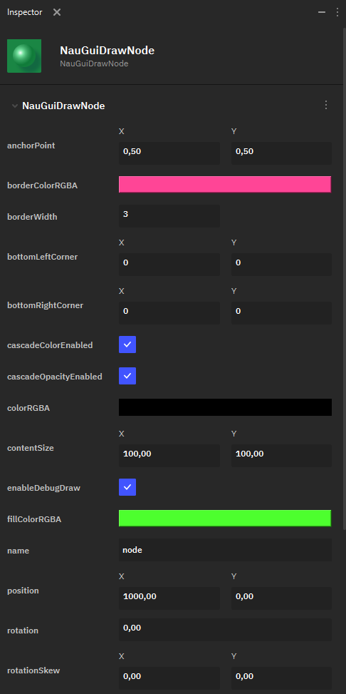
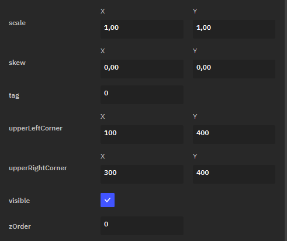

Фигура
======

**DrawNode** — это элемент UI в виде четырёхугольника. Пользователю предоставляется возможность настраивать фигуру, задавая координаты её углов.

 В Nau Engine доступны следующие параметры настройки **DrawNode**:

* **anchorPoint** — определяет точку объекта, относительно которой происходит его трансформация.
* **borderColorRGBA** — определяет цвет границ фигуры при помощи RGBA-модели.
* **borderWidth** — толщина границы фигуры в пикселях.
* **bottomLeftCorner** — координаты нижнего левого угла четырёхугольника по осям X и Y.
* **bottomRightCorner** — — координаты нижнего правого угла четырёхугольника по осям X и Y.
* **cascadeColorEnabled** — флаг, определяющий, включен ли каскадный цвет.
* **cascadeOpacityEnable** — флаг, определяющий, включена ли каскадная насыщенность цвета.
* **colorRGBA** — опция для задания общего цвета. Важно отметить, однако, что для **drawNode** используются отдельные опции для задания цветов границ и заливки фигуры.
* **contentSize** — задаёт размер прямоугольного блока, в котором рисуется фигура. ContentSize считается относительно левого нижнего угла фигуры.
* **enableDebugDraw** — флаг, определяющий, нужно отрисовывать ли отладочный прямоугольник.
* **fillColorRGBA** — основной цвет, которым заливается фигура.
* **name** — имя ноды.
* **position** — позиция DrawNode на 2D-холсте.
* **rotation** — угол поворота фигуры.
* **rotationSkew** — определяет сдвиг (Skew) объекта с вращением относительно оси X или Y.
* **scale** — определяет масштабирование фигуры.
* **skew** — определяет сдвиг фигуры (без учёта вращения) относительно оси X или Y.
* **tag** — число, задающее тэг объекта.
* **upperLeftCorner** — координаты верхнего левого угла четырёхугольника по осям X и Y.
* **upperRightCorner** — — координаты верхнего правого угла четырёхугольника по осям X и Y.
* **visible** — флаг, указывающий, является ли фигура видимой.
* **zOrder** — определяет номер слоя фигуры на оси Z: то есть, как накладываются друг на друга элементы UI на 2D-холсте.