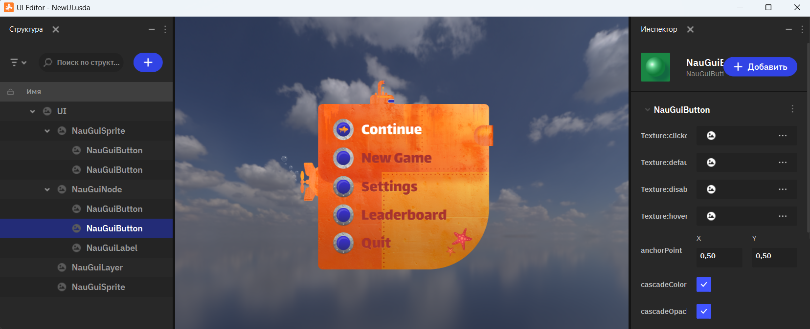
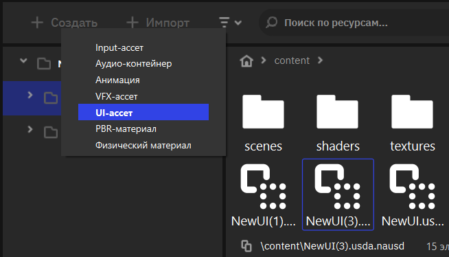
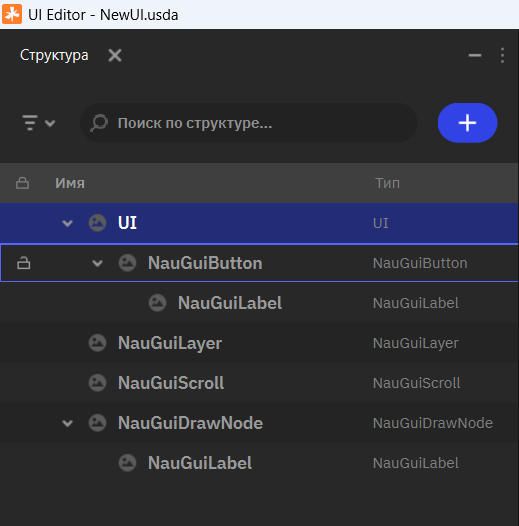
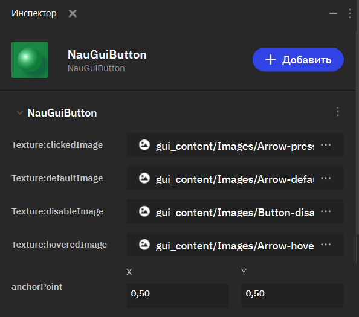
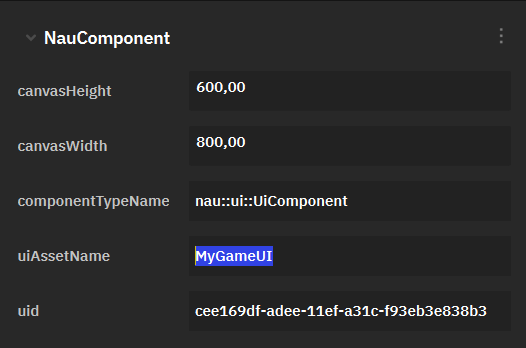
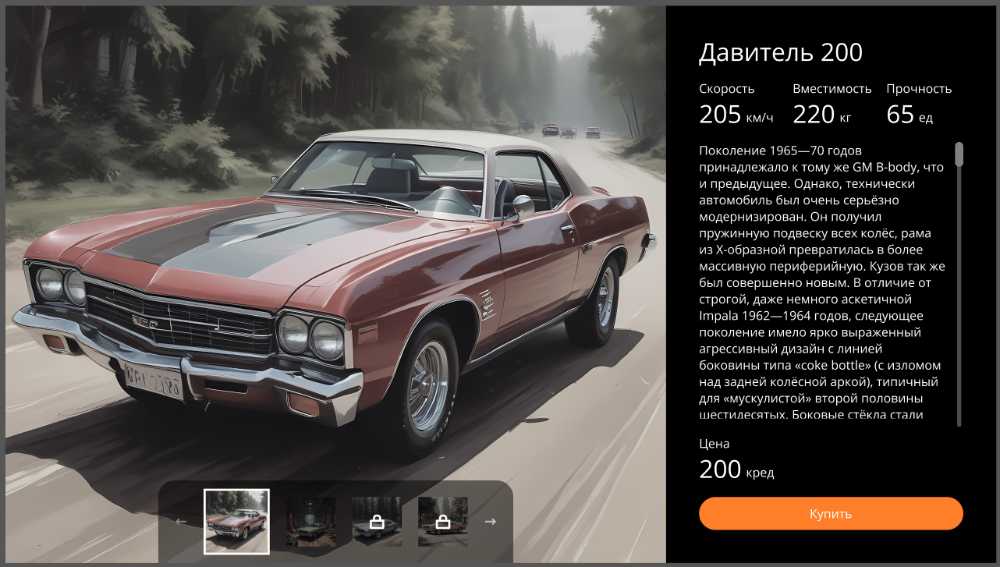

Игровой интерфейс
=================
.. _gui:

Редактор игровых интерфейсов (GUI Editor)
--------------------------------------------------------

Добро пожаловать в руководство по использованию Редактора игровых интерфейсов (GUI Editor) в Nau Engine! GUI Editor — это инструмент, позволяющий создавать и настраивать интерактивные элементы пользовательского интерфейса (UI) для ваших игр. Это руководство поможет вам освоить основные функции редактора и создать привлекательные и функциональные интерфейсы. Обратите внимание, что в бета-версии функциональность редактора пользовательских интерфейсов может быть ограничена.

Работа с UI-ассетом
-----------------------------------------

Прежде чем начать работу с GUI Editor, необходимо создать UI-ассет в браузере проекте.  GUI-ассет — это Canvas (холст), хранящий все элементы пользовательского интерфейса.

Подробные шаги по созданию, запуску и работе с UI-ассета описаны ниже:

1. **Откройте "Project Browser":** это менеджер файлов вашего проекта в Nau Engine.

2. **Нажмите кнопку "Создать" (Add):** в выпадающем списке выберите пункт "UI-ассет".

3. **Укажите имя:** укажите имя для нового ассета.

4. **Открытие ассета:** после создания GUI-ассета, двойным кликом ЛКМ по созданному файлу можно открыть **конструктор интерфейсов**. 

5. **Создание интерфейса:** создайте иерархию элементов в структуре сцены и настройте их в инспекторе. После этого сохраните UI-ассет.

6. **Подключение в игре:** после настройки интерфейса, вы можете использовать ассет инициализировав его во время выполнения через :api:`UI/index.html <API>`, либо через добавление к объекту на сцене ui компоненты в инспекторе.

UI-элементы 
----------------------------------------

GUI Editor позволяет настраивать параметры выбранного элемента UI. Эти параметры позволяют настроить внешний вид и поведение каждого элемента:

* **Node:** базовый тип элемента интерфейса. Все прочие типы элементов опираются на его функции и параметры. Настраивайте поворот, размер, масштаб и точку привязки.
* **Sprite (Изображение):** позволяет отобразить нужное изображение, импортированное в проект. Выбирайте изображения из «Project Browser». Все базовые параметры также применяются к элементу.
* **Label (Текст):** позволяет отображать текст с возможностью выбора шрифта. Вы можете использовать собственный шрифт в формате (.fnt). Текст может быть настроен как через редактор, так и изменён через программный код.
* **Draw (Фигура):** позволяет визуализировать четырёхугольник с возможностью настройки положения каждого угла. Например, можно создать квадрат или трапецию. Для элемента не требуется текстура, а цвет может настраиваться как для заполнения, так и для обводки.
* **Button (Кнопка):** настраивайте текст, изображение, состояния (normal, hover, pressed, disabled). Регистрация события нажатия происходит через программный код. Обратитесь к API системы, чтобы узнать подробнее.
* **Scroll (Скролл):** позволяет создать прокручиваемую область (например, список). Настраивайте размер, видимость стрелок, картинку каретки, ориентацию, цвет полосы прокрутки и ползунка. 
* **Layer (Слои):** вы можете управлять видимостью слоев и их параметрами для организации блоков интерфейса.

Все элементы имеют возможность включения отладочной визуализации, для упрощения вёрстки.

Обзор GUI Editor
-----------------------------

Интерфейс GUI Editor состоит из нескольких ключевых окон:

**Структура (Outliner):**  отображает иерархическую структуру элементов UI.  Здесь вы можете добавлять, переименовывать, перемещать и удалять элементы. 

Поддерживает операции:
 * добавление элементов (кнопка "+ Add"),
 * удаление элементов,
 * фильтрация элементов по имени и типу.

**Холст (Canvas):** на нем вы создаете и размещаете элементы UI. В окне возможен предварительный просмотр всех настроенных параметров.

**Инспектор элемента (Inspector):**  позволяет настраивать параметры выбранного элемента UI. Все изменения параметров отражаются на состоянии элементов в конструкторе интерфейса.  

Настройка UI
------------

Nau Engine предоставляет множество настроек, специфичных для каждого вида UI. Однако, можно выделить и общие параметры:

* **Texture** - различные виды текстур (например, вариации кнопки для Button)
* **Position**, **Rotation**, **Scale**, **Skew** и **RotationSkew** - стандартные трансформации объекта.
* **anchorPoint** - положение якоря (точки, относительно которой трансформируется UI).
* **enableDebugDraw** - флаг, указывающий, нужна ли отладочная отрисовка элемента.
* **tag** - тэг элемента, нужный для удобной сортировки элементов UI.
* **visible** - указывает, виден ли элемент UI
* **Z-order** - задает порядок отрисовки элементов UI по оси Z, что позволяет корректно накладывать их друг на друга.

Добавление GUI на сцену
-----------------------------

Чтобы отобразить созданный вами UI-ассет на 3D-сцене, необходимо добавить компонент ``nau::ui::UiComponent`` к любому игровому объекту. Для этого выделите нужный объект в сцене, откройте окно Инспектора (Inspector) и нажмите кнопку "+ Добавить". В появившемся списке выберите ``nau::ui::UiComponent``.

В параметре ``uiAssetName`` укажите имя вашего UI-ассета, который вы ранее создали в браузере проекта. Компонент ``nau::ui::UiComponent`` также позволяет настроить размер холста UI, чтобы он соответствовал требованиям вашего проекта. Вы можете изменить ширину и высоту холста в соответствующих параметрах компонента.

Заключение
-----------------------------

Интерфейс игры — важный инструмент, требующий творческого подхода. Среди основных принципов при построении удобных интерфейсов можно выделить:

* **Простота.** Меньшее количество элементов позволяет пользователю быстрее освоить интерфейс, а группировка и отделение различных функций позволит быстрее сориентироваться и легче запомнить, где находятся те или иные функции. 

* **Наглядность.** Чёткое визуальное выделение элементов по их назначению позволяет пользователю быстрее понять, что сделает элемент, даже без взаимодействия. 

* **Оригинальность.** Визуальная оригинальность интерфейса не должна идти в ущерб его читаемости. Шаблоны восприятия, которые есть у многих пользователей, так же важны, как и самовыражение автора.

* **Отзывчивость.** Интерфейс всегда должен максимально реагировать на действия пользователя. Оптимизация и тестирование — важный этап. Протестируйте различные сценарии взаимодействия. Если какие-либо действия ведут к длительным вычислениям или загрузкам, всегда сообщайте пользователю о том, чем занята программа.

* **Обратная связь.** Каждое действие пользователя должно откликаться в программе. Пользователь не должен гадать, нажал ли он кнопку и отреагировала ли игра на его действие. Используйте анимацию элементов и звуковые эффекты для подтверждения, что интерфейс функционирует верно. 

* **Однозначность.** Пользователь не должен сомневаться в действии того или иного элемента. Если какая-либо кнопка работает в зависимости от контекста, сообщите пользователю об этом через визуальные элементы (цвет, текст или любые другие способы).

GUI Editor в Nau Engine — это инструмент для создания пользовательских интерфейсов.  Используйте это руководство, экспериментируйте и создавайте уникальные и запоминающиеся интерфейсы для ваших игр!

.. toctree::
   :hidden:

   ./button/button_doc
   ./drawnode/drawnode_doc
   ./label/label_doc
   ./layer/layer_doc
   ./node/node_doc
   ./scroll/scroll_doc
   ./sprite/sprite_doc