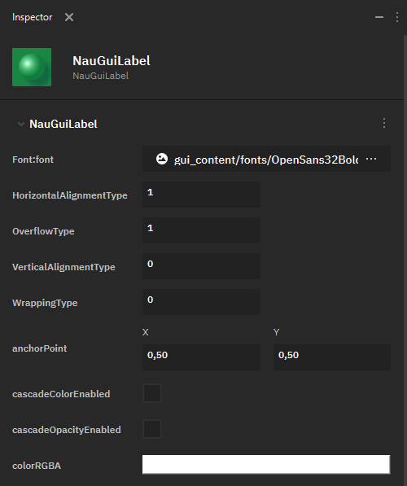
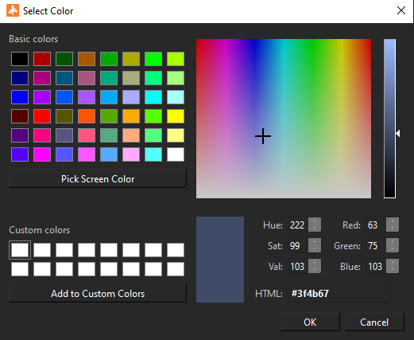
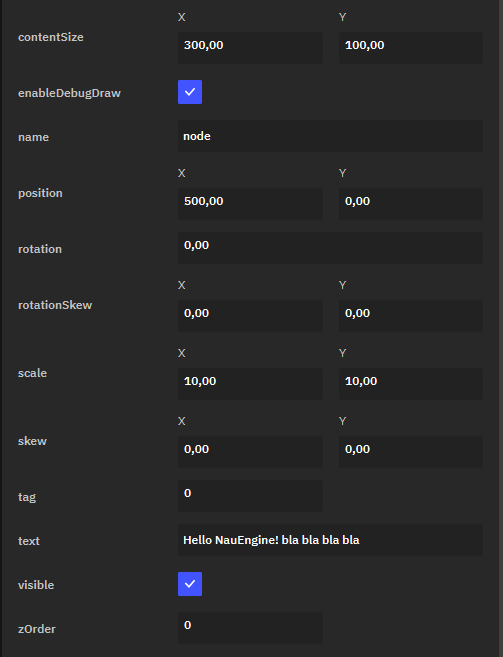

Текст
=====

**Label** — это элемент UI для любого текста, отображаемого в движке. Он используется как и в 3D-пространстве, так и для отображения надписей на других элементах UI. Каждый **Label** определяется непосредственно текстом и блоком, который отведён под вывод этого текста на холсте.

В Nau Engine доступны следующие параметры настройки **Label**:

 * **Font:font** — позволяет выбрать шрифт и его размер из доступных в браузере проекта. Шрифты импортируются в проект по общим правилам.
 
* **HorizontalAlignmentType** — определяет горизонтальное выравнивание текста:

  * 0 — текст выравнивается по левой границе блока.
  * 1 - текст выравнивается по центру.
  * 2 - текст выравнивается по правой границе блока.
  
 * **OverflowType** — определяет поведение текста при выходе за границы блока:

   * 0 — текст не обрезается.
   * 1 — текст обрезается до границ блока.
  
* **VerticalAlignmentType** — определяет вертикальное выравнивание текста:

  * 0 — текст выравнивается по верхней границе блока.
  * 1 - текст выравнивается по центру.
  * 2 - текст выравнивается по нижней границе блока.
  
 * **WrappingType** — определяет правила переноса текста:

   * 1 — текст не переносится.
   * 2 — текст переносится на новую строку по словам.
   * 3 — текст переносится на новую строку по символам.
  
* **anchorPoint** — определяет точку объекта, относительно которой происходит его трансформация.
* **cascadeColorEnabled** — флаг, определяющий, включен ли каскадный цвет.
* **cascadeOpacityEnable** — флаг, определяющий, включена ли каскадная насыщенность цвета.
* **colorRGBA** — определяет цвет текста при помощи RGBA-модели. 

   
Помимо этого, в движке представлен набор базовых цветов, есть возможность использовать пипетку для выбора цвета с экрана (**Pick Screen Color**) и сохранять пользовательские оттенки (**Add to Custom Colors**).

.. raw:: html

   

   
   

* **contentSize** — задаёт размер прямоугольного блока, в котором выводится текст.
* **enableDebugDraw** — флаг, определяющий, нужно отрисовывать ли отладочный прямоугольник для блока текста.
* **name** — имя ноды.
* **position** — позиция Label на 2D-холсте.
* **rotation** — угол поворота текста.
* **rotationSkew** — определяет сдвиг (Skew) объекта с вращением относительно оси X или Y.
* **scale** — определяет масштабирование текста.
* **skew** — определяет сдвиг текста (без учёта вращения) относительно оси X или Y.
* **tag** — число, задающее тэг объекта.
* **text** — текст в блоке текста.
* **visible** — флаг, указывающий, является ли блок текста видимым.
* **zOrder** — определяет слой блока текста на оси Z: то есть, как накладываются друг на друга элементы UI на 2D-холсте.
