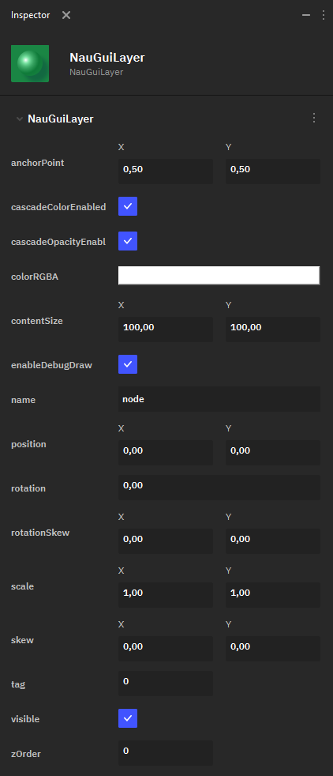

Слой
====

**Layer** — это элемент UI, предназначенный для более точной организации порядка рендеринга 2D-объектов на холсте. Слой не имеет собственной визуализации, а его настройки влияют на настройки всех прикреплённых к нему объектов-потомков. Однако, дочерние объекты, прикреплённые к слою, можно также изменять в их собственных настройках, вне зависимости от слоя.

 В Nau Engine доступны следующие параметры настройки **Layer**:

* **anchorPoint** — определяет точку объекта, относительно которой происходит его трансформация.
* **cascadeColorEnabled** — флаг, определяющий, включен ли каскадный цвет.
* **cascadeOpacityEnable** — флаг, определяющий, включена ли каскадная насыщенность цвета.
* **colorRGBA** — определяет цвет всех объектов-потомков слоя при помощи RGBA-модели. 
* **contentSize** — задаёт размер блока, отведённого под слой. Для Layer это влияет только на размер отладочного прямоугольника (если он включен); для всех дочерних объектов используются их собственные **contentSize**.
* **enableDebugDraw** — флаг, определяющий, нужно отрисовывать ли отладочный прямоугольник.
* **name** — имя ноды.
* **position** — позиция слоя на 2D-холсте, влияет на положение объектов-потомков.
* **rotation** — угол поворота слоя, влияет на поворот всех объектов-потомков.
* **rotationSkew** — определяет сдвиг (Skew) всех объектов-потомков слоя с вращением относительно оси X или Y.
* **scale** — определяет масштабирование всех объектов-потомков слоя.
* **skew** — определяет сдвиг всех объектов-потомков слоя (без учёта вращения) относительно оси X или Y.
* **tag** — число, задающее тэг слоя.
* **visible** — флаг, указывающий, является ли слой (то есть, все его объекты-потомки) видимым.
* **zOrder** — определяет слой на оси Z: то есть, как накладываются друг на друга элементы UI на 2D-холсте.