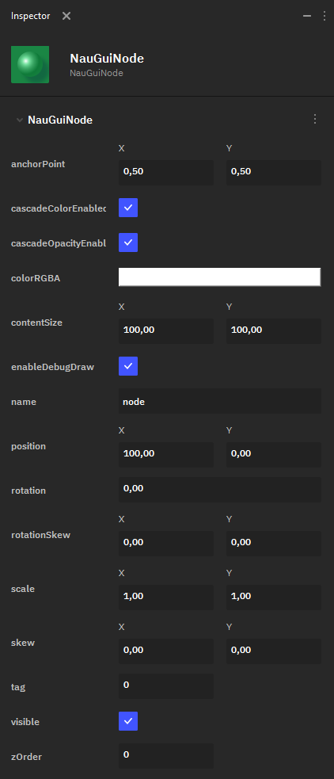

Нода
====

**Node** — это простой узел UI на 2D-холсте. Нода не отображается сама по себе, но может быть родительским объектом для других элементов UI, а также использоваться в скриптах.

 В Nau Engine доступны следующие параметры настройки **Node**:

* **anchorPoint** — определяет точку объекта, относительно которой происходит его трансформация.

 Настройки цвета:

* **cascadeColorEnabled**,
* **cascadeOpacityEnable**,
* **colorRGBA**,

 — не являются значимыми для **Node**, так как сама по себе она не отображается на экране. Однако, они являются общими для всех классов UI-элементов.

* **contentSize** — определяет размер блока на холсте, который выделяется под Node.
* **enableDebugDraw** — флаг, определяющий, нужно отрисовывать ли отладочный прямоугольник для Node. 
* **name** — имя ноды.
* **position** — позиция Node на 2D-холсте.
* **rotation** — угол поворота ноды.
* **rotationSkew** — определяет сдвиг (Skew) объекта с вращением относительно оси X или Y.
* **scale** — определяет масштабирование ноды.
* **skew** — определяет сдвиг ноды (без учёта вращения) относительно оси X или Y.
* **tag** — число, задающее тэг объекта.
* **visible** — флаг, указывающий, является ли нода видимой.
* **zOrder** — определяет слой ноды на оси Z: то есть, как накладываются друг на друга элементы UI на 2D-холсте.
