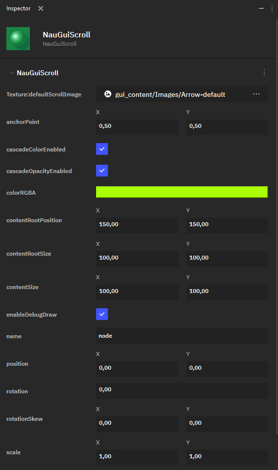

Скролл
======

**Scroll** — это элемент UI, используемый для создания прокручиваемых областей.

 В Nau Engine доступны следующие параметры настройки **Scroll**:
 
* **Texture:defaultScrollImage** — назначает текстуру для полосы прокрутки.
* **anchorPoint** — определяет точку объекта, относительно которой происходит его трансформация.
* **cascadeColorEnabled** — флаг, определяющий, включен ли каскадный цвет.
* **cascadeOpacityEnable** — флаг, определяющий, включена ли каскадная насыщенность цвета.
* **colorRGBA** — определяет цвет полосы прокрутки при помощи RGBA-модели.
* **contentRootPosition** — определяет позицию области прокрутки.
* **contentRootSize** — определяет размер области прокрутки.
* **enableDebugDraw** — флаг, определяющий, нужна ли отладочная отрисовка.
* **name** — имя ноды.
* **position** — позиция скролла.
* **rotation** — угол поворота скролла.
* **rotationSkew** — определяет сдвиг (Skew) объекта с вращением относительно оси X или Y.
* **scale** — определяет масштабирование скролла.
* **skew** — определяет сдвиг скролла (без учёта вращения) относительно оси X или Y.
* **tag** — число, задающее тэг объекта.
* **visible** — флаг, указывающий, является ли скролл видимым.
* **zOrder** — определяет слой скролла на оси Z: то есть, как накладываются друг на друга элементы UI на 2D-холсте.