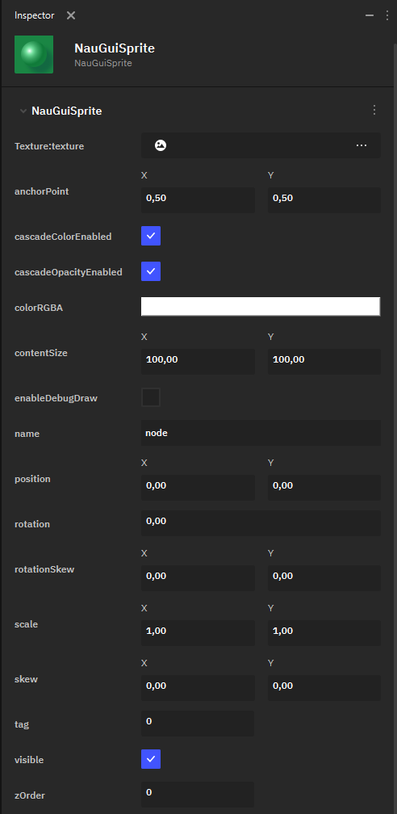

Спрайт
======

**Sprite** — это элемент UI с 2D-текстурой. Спрайты используются для большей части 2D-окружения: фонов, персонажей и т.д.

 В Nau Engine доступны следующие параметры настройки **Sprite**:

* **Texture:texture** — ключевой элемент настройки Sprite, определяющий его текстуру. 2D-текстура выбирается из файлов проекта и импортируется по общим правилам.
* **anchorPoint** — определяет точку объекта, относительно которой происходит его трансформация.

* **cascadeColorEnabled** — флаг, определяющий, включен ли каскадный цвет.
* **cascadeOpacityEnable** — флаг, определяющий, включена ли каскадная насыщенность цвета.
* **colorRGBA** — определяет цвет спрайта при помощи RGBA-модели. Выбранный цвет смешивается с цветами текстуры спрайта; для сохранения исходного оттенка текстуры значение **colorRGBA** должно быть белым.
   
Помимо этого, в движке представлен набор базовых цветов, есть возможность использовать пипетку для выбора цвета с экрана (**Pick Screen Color**) и сохранять пользовательские оттенки (**Add to Custom Colors**).

* **contentSize** — задаёт размер прямоугольного блока, в котором рисуется спрайт.
* **enableDebugDraw** — флаг, определяющий, нужно отрисовывать ли отладочный прямоугольник.
* **name** — имя ноды.
* **position** — позиция Sprite на 2D-холсте.
* **rotation** — угол поворота спрайта.
* **rotationSkew** — определяет сдвиг (Skew) объекта с вращением относительно оси X или Y.
* **scale** — определяет масштабирование спрайта.
* **skew** — определяет сдвиг спрайта (без учёта вращения) относительно оси X или Y.
* **tag** — число, задающее тэг объекта.
* **visible** — флаг, указывающий, является ли спрайт видимым.
* **zOrder** — определяет слой спрайта на оси Z: то есть, как накладываются друг на друга элементы UI на 2D-холсте.