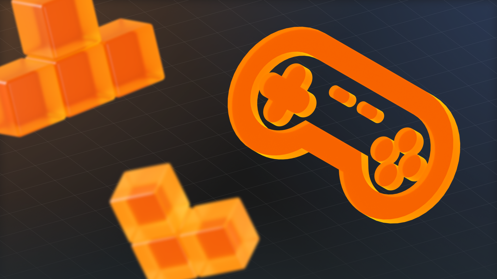
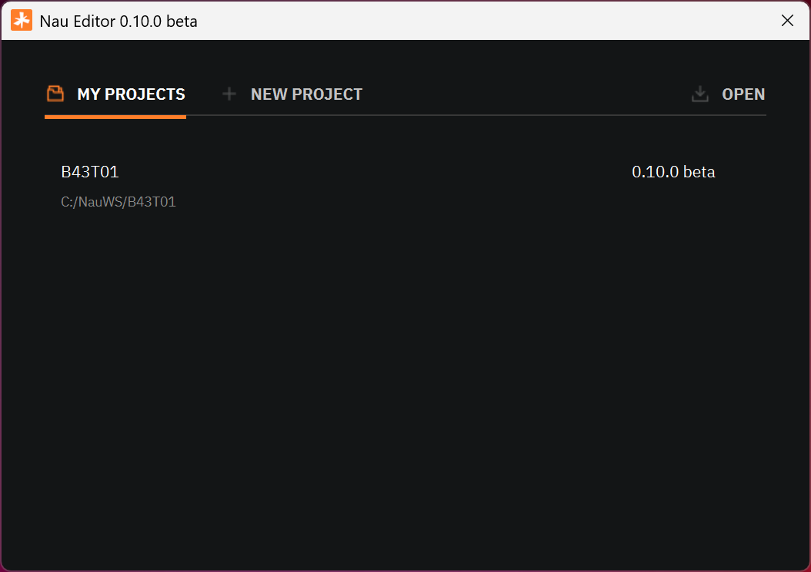
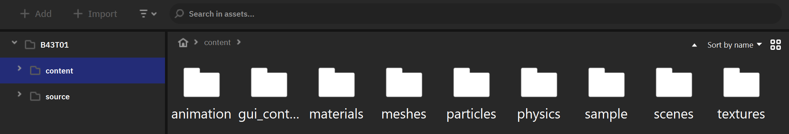
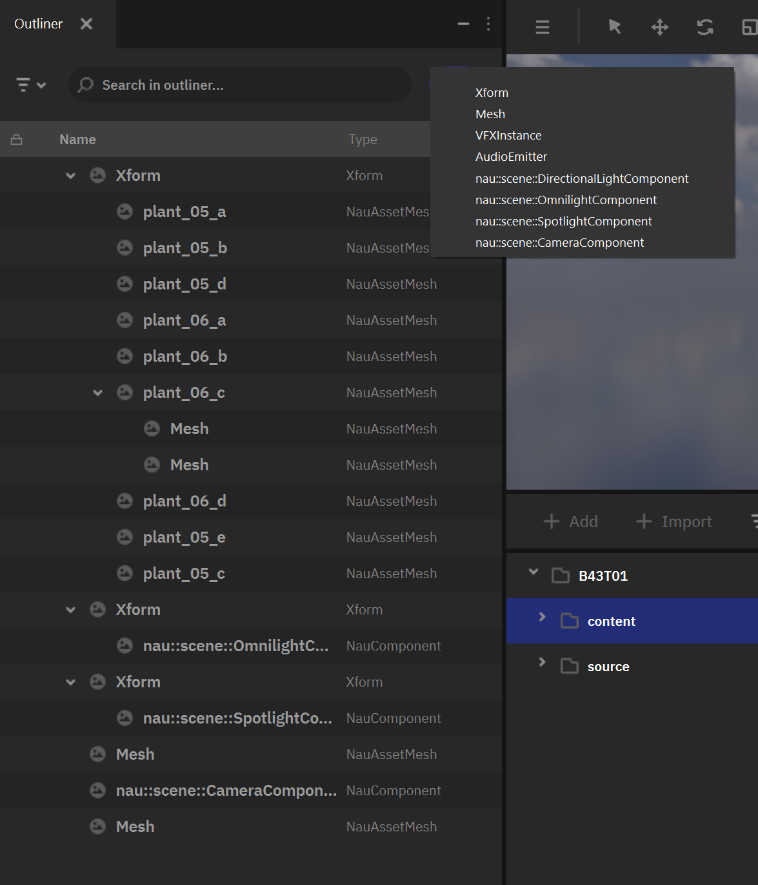
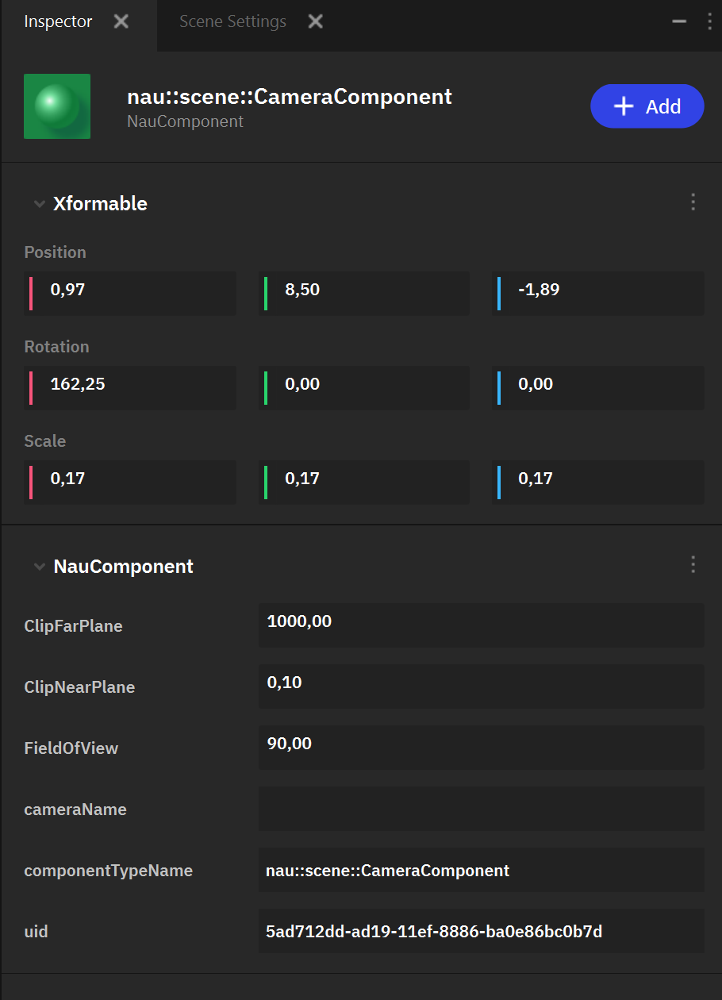
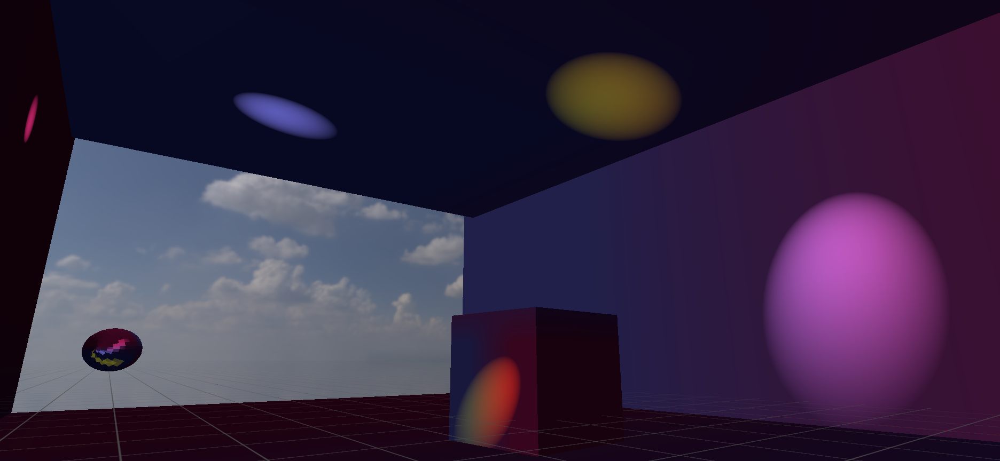
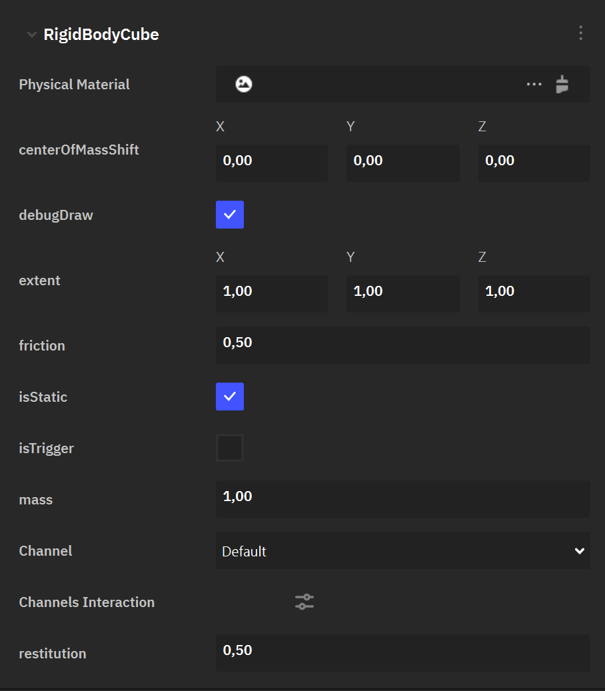
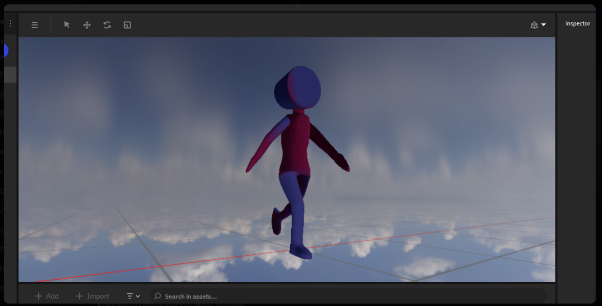
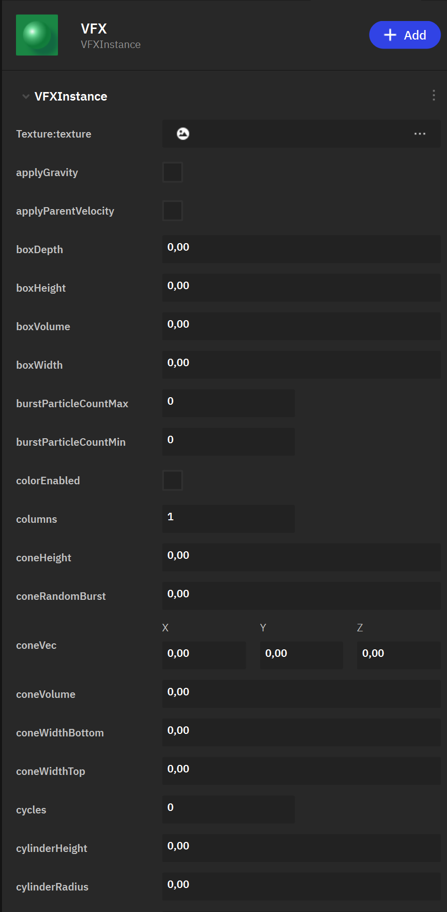
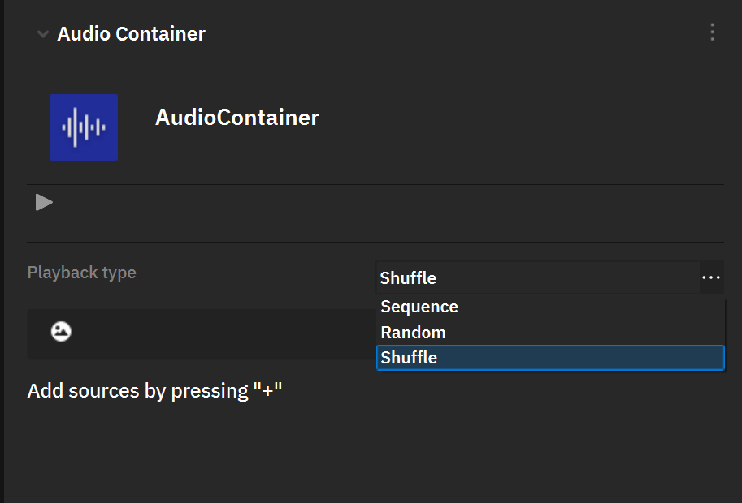

=============================
Быстрый старт
=============================
.. _walkthrough_nau:

Введение
--------------------------------------------------

Добро пожаловать в руководство по быстрому старту в Nau Engine Beta! В этом пошаговом руководстве мы создадим небольшой проект, демонстрирующий основные возможности движка в его текущей бета-версии. Вы узнаете, как создать новый проект, импортировать ассеты, работать со сценой, настраивать камеру и освещение, а также осуществлять сборку проекта.

      

Шаг 0: Установка
~~~~~~~~~~~~~~~~~~~~~~~~~~~~~~~~~~~~~~~~~~~~~~~~~~~~~~~~~~~~~~~~~~~~~~~~~~~~~~~~~~~~~~~~
Прежде всего необходимо установить редактор, скачанный из официального `GitHub репозитория <https://github.com/NauEngine/NauEditorPublic/releases/tag/0.10.0>`_. Выберите последнюю доступную версию и следуйте инструкциям по установке.

Обратите внимание на список дополнительных инструментов, указанных в `инструкции <https://nauengine.org/docs/beta/user-doc/introduction_to_nau/install_nau/install_nau_doc.html>`_.
Их установка необходима не только для создания игровой логики вашего проекта, но и для корректной работы движка.

----

Шаг 1: Cоздание нового проекта
~~~~~~~~~~~~~~~~~~~~~~~~~~~~~~~~~~~~~~~~~~~~~~~~~~~~~~~~~~~~~~~~~~~~~~~~~~~~~~~~~~~~~~~~

Первым делом создадим фундамент для нашей игры — новый проект в Nau Engine. Запустите движок, и перед вами откроется меню создания нового проекта и список уже созданных ранее проектов. 

Нажмите кнопку «New Project». Выберите папку на диске, в которой будет создан проект (например: ``C:\NauWS``). В появившемся окне введите название, например ``MyNauProject``.
Важно учитывать текущие ограничения:

- Используйте только латинские символы в названиях папок.

- Не размещайте проект на сетевых дисках или директориях облачных хранилищ.

- Убедитесь, что папка с таким же названием не существует в выбранной директории.

Нажмите «Create Project», после чего начнётся процесс создания всех файлов проекта. По завершении редактор откроется автоматически. Дождитесь окончания загрузки.

-----

Шаг 2: Импорт ресурсов
~~~~~~~~~~~~~~~~~~~~~~~~~~~~~~~~~~~~~~~~~~~~~~~~~~~~~~~~~~~~~~~~~~~~~~~~~~~~~~~~~~~~~~~~

Подробнее об :ref:`импорте ресурсов<importing_assets>`.

После загрузки редактора автоматически откроется сцена по умолчанию. Вы можете приступить к её настройке, однако прежде нужно импортировать необходимые игровые ресурсы.

Начать стоит с создания структуры из папок для организации ресурсов в проекте через окно Project browser. Важно помнить, что в текущей версии вы можете столкнуться с ограничениями на перемещение и удаление файлов.

Когда будете готовы перейти к процессу импорта, откройте в Project browser папку, в которой должен оказаться файл и нажмите кнопку "+ Import". Альтернативно можно кликнуть ПКМ по пустому месту в текущей папке окна "Project browser" и в выпавшем меню выбрать пункт "import asset".

Появится окно импорта файла. Обратите внимание, что исходный файл будет скопирован в текущее расположение, а также будет создан специальный ассет-файл.

Ниже затронем особенности импорта различных типов контента.

Модели
****************************
В текущей версии поддерживается только импорт USD. Подготовьте файл во внешней программе (Blender отлично подходит). Рекомендуется минимизировать количество объектов геометрии в контейнере. При подключении геометрии к объекту в списке доступных ассетов будут отображаться элементы USD-контейнера, а не весь контейнер целиком.

Текстуры
***********
Текстуры должны импортироваться отдельно от USD-контейнера. Поддерживаются форматы PNG, JPG, DDS.

Стандартный материал использует три текстуры: albedo, roughnessMetal и normalMap. Рекомендуется заранее назвать файлы так, чтобы из названия было понятно, какой тип текстуры вы выбираете и к какому объекту он относится. 

Материалы
***********

На данный момент материалы из контейнера не импортируются автоматически, необходимо создать ассет материала в формате Nau. Для этого нажмите кнопку «+ Add» в браузере проекта и выберите пункт «PBR Material».

Дважды кликните по созданному ассету. Откроется редактор материала (по умолчанию в блоке рядом с окном Inspector). Кликните на поля текстур в настройках материала и выберите импортированные ранее текстуры.

Материал готов и может быть назначен объекту.

Подробнее о :ref:`материалах<materials>`.

Аудио файлы
************
Звук импортируется тем же инструментом импорта («+ Import»). Обратите внимание на поддерживаемые форматы. В сцену звук может быть назначен после настройки аудиоконтейнера. Этот момент подробнее рассмотрим далее в статье.

-----

Шаг 3: Общие принципы наполнения сцены
~~~~~~~~~~~~~~~~~~~~~~~~~~~~~~~~~~~~~~~~~~~~~~~~~~~~~~~~~~~~~~~~~~~~~~~~~~~~~~~~~~~~~~~~

В основе сцены лежит система компонентов игровых объектов GOC. 
Чтобы создать новый объект в сцене, нужно нажать кнопку «+» в окне «Outliner» и выбрать один из базовых объектов.

Новые объекты создаются в качестве дочерних к текущему выбранному объекту. Если объект не выбран, то новый будет создан на верхнем уровне (в пространстве сцены).

Известные ограничения:
 - Перемещение объекта в рамках одного уровня иерархии отключено, вы можете вкладывать объекты в иерархии или перемещать их на верхний уровень.
 - Изменение положений источников света может некорректно отображаться в параметрах объекта. При изменении непосредственно положения, масштаба или вращения, может сбрасываться вращение объекта. В этом случае вы можете снять выделение и скорректировать вращение через гизмо.

XForm: Трансформации объектов
******************************

Некоторым объектам для корректной работы необходимо быть внутри иерархии родительского объекта типа XForm. Например, DirectionalLight изменяет направление лучей, только если источник находится внутри родительского XForm-объекта. А VFXInstance может существовать самостоятельно, но мы рекомендуем размещать его в иерархии другого объекта. 

Чтобы создать XForm, нажмите кнопку «+» в окне Outliner и выберите "XForm". После создания XForm вы можете добавить в него другие объекты (например, DirectionalLight) через то же меню «+», выбрав нужный тип объекта. XForm позволяет группировать объекты и управлять их трансформами как единым целым.

Добавление модели в сцену
***************************

Для создания объекта геометрии выберите пункт "Mesh". По умолчанию создается куб со стандартной текстурой. В инспекторе  для нового объекта можно переключить используемую геометрию и материал. После назначения объект должен сразу отобразиться в окне Viewport.

-----

Шаг 4: Камера
~~~~~~~~~~~~~~~~~~~~~~~~~~~~~~~~~~~~~~~~~~~~~~~~~~~~~~~~~~~~~~~~~~~~~~~~~~~~~~~~~~~~~~~~

Для создания камеры необходимо добавить CameraComponent через меню "+" в окне Outliner. Камера необходима для сборки проекта. Проверьте параметры добавленной камеры в Inspector. В параметре cameraName проверьте значение. Оно не должно быть пустым, если это так пропишите значение "main".

-----

Шаг 5: Освещение
~~~~~~~~~~~~~~~~~~~~~~~~~~~~~~~~~~~~~~~~~~~~~~~~~~~~~~~~~~~~~~~~~~~~~~~~~~~~~~~~~~~~~~~~

В текущей версии реализованы базовые источники света, такие как 
 - DirectionalLightComponent, т. е. направленный источник света, имитирующий, например, солнечный свет. Для изменения направления света, вложите "DirectionalLightComponent в объект "XForm".
 - OmnilightComponent, т.е. точечный (всенаправленного) источник света, излучающий свет во всех направлениях. 
 - SpotlightComponent, который может быть использован в качестве источника света в виде конуса, имитирующего, например, прожектор.
 

В текущей версии рекомендуется создавать источники света внутри родительского объекта Xform, который можно в последствии использовать и для перемещения света.

Подробнее об :ref:`освещении<lights_doc>`.

-----

Шаг 6: Физика
~~~~~~~~~~~~~~~~~~~~~~~~~~~~~~~~~~~~~~~~~~~~~~~~~~~~~~~~~~~~~~~~~~~~~~~~~~~~~~~~~~~~~~~~

Для добавления физики к объекту сцены необходимо добавить соответствующий компонент на уже созданный ранее объект. Для этого выберите существующий игровой объект в Outliner и в окне Inspector добавьте объекту один из компонентов физики (RigidBody...) через кнопку "+Add". Вы можете выбрать один из нескольких базовых типов коллайдеров и скорректировать их настройки через Inspector. 

Объекту требуется один компонент RigidBody с указанием формы коллайдера. После назначения компонента обратите внимание на настройки. 

По умолчанию для всех компонентов установлен параметр isStatic. Это означает, что объект существует в физическом мире, но сам по физическим законам не движется, а лишь является объектом, с которым сталкиваются динамические объекты. Объект становится динамическим после отключения параметра isStatic.

Проверить работу физики можно в PlayMode. Если всё настроено верно, динамические объекты сразу после старта начнут двигаться согласно законам физики игрового мира.

Подробнее о :ref:`системе физики<physics_doc>`.

-----

Шаг 7: Игровая логика
~~~~~~~~~~~~~~~~~~~~~~~~~~~~~~~~~~~~~~~~~~~~~~~~~~~~~~~~~~~~~~~~~~~~~~~~~~~~~~~~~~~~~~~~

Обратите внимание, что для разработки игровой логики необходимо наличие сторонних программных пакетов, таких как Python и vcpkg. 
Подробнее о требуемых приложениях читайте в `статье об установке движка <../../introduction_to_nau/install_nau/install_nau_doc.html>`_. 

В этом разделе мы создадим скриптовый компонент, с помощью которого пользователь сможет менять цвет и направление Directional light посредством зажатия клавиш мыши.

Создание скриптового компонента
********************************

1. В Visual Studio откройте ``.sln`` файл решения проекта.
2. Добавьте файлы ``MyComponent.h`` и ``MyComponent.cpp``. Для этого в Solution Explorer нажмите ПКМ на проект MainGameModule, 
   выберите Add → New Item. Не забудьте указать путь ``source\game\main_module``.
3. В файл ``MyComponent.h`` добавьте следующий код

   .. literalinclude:: MyComponent.h
      :language: cpp
      :class: larg
      :linenos:

   Необходимо также зарегистрировать класс MyComponent в движке. Для этого
   в файле ``source/game/main_module/module.cpp`` в тело метода ``initialize`` добавьте следующий код:

   .. code-block:: cpp
      :class: larg

      nau::getServiceProvider().addClass<MyComponent>();

   После этого компонент ``MyComponent`` станет доступным для добавления в редакторе.

4. В файл ``MyComponent.cpp`` добавьте следующий код

   .. literalinclude:: MyComponent.cpp
      :language: cpp
      :class: larg
      :linenos:

5. Перезапустите редактор для рекомпиляции скриптов.

   .. caution:: После внесения изменений в код скриптов не забывайте каждый раз перезагружать редактор для рекомпиляции скриптов.

6. Добавьте компонент ``MyComponent`` к объекту-родителю источника света.

7. Запустите PlayMode. Удерживая ПКМ/ЛКМ мы видим, что направление света, а также его цвет меняются.

Подробнее об :ref:`игровой логике<game_logic_doc>`.

-----

Шаг 8: Настройка управления
~~~~~~~~~~~~~~~~~~~~~~~~~~~~~~~~~~~~~~~~~~~~~~~~~~~~~~~~~~~~~~~~~~~~~~~~~~~~~~~~~~~~~~~~

Самый простой способ обработать пользовательский ввод - сделать это из скрипта, с помощью специальных функций из модуля Input.

* ``isKeyboardButtonPressed`` - проверяет, была ли в этом кадре нажата кнопка клавиатуры;
* ``isKeyboardButtonHold`` - проверяет, удерживается ли кнопка клавиатуры;
* ``isMouseButtonPressed`` - проверяет, были ли в этом кадре нажата клавиша мыши;
* ``isMouseButtonHold`` - проверяет, удерживается ли клавиша мыши;
* ``isMouseButtonReleased`` - проверяет, перестала ли в этом кадре удерживаться клавиша мыши;
* ``getMouseAxisValue`` - возвращает положение курсора по оси;
* ``getMouseAxisDelta`` - возвращает смещение курсора по оси относительно его положения в предыдущем кадре.

Вот пример использования инпута в скрипте:

.. code-block:: cpp
   :class: larg

    if (nau::input::isKeyboardButtonHold(0, nau::input::Key::D))
        m_direction = 1;        //Если зажата клавиша "D", персонаж двигается вправо.
    if (nau::input::isKeyboardButtonHold(0, nau::input::Key::A))
        m_direction = -1;       //Если зажата клавиша "D", персонаж двигается влево.
    if (nau::input::isKeyboardButtonPressed(0, nau::input::Key::CtrlL))
        m_isCrouching = true;   //Если нажата клавиша "Ctrl", персонаж приседает.
    if (nau::input::isMouseButtonPressed(0, nau::input::MouseKey::Button0))
        shoot();                //Если нажата ЛКМ, персонаж стреляет.

Подробнее о :ref:`настройке управления<input_doc>`.

-----

Шаг 9: Анимация
~~~~~~~~~~~~~~~~~~~~~~~~~~~~~~~~~~~~~~~~~~~~~~~~~~~~~~~~~~~~~~~~~~~~~~~~~~~~~~~~~~~~~~~~

Анимационная система Nau Engine в бета-версии предоставляет два основных способа создания анимации: анимация параметров и скелетная анимация.

* **Анимация параметров:**  редактор находится в нижней вкладке "Animation Editor" (Редактор анимаций). Он позволяет анимировать различные параметры объектов, такие как положение, поворот, масштаб, цвет и другие. Анимация параметров создается непосредственно в редакторе Nau Engine и хранится в файлах собственного формата.

* **Скелетная анимация:**  предназначена для анимации персонажей и других объектов, имеющих скелет. Скелетная анимация импортируется из внешних 3D-редакторов в формате USD. Вы можете просматривать импортированную скелетную анимацию в Nau Engine, но редактировать ее необходимо во внешнем редакторе.

**Примечание:** В бета-версии функциональность анимационной системы может быть ограничена. Не все возможности формата USD для скелетной анимации могут поддерживаться.

Подробнее об :ref:`анимации<animation>`.

----

Шаг 10: Система частиц
~~~~~~~~~~~~~~~~~~~~~~~~~~~~~~~~~~~~~~~~~~~~~~~~~~~~~~~~~~~~~~~~~~~~~~~~~~~~~~~~~~~~~~~~

Для создания объекта системы частиц необходимо добавить VFXInstance на сцену, выбрав его в меню добавления объекта ("+") в Outliner. По аналогии с источниками света, в текущей версии рекомендуется распологать этот объект внутри родительского объекта Xform.

Объекту сцены необходимы данные настроенного эффекта. Их можно создать в файлах проекта нажав кнопку "+Add" в Project Browser и выбрав пункт VFX. Будет создан новый ассет эффекта системы частиц. Эффект имеет большое количество параметров, настраивая которые можно скорректировать динамику и внешний вид эффекта в сцене.

Назначить настроенный эффект объекту сцены можно выделив его в Outliner и через Inspector в параметрах группы asset и поле asset, назначить подготовленный файл эффекта.

В текущей версии для частиц используется базовый материал, параметры которого изменяются в лишь в самом эффекте. Через редактор заменить материал частиц нельзя, однако вы можете назначить текстуру, выбрав её из импортированных файлов изображений.

Подробнее о :ref:`системе частиц<vfx_doc>`.

|

Шаг 11: Звук
~~~~~~~~~~~~~~~~~~~~~~~~~~~~~~~~~~~~~~~~~~~~~~~~~~~~~~~~~~~~~~~~~~~~~~~~~~~~~~~~~~~~~~~~

Для добавления звука в сцену необходимо создать объект Xform в сцене через Outliner. После этого выбрать объект в Inspector и добавить на него новый компонент AudioEmitter, нажав кнопку «+ Add».

Для воспроизведения звука в сцене также должен существовать объект AudioListener, который рекомендуется создавать вложенным в родительский объект типа Xform.

Импортированные файлы аудио должны быть добавлены в контейнер аудио. Создать контейнер можно через Project Browser, нажав кнопку «+ Add» и выбрав пункт Audio Container. Дважды кликните на созданный файл, чтобы открыть его настройки. Здесь вы можете добавить ранее импортированные файлы, а также настроить работу контейнера. 

После настройки контейнер может быть назначен объекту сцены в компоненте AudioEmitter. В этом же компоненте можно включить циклическое воспроизведение звука и автоматическое начало воспроизведения при старте сцены.

Подробнее об :ref:`аудио<audio_doc>`.

-----

Шаг 12: Игровой интерфейс
~~~~~~~~~~~~~~~~~~~~~~~~~~~~~~~~~~~~~~~~~~~~~~~~~~~~~~~~~~~~~~~~~~~~~~~~~~~~~~~~~~~~~~~~

Система игрового интерфейса (GUI) существует вне трёхмерной сцены. Иерархия элементов интерфейса работает в отдельном режиме Outliner, а также отображается поверх сцены в Viewport.

Интерфейс может быть создан полностью через код, но удобнее делать это в конструкторе. 

Создайте новый ассет, нажав кнопку «+ Add» в Project Browser и выбрав пункт UI-ассет. Дважды кликните по файлу, после чего Outliner переключится в режим работы с интерфейсом. Вы можете добавлять элементы через Outliner, настраивать иерархию и параметры каждого элемента. Для текстур можно использовать импортированные изображения.

.. figure:: img/ui_editor.png
      :figwidth: 80%

Чтобы отобразить созданный вами UI-ассет на 3D-сцене, необходимо добавить компонент ``nau::ui::UiComponent`` к любому игровому объекту. Для этого выделите нужный объект в сцене, откройте окно Инспектора (Inspector) и нажмите кнопку «+ Добавить». В появившемся списке выберите ``nau::ui::UiComponent``.

В параметре ``uiAssetName`` укажите имя вашего UI-ассета, который вы ранее создали в браузере проекта. Компонент ``nau::ui::UiComponent`` также позволяет настроить размер холста UI, чтобы он соответствовал требованиям вашего проекта. Вы можете изменить ширину и высоту холста в соответствующих параметрах компонента.

Интерфейс не состоит из игровых объектов, а его элементы не могут иметь пользовательских компонентов. Для управления и взаимодействия с интерфейсом необходимо обратиться к нему через пользовательский компонент игровой логики.

Подробнее о :ref:`GUI<gui>`.

-----

Шаг 13: Тестирование
~~~~~~~~~~~~~~~~~~~~~~~~~~~~~~~~~~~~~~~~~~~~~~~~~~~~~~~~~~~~~~~~~~~~~~~~~~~~~~~~~~~~~~~~

После того, как вы завершили разработку основных механик игры, необходимо тщательно протестировать проект. Запустите игру в режиме "Playmode" (кнопка воспроизведения |playmode| на главной панели инструментов). При необходимости Используйте инструменты отладки Nau Engine "Debug Tools" (консоль), чтобы выявить и исправить ошибки.

Подробнее о :ref:`тестировании<testing_doc>`.

-----

Шаг 14: Сборка игры
~~~~~~~~~~~~~~~~~~~~~~~~~~~~~~~~~~~~~~~~~~~~~~~~~~~~~~~~~~~~~~~~~~~~~~~~~~~~~~~~~~~~~~~~

Для сборки откройте «Build Editor», нажав кнопку |build| в верхней части редактора рядом с кнопкой запуска Play Mode. Укажите параметры и запустите процесс сборки. В текущей версии рекомендуется оставить основные параметры по умолчанию.

В параметре «Build Directory» указана директория, куда будет собрано приложение. Нажав на кнопку изменения пути сборки (выглядит как копия пути справа), вы можете выбрать изменить другую директорию. 

Обратите внимание, что для корректной сборки в сцене должен присутствовать игровой объект с компонентом камеры. Создать камеру можно с помощью меню добавления нового объекта в окне Outliner.

После завершения вы получите готовый исполняемый файл игры, который можно запустить на любом компьютере с установленной операционной системой Windows. В данной версии движка реализована работа DirectX 12, что ведёт к ограничению поддерживаемых версий Windows, начиная с Windows 10 и выше.

Подробнее о :ref:`сборке проекта<building_from_source>`.

----

В этом руководстве мы рассмотрели основные этапы создания простого проекта в Nau Engine Beta. Вы научились создавать новый проект, импортировать ассеты, работать со сценой, освещением, анимацией и другими компонентами движка. Вы также узнали, как тестировать и отлаживать ваш проект. Это руководство — лишь отправная точка для изучения возможностей Nau Engine. Мы рекомендуем вам ознакомиться с полной документацией и экспериментировать с различными функциями движка. Следите за обновлениями и присоединяйтесь к нашему сообществу, чтобы быть в курсе последних новостей и делиться своим опытом!

