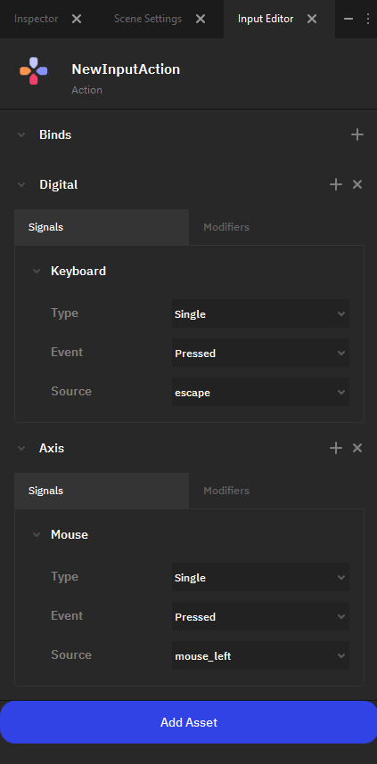
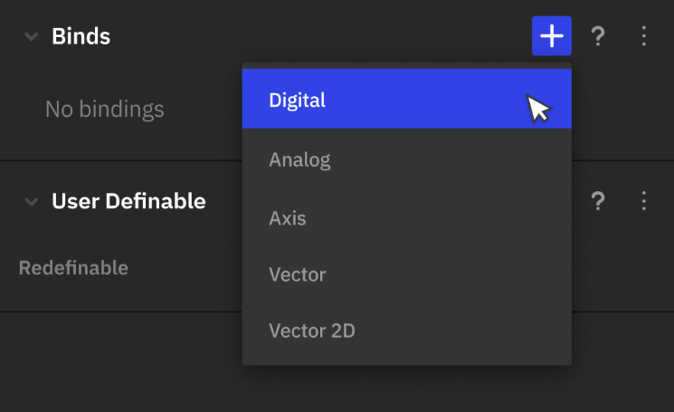
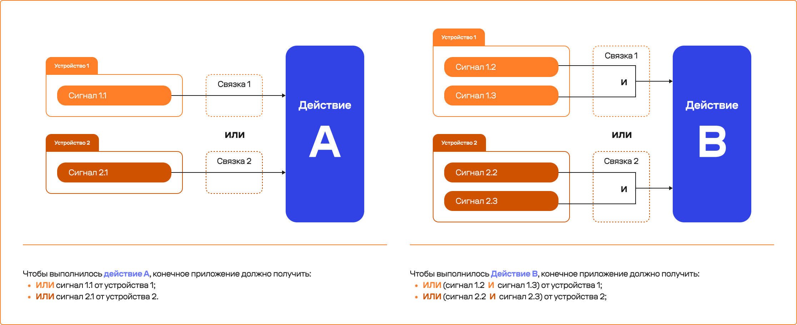
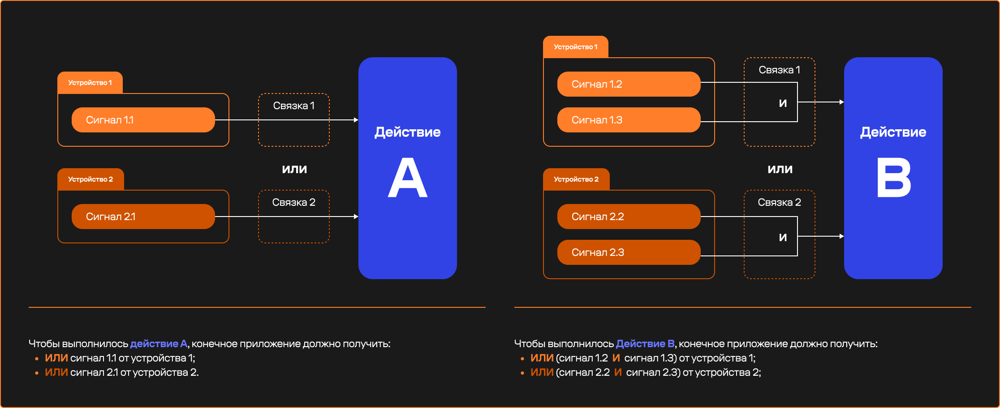
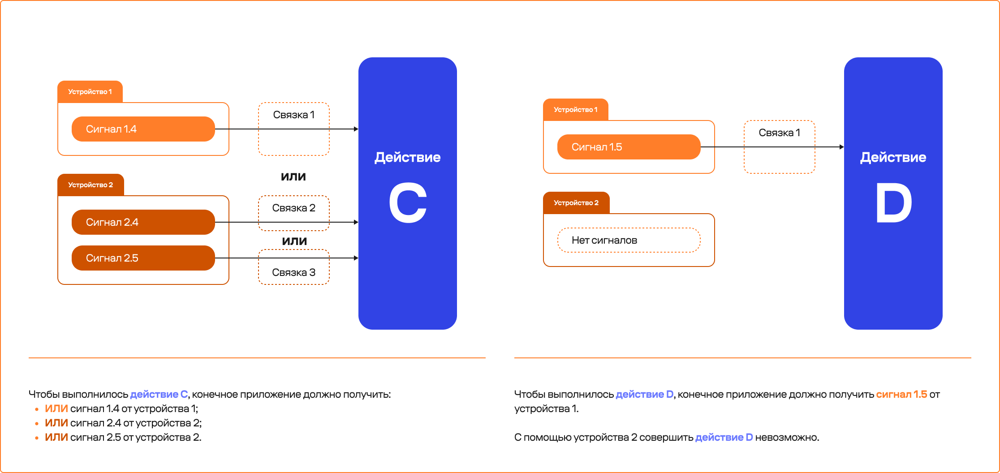
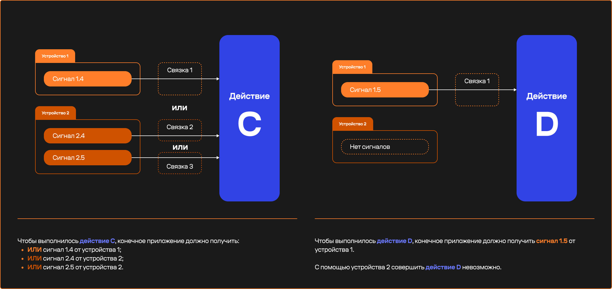
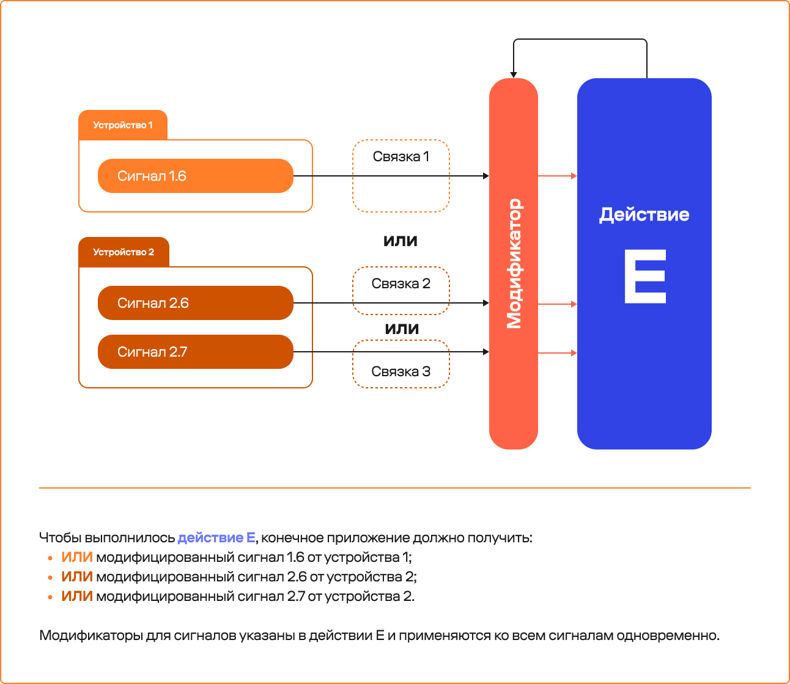
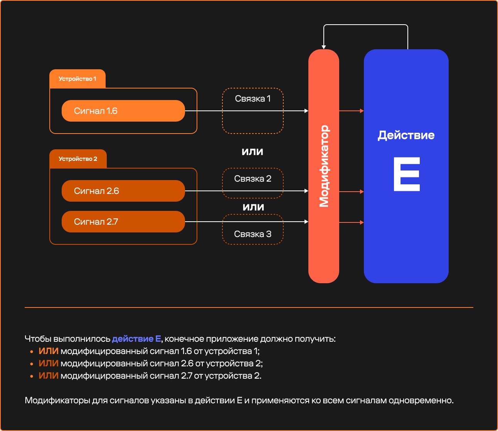
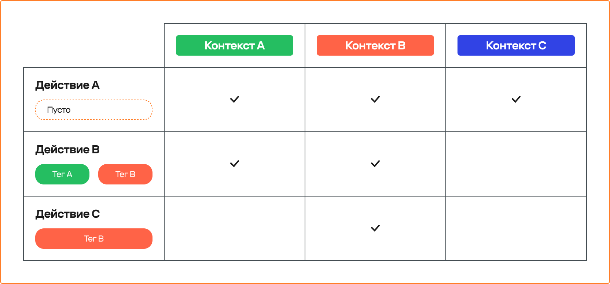
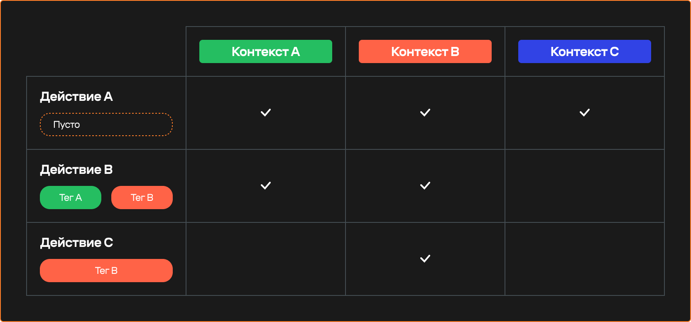

Сигналы и управление
====================
.. _input_doc:

Вы можете использовать для работы базовый API (:api:`Input/index.html <Input>`), но также в редакторе присутвует гибкий инструмент создания настраиваемых ассетов, описывающих действия и позволяющих упростить переключение между контекстами игрового процесса.

Настройка управления происходит через создание файлов действий ассоциированных с одним или несколькими сигналами внешних контроллеров через связки разных типов. Например, действие “перемещение” можно осуществлять при помощи кликов мыши или стрелок клавиатуры.
Для того, чтобы действие считывалось в проекте, его нужно добавить в Настройки проекта 

**Для каждого сигнала можно настроить:**

 * способ его обработки в рамках действия,
 * применяемые преобразования.

Чтобы добавить действие на сцену, нужно указать его в менеджере действий.

Создание действия
-----------------

Действие можно создать в любой папке проекта. Для этого нужно выбрать пункт **“input action”** в выпадающем меню, которое появляется:

* по нажатии кнопки “+Add”, 
* при нажатии ПКМ на пространство в браузере проекта.

По умолчанию все созданные действия работают на всех сценах проекта, изменить это можно путём настройки контекстов.
 
**Настройка действия (Actions)**

Для настройки действия нужно выбрать ранее созданный файл в браузере проекта. После этого его свойства будут доступны для редактирования в инспекторе.

Для каждого действия можно настроить:

* сигналы и способы их передачи в виде связок,
* модификаторы, изменяющие сигнал,
* контексты, определяющие когда будет активно действие. 

Связки (Binds)
--------------

Список связок позволяет задать, как и какие сигналы будут приниматься программой для активации действия. 

Все связки обрабатываются как “ИЛИ”

|

**Возможные типы связок:**

 .. tab-set:: 

    .. tab-item:: Digital

        * передаёт bool
        * принимает 1 сигнал

    .. tab-item:: Analog

         * передаёт float
         * принимает 1 сигнал

    .. tab-item:: Axis

         * передаёт float
         * принимает 2 сигнала (позитивный / негативный)

    .. tab-item:: Vector

         * передаёт vector
         * принимает 6 сигналов (X-позитивный/X-негативный/Y-позитивный/Y-негативный/Z-позитивный/Z-негативный)

    .. tab-item:: Vector 2D

         * передаёт vector 2D
         * принимает 4 сигнала (X-позитивный/X-негативный/Y-позитивный/Y-негативный)
         

Рассмотрим для примера несколько схем связывания сигналов управления с действиями в игре:

.. note:: В случае, если вам необходимо создать действие, активируемое при нажатии трёх или более клавиш, сделать это можно через модификатор.

Сигнал и его срабатывание (Signals) 
-----------------------------------

Связка может воспринимать один или несколько сигналов в зависимости от её типа. Каждый сигнал можно задать, выбрав его в списке, или введя напрямую с устройства при активном меню выбора.

.. note:: Сейчас редактор поддерживает сигналы следующих устройств: мышь, клавиатура

**Тип срабатывания** отвечает за указание на то, в какой момент сигнал считается сработавшим и передаётся в действие. Поддерживаются следующие варианты для типов срабатывания:

 * **Single Press** – сигнал начал поступать.  
 * **Single Release** – сигнал поступал, а потом перестал поступать.
 * **Long Press** – сигнал непрерывно поступает N секунд и продолжает поступать (время N указывается в настройке).
 * **Long Release** – сигнал непрерывно поступал N секунд и перестал поступать (время N указывается в настройке).
 * **Multiple press** – один и тот же сигнал был получен M раз подряд (в настройке указывается M как количество и время N как интервалы между сигналами).
 * **Multiple Release** – один и тот же сигнал был получен M раз подряд (в настройке указывается M как количество и время N как интервалы между сигналами) и перестал поступать.

Модификаторы (Modifiers)
------------------------

Для каждого сигнала доступны модификаторы, которые изменяют его до поступление в действие. 
В редакторе присутствуют следующие модификаторы:

 * **Invert** – инвертирует данные сигнала.
 * **Scale** – умножает данные от сигнала на заданное значение. В настройках задаётся множитель.
 * **Button modifier** – добавляет дополнительный сигнал, который связка должна получить наравне, чтобы считаться сработавшей. В настройках задаётся добавляемый сингал.
 * **Dead zone** – в настройках указывается минимальное и максимальное значение для сигнала.
 * **Clamp** – в настройках указывается минимальное и максимальное значение к которому нужно привести сигнал.
 * **Normalization** – нормализует поступающий сигнал.
 * **Nonlin** – задаёт ускорение, передаваемое в зависимости от отклонения стика.

**В настройках отображается:**

* выпадающее поле с выбором пресета способа обработки сигнала ("стандартный", "линейный", "динамический" или "пользовательский"),
* график, на котором способ обработки сигнала отображаются в виде кривых (X – сырой сигнал, а Y – обработанный).

График нарисован при помощи кривых, разработчик может их редактировать (по аналогии с инструментом "перо"), меняя этим способ обработки сигнала.

Контексты (State tags)
----------------------

Контексты представлены в виде тегов, позволяющих группировать действия между собой и регулировать, когда они будут активны.

Добавить тег контекста можно в соответствующей панели, выбрав из уже существующих или создав новый.

Контекст существует пока существует хотя бы одно действие с его тегом. Записи в списке тегов контекстов обрабатывается по принципу “ИЛИ”.

Если у действия нет ни одного тега контекста, его можно совершить всегда.

.. note:: Чтобы действие заработало на сцене, необходимо также добавить в менеджер управления [ak].

