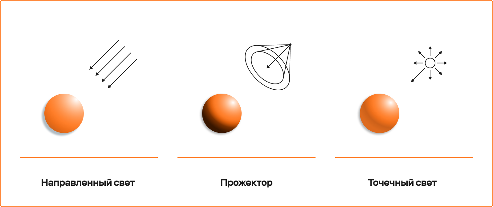
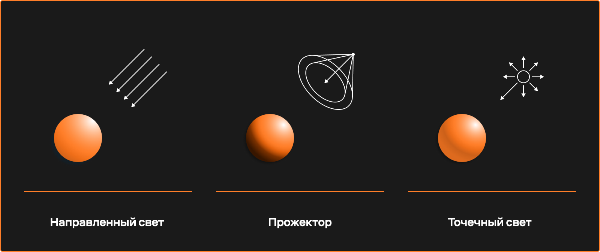
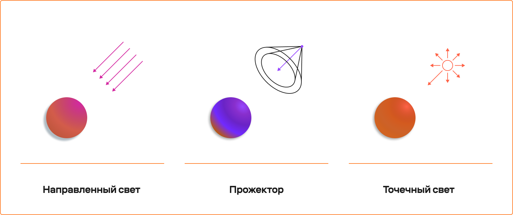
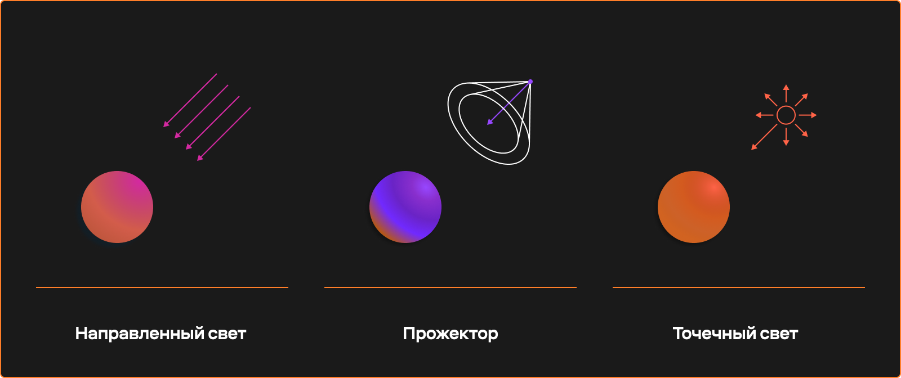
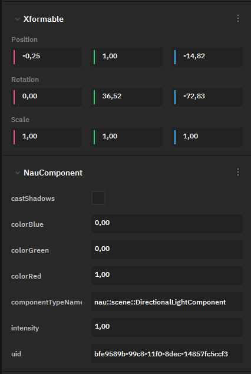
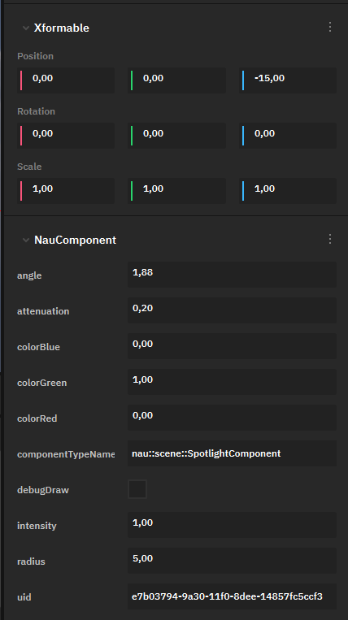
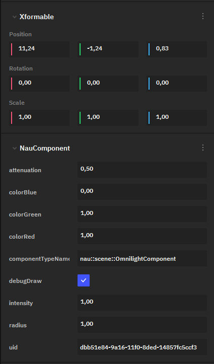
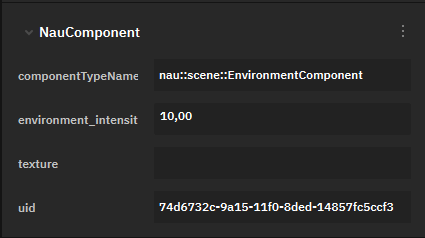

Освещение
=========
.. _lights_doc:

Общая информация
----------------

При расчёте освещения на сцене учитываются объекты, имеющие один или несколько компонентов, связанных со светом.

В проекте имеются следующие типы компонентов:

* **Направленный свет (Directional Light)** имитирует бесконечно далёкий источник света с параллельными лучами, идущими по всей области применения. Свет, испускаемый параллельными лучами в одном направлении, не имеет точки эмиссии в пространстве.
* **Прожектор (Spotlight)** – проецируемый источник света. Направленный из точки свет, формирующий пятно.
* **Точечный свет(Omnilight)** - всенаправленный источник света с отбрасыванием теней и уменьшением интенсивности при увеличении дистанции.

Для удобства отображения на сцене объекты освещения отмечены гизмо.

.. note:: Каждому компоненту соответствуют стандартные файлы с соответвующими именами. 
   
.. figure:: img/light_case.png
   :figwidth: 100%

   Пример работы со светов в редакторе

Параметры освещения
-------------------
Все объекты освещения в сцене имеют как общие настройки (цвет и трансформация), так и дополнительные, зависящие от типа (радиус для точечного света, дальность и угол для прожектора).

Аспекты положения, вращения и масштаба для разных источников обрабатываются по-разному.

.. list-table::
   :header-rows: 1
   :stub-columns: 1

   * - 
     - Положение
     - Вращение
     - Масштаб
   * - Направленный свет
     - влияет только на положение гизмо
     - влияет на угол падения лучей
     - не влияет
   * - Точечный свет
     - влияет на точку, из которой исходит свет
     - влияет на угол проекции
     - не влияет
   * - Прожектор
     - влияет на точку, из которой исходит свет
     - влияет на направление прожектора
     - не влияет (размер луча определяется дальностью)
   

   Цвет зависит от цвета источника

Направленный свет
-----------------

   
Как уже было сказано, направленный свет не имеет точки эмиссии и имитирует бесконечно дальний источник света, от которого исходят параллельные, не затухающие лучи, поэтому из всех его параметров **XFormable** реальную роль играет только **Rotation**, определяющий угол падения света.

* **castShadows** определяет, отбрасывает ли тени источник света.
* **colorBlue, colorGreen, colorRed** задают его цвет с помощью RGB-модели.
* **intensity** определяет яркость освещения.

Направленный свет хорошо использовать для создания общего настроения во всей сцене. Например, он используется для симуляции солнца.

.. raw:: html

   

Прожектор
---------

   
Значимыми параметрами **XFormable** являются **Position** и **Rotation**.
   
* **angle** определяет угол прожектора в радианах.
* **attenuation** определяет, как быстро затухает свет при удалении от эмиттера.
* **colorBlue, colorGreen, colorRed** задают цвет освещения с помощью RGB-модели.
* **debugDraw** - флаг, указывающий, отрисовывать ли отладочную форму прожектора во **Viewport**.
* **intensity** определяет яркость освещения.
* **radius** задаёт радиус проекции света.

Прожектор используется, когда нужен сфокусированный источник света или подсветка одного объекта.

.. raw:: html

   

Точечный свет
-------------

**Omnilight** используется для симуляции локальных источников света, направленных во все стороны (например, лампочки).

Его значимыми параметрами **XFormable** также являются **Position** и **Rotation**.

* **attenuation** определяет, как быстро затухает свет при удалении от эмиттера.
* **colorBlue, colorGreen, colorRed** задают цвет освещения с помощью RGB-модели.
* **debugDraw** - флаг, указывающий, отрисовывать ли отладочную форму прожектора во **Viewport**.
* **intensity** определяет яркость освещения.
* **radius** задаёт радиус сферы, по которой распределяется свет.

.. raw:: html

   

Enviroment Component
--------------------

Говоря об освещении, отдельно стоит упомянуть **Enviroment Component**. В нём учитывается, как распределяется по сцене свет от окружения (например, неба).

В настройках **Enviroment Component** можно указать текстуру окружения. 

**enviroment_intensity** определяет, насколько интенсивен свет от окружения и насколько сильно он смешивается с остальными источниками света (так, при слабом **enviroment_intensity** остальные источники света будут казаться более интенсивными).