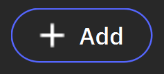
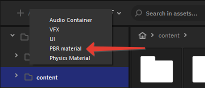
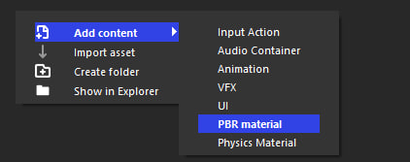
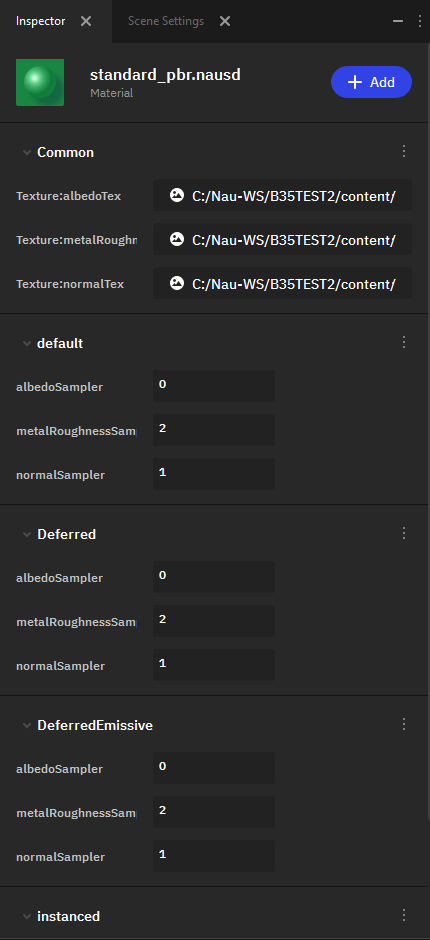
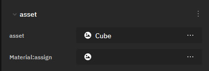
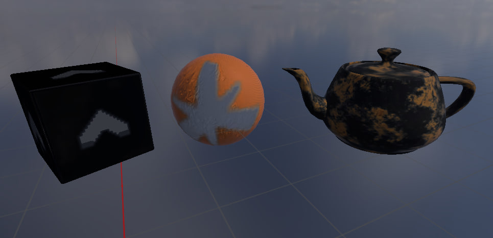

Материалы
=========

.. _materials:

**Материалы** - это набор свойств, определяющих внешний вид объекта в 3D-сцене. Они могут включать в себя цвет, текстуру, отражение, прозрачность и другие параметры.
  
С помощью **редактора материалов** (Material Editor) вы можете создавать материалы с различными эффектами.

Стандартный шейдер Nau Engine основан на принципе PBR (Physically Based Rendering), который направлен на максимально точное воспроизведение оптических свойств материала с учётом физических законов. Для корректной работы шейдера необходимо настроить ряд предварительно подготовленных текстур, таких как цветность, металличность и карта нормалей.

Создание материала
------------------

Чтобы создать новый материал, вы можете нажать на кнопку |material_add| на панели инструментов браузера и выпавшем меню вбрать "Создать материал".

Аналогично, можно нажать правой кнопкой мыши в **Project Browser**, после чего в выпадающем меню выбрать **Add content -> PBR Material**.

 
Будет предложено выбрать имя нового материала, выбрать шаблон и подтвердить создание. Впоследствии имя материала можно будет изменить, нажав по материалу правой кнопкой мыши и выбрав **Rename**.
 
Чтобы отредактировать существующий материал, вы можете дважды щелкнуть по нему в браузере ассетов. Параметры материала появятся в окне Инспектора.
  
Настройка материала в редакторе 
-------------------------------

Окно редактора состоит из пяти блоков: **Common**, **Default**, **Deferred**, **Deferred Emissive** и **Instanced**.
  
В **Common** из ресурсов проекта выбираются текстуры материала.

* **Texture:albedoTex** — определяет базовый цвет материала, без бликов и теней.
* **Texture:metalRoughnessAoTex** — определяет, как материал отражает свет.
* **Texture:normalTex** — определяет рельефность материала.

Дальше следуют четыре похожих по структуре блока **Default**, **Deferred**, **deferredEmissive** и **Instanced**. Каждый из них отвечает за настройку соответствующей техники рендеринга:

* **Default** — прямой рендеринг.
* **Deferred** — отложенный рендеринг.
* **deferredEmissive** — отложенный рендеринг для светящихся (emissive) материалов.
* **Instanced** — рендеринг одинаковых объектов — инстансов.

В каждом блоке содержатся поля:

* **albedoSampler**, **metalRoughnessSampler**, **normalSampler** — сэмплеры, определяющие, как считываются данные из текстур albedo, roughness и normal.
* **isScissorsEnabled** — флаг, указывающий, отсекаются ли объекты за пределами заданной области (Viewport).

**Предварительный просмотр.** Все изменения параметров материала сразу отображаются на объектах в окне Обозревателя (Viewport). 

Использование материалов
------------------------

Чтобы применить материал к мешу, необходимо выбрать нужный меш слева, в иерархическом окне структур (**Outliner**) или в окне просмотра (**Viewport**). После этого появится возможность редактировать его в **Inspector**. Затем нужно выбрать **asset -> Material:assign** и указать желаемый материал.

Материал тут же отобразится на объекте в Viewport.

  
Общие рекомендации
------------------------------------

Nau Engine способен работать с множеством объектов и разнообразных материалов. Однако есть несколько советов, которые помогут улучшить качество изображения и производительность:

Организуйте ресурсы. Подготовьте необходимый набор текстур. Для удобства поиска объедините текстуры одной группы общим названием. Если у материала есть вариации, добавьте уточнение или индекс (например, shihy_plastic_00).

Для отдельных текстур из группы можно использовать дополнительный постфикс, который будет обозначать их назначение в материале (например, «_m» для металичности и «_n» для карты нормалей). Это поможет легко определить, какой файл нужно назначить в то или иное поле, и избежать ошибок.

Качество изображения зависит от детализации текстур, но не стоит делать разрешение избыточным. Кроме снижения разрешения, это может привести к ухудшению вида объекта, особенно если детализация прочих текстур существенно отличается. Стилизация может быть важнее детализации.

Многократное использование данных без создания копии в памяти улучшит производительность. Несколько материалов вполне могут использовать одинаковые текстуры и отличаться только дополнительными параметрами.

В процессе создания текстур важно обеспечить сохранность исходных материалов в архивах. Даже если объект кажется полностью готовым, вы можете захотеть вернуться к нему в будущем. Кроме того, при создании новых версий может потребоваться повторный импорт данных для оптимизации и улучшения качества. 