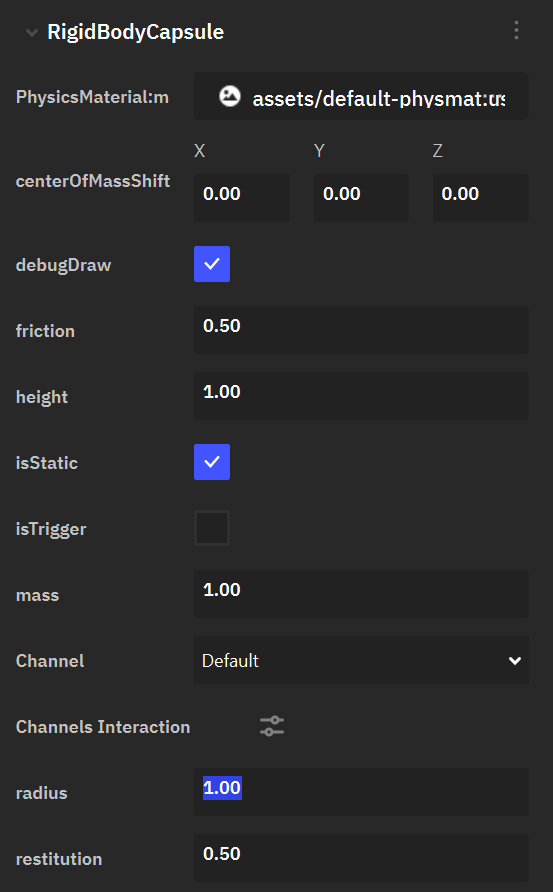
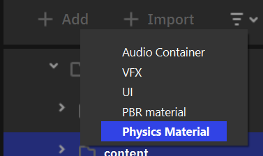
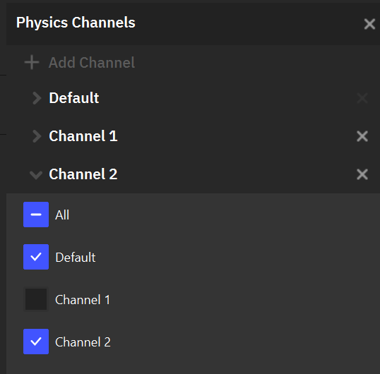

Система физики
================

.. _physics_doc:

Общее описание
------------------

Nau Engine использует высокопроизводительный физический движок 
**Jolt Physics**, предоставляющий широкие возможности для симуляции 
реалистичной физики в играх. В этой статье будут подробно рассмотрены 
основные возможности системы физики Nau Engine, такие как создание компонента твердого тела, его настройка, 
создание и работа с физическими материалами, слоями коллизий, триггерами, а также механизм рейкаста.
Данная статья предполагает, что пользователь уже знаком с :ref:`базовым функционалом редактора движка<basic_editor>`, 
а также имеет представление
о компонентах :ref:`игровой логики<game_logic_doc>` и работе с ними. 

Создание и настройка компонента твердого тела
----------------------------------------------

Для того, чтобы объект стал частью физической симуляции, т.е. перемещался под действием сил, импульсов, а также реагировал на столкновения, необходимо 
добавить к нему компонент твердого тела (**Rigid Body**). Для этого нужно нажать на |add| и выбрать компонент твёрдого тела с желаемой формой коллизии (**Collision Shapes**):

* **RigidBodyCube:** куб
* **RigidBodySphere:** сфера
* **RigidBodyCapsule:** капсула
* **RigidBodyCylinder:** цилиндр
* **RigidBodyMesh:** меш
* **RigidBodyConvexHull:** выпуклая оболочка

Пользователь должен выбрать тип компонента, исходя из игровых нужд. В зависимости от выбора, опции настроек геометрии будут изменяться, например, для примитивных форм 
(куб, сфера, капсула и цилиндр) вы можете задать геометрические параметры напрямую. Для сложных форм (меш, выпуклая оболочка) вы можете выбрать соответствующий ассет. Однако остальная часть
настроек является единой для всех компонентов твердых тел. Рассмотрим эти настройки.

1. Физический материал (**Physics Material**) определяет поведение тела при столкновении. Подробнее о физических материалах :ref:`ниже <phys_mat>`.
2. Центр масс (**centerOfMassShift**) определяет положение центра масс объекта в локальных координатах.
3. Отладочная отрисовка (**debugDraw**) определяет нужно ли отрисовывать форму коллизии тела в редакторе.
4. Коэффициент трения (**friction**) определяет сопротивление тела "волочению" по другой поверхности.
5. Тип подвижности (**isStatic**) определяет круг физических воздействий, которые могут оказать влияние на тело. 

   * Статичные (**static**) тела не могут быть сдвинуты под действием сил в рамках физической симуляции. Используйте этот тип для неподвижных элементов окружения,
     таких как здания и почва. Тела данного типа наиболее просты для расчета в симуляции и, следовательно, их использование наиболее оптимально по производительности.
   * Динамичные (**dynamic**) тела могут быть сдвинуты силой или импульсом. Эти воздействия могут быть приложены "искусственно" пользователем из скрипта, а также в следствие столкновения 
     с другим физическим объектом.

6. Масса (**mass**) отражает, насколько тяжелый объект и как легко он сдвигается с места при взаимодействии с другими объектами.

   * Для создания кинематического объекта, задайте ему массу, равную 0. Кинематические (**kinematic**) тела не могут быть сдвинуты приложенной силой или импульсом. 
     Однако, пользователь может задать их скорость из скриптов. Используйте этот тип для физических объектов с заранее заданной траекторией и скоростью перемещения, 
     например подвижных платформ.

7. Канал коллизий (**Channel**) определяет множество других физических объектов, с которыми данное тело может контактировать. Подробнее о каналах коллизии :ref:`ниже <col_channels>` .
8. Коэффициент упругости (**restitution**) определяет "силу отскока", "прыгучесть" объекта при столкновении.

.. note:: Обратите внимание, что, если изменить значения коэффицентов трения и упругости тела в Инспекторе после прикрепления к телу физического материала, то актуальными будут считаться измененные значения.

.. _phys_mat:

Физический материал
--------------------

Физический материал в текущей реализации включает в себя два параметра: коэффицент трения (**friction**)) и коэффициент упругости (**restitution**). 
Их роль в физической симуляции была раскрыта выше. 

|

Для создания физического материала в Браузере Проекта нажмите "Создать" и в списке выберите "Физический материал".
В результате вы получите новый ассет физического материала. Дважды кликните на него и в правой части интерфейса редактора вы увидите окно редактирования физического материала.

.. _triggers:

.. _col_channels:

Каналы коллизий
----------------

Пользователь может группировать физические тела и разрешать/запрещать контакты между целыми группами. 
Такая группа тел, характеризуемая (не)возможностью контактов с каждой другой такой группой называется Каналом коллизии (**Collision channel**).

|

В меню Взаимодействия каналов (**Channels Interaction**) можно перейти из параметров компонента твердого тела в инспекторе. Далее описаны возможности, доступные из данного меню:

* Добавление нового канала происходит путем нажатия на кнопку |add_channel|.
* Переименование канала происходит путем двойного нажатия на его текущее название.
* Изменение множества других каналов, тела в которых могут столкнуться с телами данного канала, происходит путем выбора в выпадающем списке (см. картинку ниже).

Приложение воздействия к телу
------------------------------

Пользователь может прикладывать к телу силы, импульсы, а также скорость (для кинематических тел) с помощью пользовательских скриптов. 
В этом помогут функции addForce и addImpulse. Кроме того, скрипты позволяют в runtime изменять и другие параметры твердого тела. Для более подробного изучения 
функционала системы физики обратитесь к описанию :api:`Physics/Components/classes.html <RigidBodyComponent>`.

Дополнительно
---------------------

Для расширения возможностей системы физики движка пользователь может обратиться к модулям :api:`Physics/index.html <Physics>`, :api:`PhysicsJolt/index.html <PhysicsJolt>`. 
Для этого понадобится :ref:`собрать проект движка из файлов исходного кода<building_from_source>`.
Документация и примеры Jolt Physics доступны на 
`GitHub <https://github.com/jrouwe/JoltPhysics>`_.