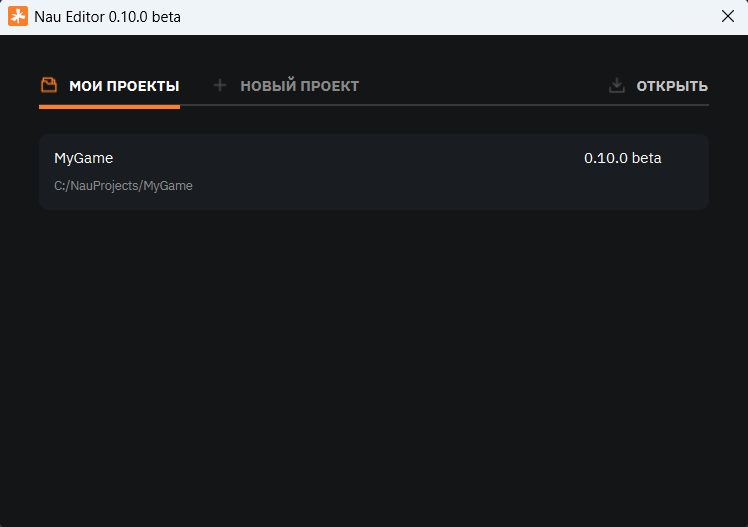
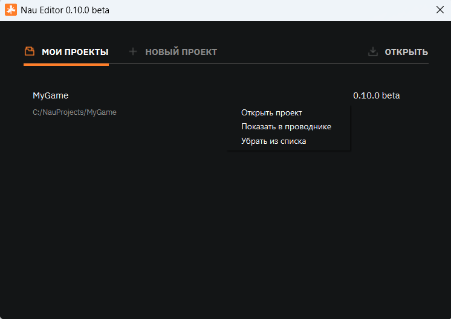
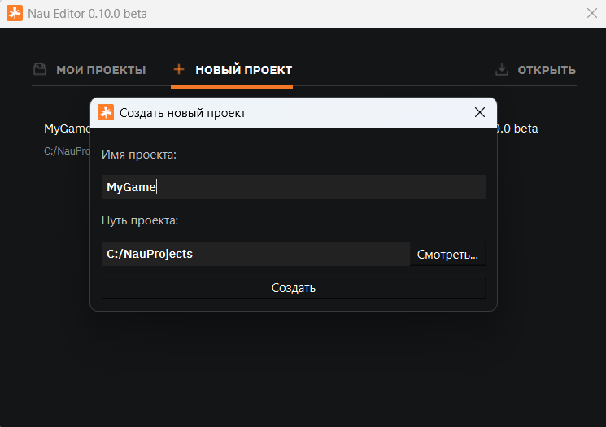
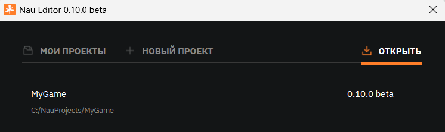

Управление проектами
====================

Перед тем как начать работу с Nau Engine, вам необходимо создать проект. 
**Окно управления проектами** — это отправная точка для создания, открытия и управления вашими проектами. 
Здесь вы можете быстро создать новый проект, открыть существующий или получить доступ 
к недавно использованным проектам. В данной статье мы подробно рассмотрим 
функциональность окна управления проектами и основные операции, которые можно в нем выполнять.

Окно управления проектами
-------------------------

При запуске Nau Engine (через ярлык NAU Editor) открывается окно управления проектами. В этом окне отображается список недавно открывавшихся проектов на вашем компьютере. Этот список позволяет быстро вернуться к работе над проектами, с которыми вы взаимодействовали ранее.

   Окно управления проектами

.. note:: Список последних проектов сохраняется в реестре по следующему пути: ``Computer/HKEY_CURRENT_USER/Software/N-GINN/Nau Editor/Editor в ключе RecentProjects``.

Каждый проект в списке представлен отдельной карточкой, содержащей имя проекта, его расположение и версию редактора. 

Кликая ПКМ по карте проекта, откроется меню дополнительных действий:

   * *Показать в папке:* открывает папку проекта в проводнике вашей операционной системы. Это может быть полезно, если вам нужно работать с файлами проекта напрямую.

   * *Удалить из списка:* удаляет проект из списка последних проектов в окне управления. **Важно:** это действие не удаляет файлы проекта с вашего компьютера.

   * *Удалить с устройства:* полностью удаляет проект и все его файлы с вашего компьютера. Будьте осторожны при использовании этой функции!

Чтобы открыть проект, просто щелкните по его карточке. Окно управления проектами закроется, и проект откроется в редакторе Nau Engine.

.. note:: Название проекта можно поменять в настройках

Создать проект с нуля
++++++++++++++++++++++

Нажмите кнопку **«Создать новый»** в окне управления проектами. Откроется диалоговое окно, где вам потребуется указать следующую информацию:

* *Имя проекта:* введите имя вашего проекта, используя латинские буквы, цифры и некоторые специальные символы (подчеркивание). Длина имени проекта ограничена, не более 16 символов.

* *Местоположение:* укажите папку на вашем компьютере, где будут храниться файлы проекта. Рекомендуется создать отдельную папку для каждого проекта, чтобы поддерживать порядок на вашем компьютере. Вы можете использовать кнопку "Обзор", чтобы выбрать нужную папку.

После того как вы заполнили все необходимые поля, нажмите кнопку **«Создать»**. 
Nau Engine создаст новую директорию в указанном месте и сгенерирует базовые файлы 
проекта на основе пустого шаблона, включая файл проекта ``.nauproject``, 
папку с ассетами и начальную сцену. После создания проекта, 
редактор Nau Engine запустится автоматически, и вы сможете начать работу над вашим проектом.

Добавление существующего проекта
++++++++++++++++++++++++++++++++++++++++

Чтобы открыть существующий проект Nau Engine, нажмите кнопку **«Загрузить»** 
в окне управления проектами. Откроется диалоговое окно выбора файла.

 
Перейдите в директорию, где хранятся файлы вашего проекта, 
и выберите файл с расширением ``.nauproject``. После выбора файла проект 
будет добавлен в список последних проектов и автоматически открыт в редакторе.