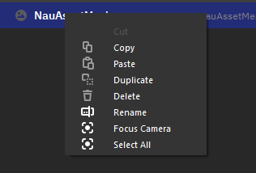
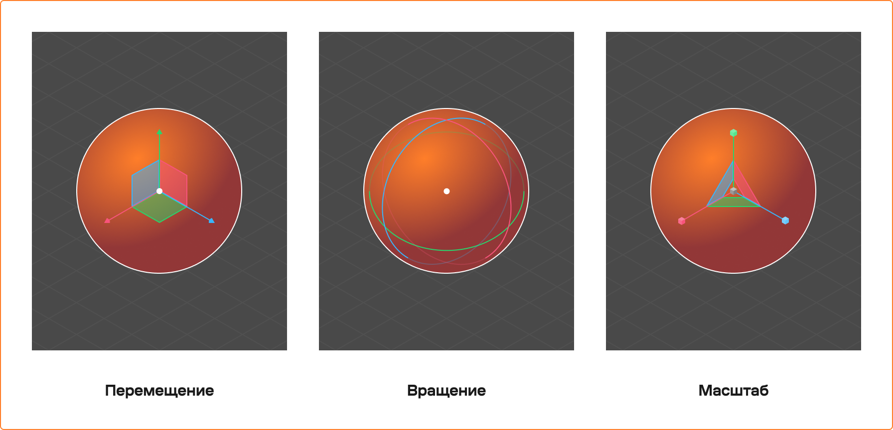
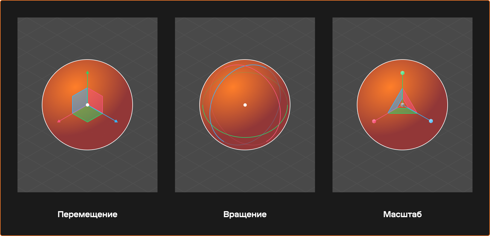
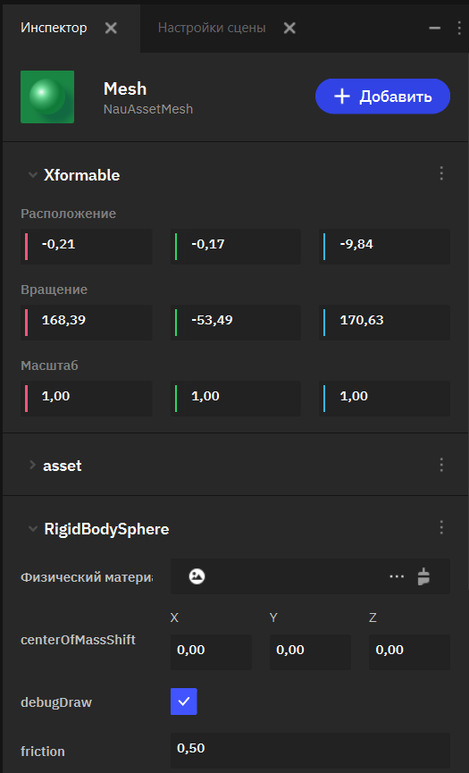

Объекты и пространство сцены
============================
.. _basic_editor:

Введение
--------

В игровой разработке сцена включает множество объектов, от персонажей и окружения до служебных объектов, управляющих игровыми механиками. **Иерархия объектов** — это система, позволяющая организовать логическую структуру или области игрового пространства в рамках сложного мира игры. Объединение в группы также позволяет настраивать анимации или управление для сложных структур, состоящих из множества вложенных игровых объектов.

В качестве основного варианта организации игровой сцены в Nau Engine используется система игровых объектов и компонентов. Каждый объект представляет собой сущность, реализующую определенную задачу в рамках игровой механики. Подход используется в большинстве современных инструментов разработки игр и позволяет гибко организовывать большие игровые миры.

.. figure:: img/sobj_interface.png
   :figwidth: 100%
   :alt: Окна редактирования игровой сцены

   Окна редактирования игровой сцены

**В окне Структур (Outliner)** можно увидеть структуру сцены с иерархией всех объектов сцены. Вы можете изменять её при помощи drag and drop, перенося объекты или вкладывая их для создания связей по типу родитель-потомок.

**В окне Просмотра (Viewport)** можно увидеть, как будут выглядеть объекты после запуска приложения.

**В окне Инспектора (Inspector)** можно увидеть все компоненты игрового объекта и их свойства (переменные).

-----

Структура сцены
---------------------------

Все игровые объекты существуют в едином трехмерном пространстве сцены. Структура этих объектов отображается в виде древовидного списка в окне Структур (Outliner).

Игровые объекты имеют иерархическую организацию, то есть один игровой объект может быть вложен в другой, являясь его функциональной частью. Иерархия нескольких объектов может представлять собой более комплексную сущность, собранную из нескольких игровых объектов. 

Каждый объект в сцене обладает данными о положении, вращении и масштабе относительно родительского объекта. Все модели, эффекты, источники света располагаются в пространстве сцены и могут группироваться через включение в другие объекты. Вы можете выбирать отдельные объекты и перемещать их в сцене через окно просмотра (Viewport).

Вложенность объектов
~~~~~~~~~~~~~~~~~~~~

Вместе группы объектов могут составлять сложные структуры с множеством элементов. Например, это может быть большой корабль, включающий как детали корпуса, так и персонажей.

Основная идея иерархии — связь объектов через отношения «родитель-потомок».

Родительский объект: является «родителем» для одного или нескольких дочерних объектов. Трансформации (положение, поворот, масштаб) родительского объекта влияют на все его дочерние объекты.

Дочерний объект: связан с родительским объектом и наследует его трансформации. При этом дочерний объект может иметь собственные трансформации, которые применяются относительно родителя.

**Пример:**

 Рассмотрим автомобиль как пример иерархии:

 * **Кузов автомобиля**: является корневым объектом, остальные части привязаны к нему.

 * **Колеса, двери, фары**: расположены относительно кузова. При перемещении кузова все эти элементы перемещаются вместе с ним.

 * **Дверная ручка**: ручка прикреплена к двери, но может двигаться для открытия замка, а значит может перемещаться в локальном пространстве относительно двери.

Изменять расположение объектов в иерархии можно при помощи перетаскивания объекта в нужное место древовидного списка. 

Добавление объектов
~~~~~~~~~~~~~~~~~~~

Для создания нового игрового объекта в окне обозревателя необходимо нажать кнопку «Добавить» (+). В появившемся списке необходимо выбрать базовый шаблон объекта, на базе которого будет создан новый. Базовые шаблоны заранее подготовлены для основных типов и содержат объекты для отображения геометрии, визуальных эффектов, позиционирования аудио и прочее. 

Если необходимого типа объекта нет в базовом, можно создать пустой объект и настроить его, добавив необходимые компоненты через инспектор объектов.

Управление объектом
~~~~~~~~~~~~~~~~~~~

Нажав на правую кнопку мыши, можно выполнить следующие операции над объектом:

 * **Cut** - вырезать объект из сцены.
 * **Copy (Ctrl + C)** - скопировать объект в буфер обмена.
 * **Paste (Ctrl + V)** - вставить последний скопированный объект. Копии объектов становятся самостоятельными экземплярами в рамках сцены, хоть и могут ссылаться на те же исходные данные, что и оригинал.
 * **Duplicate (Ctrl + D)** - дублировать объект. Если у объекта есть дочерние объекты, они также будут продублированы.
 * **Delete (Del)** - удалить объект.
 * **Focus Camera** - камера сфокусируется на выбранном объекте.
 * **Select All** - выбрать все объекты в сцене для дальнейшего редактирования.

Управление иерархией
~~~~~~~~~~~~~~~~~~~~

Настроить положение объекта в иерархии можно, перетаскивая объекты в списке. При таком перемещении объект сохраняет глобальное положение в мире, а его локальные координаты автоматически пересчитываются с учётом нового родительского объекта.

 

-----

Отображение сцены
-----------------
Все объекты сцены присутствуют в виртуальном пространстве и могут отображаться в окне обозревателя сцены (Viewport). Вы можете перемещаться в сцене с помощью виртуальной камеры редактора. Это системная камера, которая не присутствует в самой игре и нужна только для настройки сцены..

.. note::
   Камеру редактора можно быстро перенести к выбранному объекту при помощи функции Фокус. Для того, чтобы сфокусировать камеру на объекте, можно нажать **(F)** или выбрать соответствующий пункт в контекстном меню объекта в **окне Структур (Outliner)**.
   
С объектом в сцене можно взаимодействовать, выбирая инструменты на панели **инструментов обозревателя** или вызывая их при помощи горячих клавиш. Для большинства объектов доступны следующие инструменты:

* **Селектор (Q)** – инструмент, позволяющий только выделять объекты.
* **Перемещение (W)** – инструмент, позволяющий перемещать объекты.
* **Поворот (E)** – инструмент, позволяющий вращать объекты.
* **Масштабирование (R)** – инструмент, позволяющий уменьшать или увеличивать проекты.

.. note::
   У некоторых объектов (например, камера) могут появляться уникальные гизмо для редактирования их специфических свойств.

При выборе инструмента на объекте появляется соответствующиея ему элементы контроля, 
облегчающая процесс редактирования.

-----

Настройка объекта
--------------------------

Каждый игровой объект состоит из одного главного компонента и может иметь дополнительные компоненты. Переменные этих компонентов позволяют настраивать каждый экземпляр компонента на отдельных объектах.

Для настройки параметров конкретного объекта используется Инспектор объектов. При выборе игрового объекта в иерархии или непосредственно в сцене в инспекторе будут отображены переменные, открытые для изменения через редактор.

Изменение этих параметров позволяет точно настроить каждый объект для выполнения нужных задач. Все параметры объекта сгруппированы в компоненты объекта. Каждый объект выполняет определённую задачу в зависимости от своего назначения. В соответствии с общей системой игровых объектов Nau, первым в списке всегда отображается главный компонент объекта, который всегда имеет данные трансформации (положение объекта относительно его родителя).

Дополнительные компоненты могут, но не обязаны, иметь информацию о собственном положении относительно главного компонента. 

Комбинируя набор компонентов игрового объекта и настраивая доступные параметры в компонентах, можно точно настроить роль и поведение объекта в сцене. Кроме стандартных компонентов, включенных в движок изначально, возможно добавление и собственных компонентов через добавление C++ классов.
Подробнее о создании собственных компонентов можно прочитать в статье: :ref:`Разработка игровой логики <game_logic_doc>`

.. toctree::
   :hidden:
   
   ./scenes_doc/scenes_doc