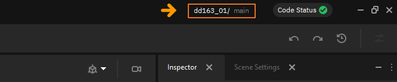
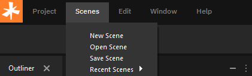
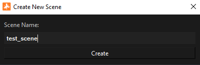
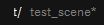

Сцены
=====

**Сцена** — это структурная единица игрового проекта, описывающая состояние объектов (мешей, компонентов, персонажей), игровой логики и их взаимосвязей в определённый момент игры. Например, сцены — это отдельные уровни в игре, для которых нужно загружать окружение. Отдельные 2D-интерфейсы, которые не требуют основной игровой логики, вроде главного меню, тоже могут являться сценами.

Структура сцен
--------------

.. figure:: img/scenes_interface.png
   :figwidth: 100%

У каждой сцены Nau Engine существует своя структура (Outliner). Иерархическое древо каждой сцены настраивается индивидуально по общим правилам, с использованием всех ресурсов проекта.

Имя сцены, открытой в данный момент, можно посмотреть в правой части ленточного меню:

В каждом проекте по умолчанию существует сцена **main**. Список других сцен проекта можно посмотреть в **Content Browser** в папке **scenes**.

Управление сценами
------------------

Действия со сценами, такие как создание новой сцены, переключение текущей сцены и т.д., производятся с помощью опции **Scenes** в ленточном меню в верхней панели экрана.

   
В нём представлены такие опции, как:

 * **New Scene** — создание новой сцены.
 * **Open Scene** — открывает уже существующую в проекте сцену.
 * **Save Scene** — сохраняет сцену, открытую в данный момент.
 * **Recent Scenes** — открывает список последних редактированных сцен.
 
Чтобы создать новую сцену, нужно выбрать **New Scene**. Далее будет предложено выбрать имя новой сцены (оно не может повторять имена уже существующих в проекте сцен).

   
   

   
   
После создания сцена будет открыта автоматически. Её структура (Outliner) будет полностью пустой. Пользователь может произвести любые желаемые действия, после чего сохранить сцену с помощью **Save Scene**, либо нажав на **Ctrl+S**. Наличие несохранённых изменений в сцене отображается звёздочкой в правой части экрана: |scenes_unsaved|.

Открыть уже существуюшую сцену можно двумя способами:

 1. **Recent Scenes** выводит список с последними открытыми сценами проекта:
 
 .. figure:: img/scenes_recent.png
   :figwidth: 100%
   
 2. **Open Scene** позволяет открыть любую сцену проекта через проводник. Сцены хранятся в папке **content -> scenes**.
 
Итог
----

Правильная организация сцен — это ключ к созданию полноценного большого проекта.

