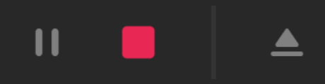
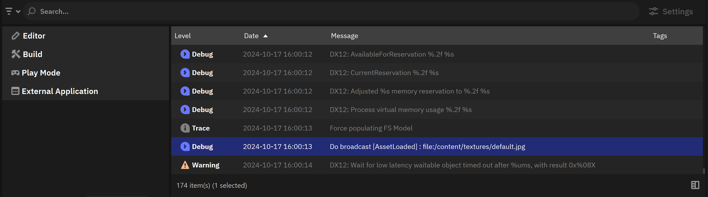
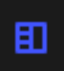
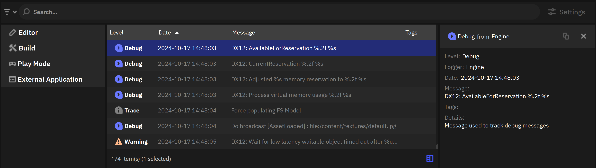
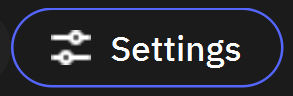
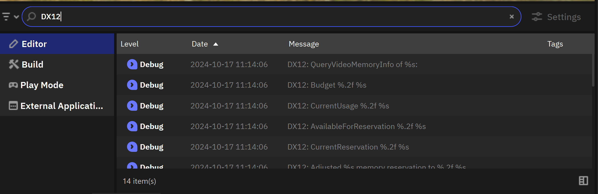
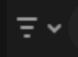
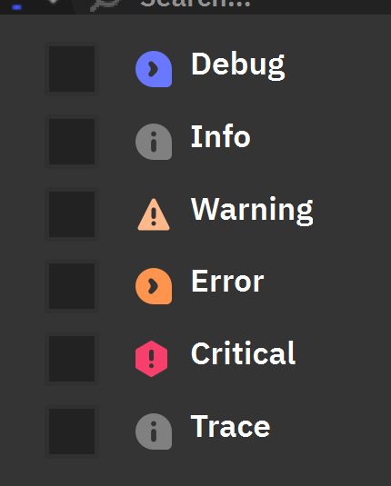

Инструменты отладки
===================
.. _testing_doc:

Nau Engine предоставляет набор инструментов, облегчающих процесс тестирования и отладки вашей игры. Все возникающие проблемы во время выполнения приложения фиксируются и отображаются в консоли. Чтобы оценить внешний вид приложения с точки зрения конечного пользователя, вы можете воспользоваться режимом Play mode.

Запуск приложения “Play mode”
-----------------------------

После нажатия кнопки запуска |play_button| на панели инструментов редактор попытается запустить открытую на данный момент сцену. 
В случае успеха сцена будет запущена в активном окне обозревателя, курсор исчезнет, а кнопки на панели инструментов изменят вид |play_panel|.
В случае неудачи сообщения о возникших проблемах появятся в :ref:`консоли <console>`.

Для выхода из режима запуска необходимо нажать **ESC**.

Консоль
-------
.. _console:

Консоль — это система сбора и отображения сообщений, предназначенных для отслеживания событий в работе редактора, ядра и разрабатываемого приложения. Система сообщений (лог) собирает максимум информации о работе процессов. Логи автоматически сохраняются в процессе работы и могут быть проанализированы после.

.. note:: При процессах, подразумевающих блокировку интерфейса (например, сборке проекта), система логирования сообщает об этапах работы и прогрессе их выполнения.

Интерфейс отображения лога консоли по умолчанию нацелен на минимизацию сообщений и предоставление минимально необходимой информации. Более подробную информацию можно увидеть, открыв окно деталей по нажатию на кнопку |console_details|.

По нажатию на кнопку |console_settings|, раскрывается панель настроек, позволяющая:

* Сохранить лог в виде отдельного файла.
* Очистить лог.
* Выключить / выключить автоматическую прокрутку лога.

Список отправителей
++++++++++++++++++++++++++++++++++++++

Вы можете переключаться между различными группами для более четкого понимания источника сообщения. События в режиме редактирования, сборки или проверки игры не будут смешиваться в общем логе.

Поиск
+++++

Строка поиска позволяет отфильтровать сообщения в консоли относительно введённого текста. 

Фильтр критичности
++++++++++++++++++

Сообщения в консоли можно отфильтровать по типу. Для этого нужно нажать на кнопку |console_fllt| и в выпавшем списке выбрать, какие типы сообщений будут отображаться.

**Список доступных типов:**

* **Отладка (Debug)** - общие сообщения необходимые для отладки.
* **Информация (Info)** - сообщение с значимой информацией о работе.
* **Предупреждение (Warning)** - предупреждение о потенциальной нестабильности или любом другом нежелательном событии, которое может произойти, но в данный момент не вызывает ошибок.
* **Ошибка (Error)** - нарушение работы функции или отдельной системы.
* **Критическая ошибка (Critical)** - критические ошибки нарушающие работу программы.
* **Трассировка (Trace)** - цепочка вызовов для случаев, когда необходимо проследить отдельные ошибки.

Использование в скриптах
------------------------

Система логирования доступна для использования в коде приложения. Вы можете использовать макрос для отправки сообщения в систему.

::

  NAU_LOG_WARNING("My warning message"); // Пример предупреждения
  
  NAU_LOG_ERROR(nau::string::format(nau::string(u8"7zip error {} in LzmaEnc_SetProps\nsource: '{}'\n"), res, nau::string(dest.getTargetName()))); // Пример сообщения об ошибке

