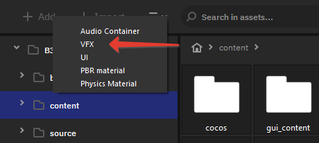
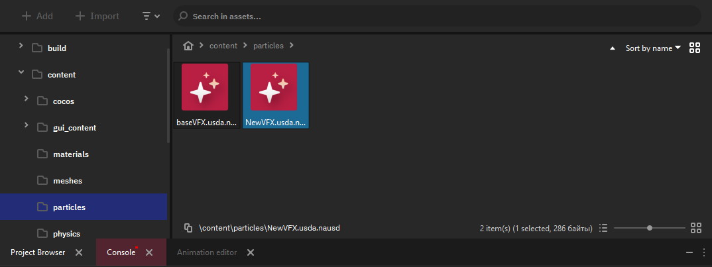
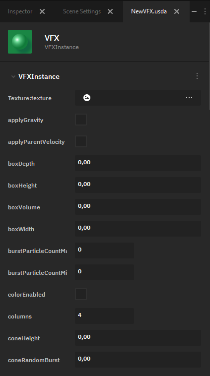
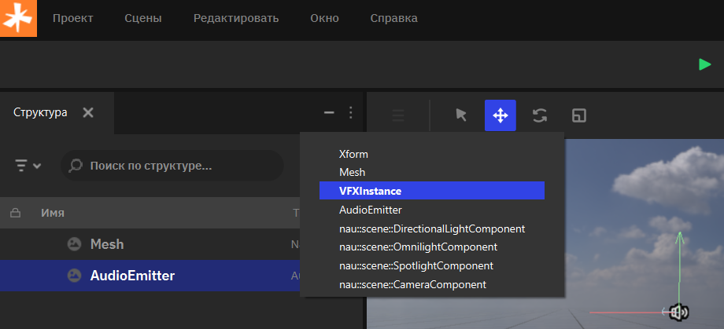
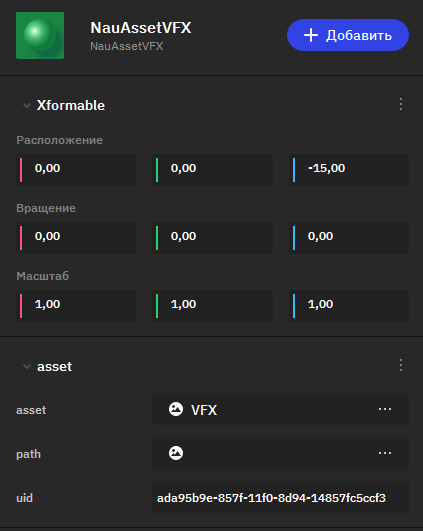

Система частиц
======================

.. _vfx_doc:

Системы частиц в играх применяются для создания визуальных эффектов. С их помощью в цифровом мире можно воссоздать огонь и дым, дождь и снег, а так же магию и не диегетические эффекты вроде подсветки. Они помогают погрузить игрока в игровую реальность, делая весь процесс более увлекательным.

Основные шаги в создании эффекта системы частиц в сцене:

 #. Создать ассет файл данных в проекте и настроить параметры эффекта.
 #. Добавить на сцену игровой объект с компонентом ParticleVFX.
 #. Назначить в параметрах компонента созданный ассет.

Создание эффекта
----------------

Параметры эффекта могут быть настроены в ассете внутреннего формата Nau Editor. Вы можете использовать этот ассет для создания множества однотипных экземпляров эффектов в сцене. 

Чтобы создать ассет с параметрами системы частиц, необходимо в браузере проекта нажать на кнопку добавления ассета и выбрать тип VFX.

В папке, открытой в данный момент в браузере, будет создан новый файл с базовыми настройками системы частиц. 

Настройка эффекта
-----------------

.. note:: В данный момент наблюдаются проблемы с отображением корректных названий классов VFXInstance и VFXAsset.

   
Дважды кликнув на ассет, вы сможете отредактировать его. Nau Engine предоставляет возможность крайне детализированной настройки эффекта. Основные категории настроек включают в себя:

* **Внешний вид одной частицы** - можно выбрать текстуру из 2D-ассетов проекта (Texture::texture) или задать цвет вручную (startColor и endColor).
* **Форма и размеры эмиттера** - можно выбрать, в какой области (box, cone, sphere) будут появляться частицы.
* **Скорость (Velocity)** - позволяет настроить максимальную и минимальную скорость частицы, а также учесть скорость родительского объекта, к которому добавлен VFX-компонент (applyParentVelocity).
* **Физика частицы** - позволяет определить, как влияет гравитация на частицу (applyGravity, gravityTransform), задать эффект ветра (Wind) и силовое поле (ForceField)

Эффект в сцене
--------------
Экземпляр визуального эффекта в сцене может быть создан через компонент ParticleVFX на игровом объекте. В свойствах компонента назначьте настроенный ассет для отображения эффекта в сцене. 

Для создания нового объекта с компонентом системы частиц нажмите кнопку "Добавить" в окне Структур (Outliner) и выберите VFXInstance.

Будет создан новый экземпляр эффекта в сцене. Кликните по объектам в Инспекторе (Inspector), и их параметры отобразятся. Назначьте подготовленный ассет визуального эффекта. Также в компоненте присутствуют дополнительные параметры для настройки конкретного экземпляра эмиттера в сцене.

Дополнительно
+++++++++++++++
Вы можете управлять эффектами через код собственного компонента, обратившись непосредственно к объекту с эффектом.

Вы можете внести вклад в развитие системы частиц. Код инструмента расположен в `репозитории в разделе VFX <https://github.com/NauEngine/NauEngine/tree/dev/engine/core/modules/graphics/src/vfx>`_
